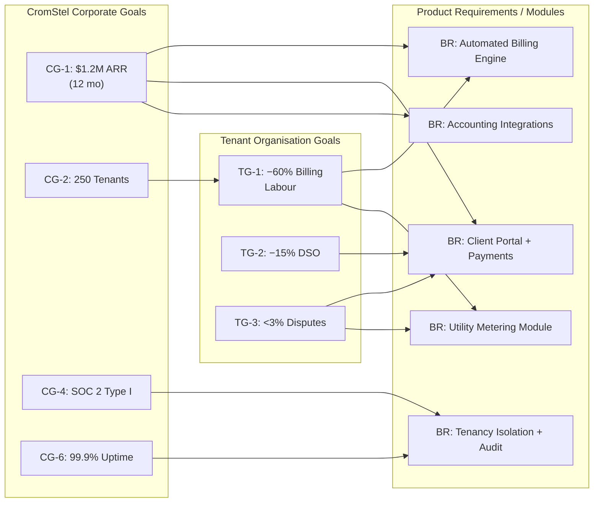

# myTenant Invoice — Business Requirements

> Document ID: MTI-BR-002 | Version: 1.0 | Owner: CromStel IT Group Product Office | Status: APPROVED | Last Updated: 2026-09-20
>
> *Cross-references: [Product Vision](./product-vision.md) · [Functional Requirements](./functional-requirements.md) · [Non-Functional Requirements](./non-functional-requirements.md) · [Acceptance Criteria](./acceptance-criteria.md)*

---

## 1. Business Goals

Business goals define the measurable commercial outcomes that myTenant Invoice must deliver to CromStel IT Group and its paying tenant organisations. Every requirement in this document traces to at least one goal below.

### 1.1 CromStel Corporate Goals (Platform Operator)

| ID | Goal | Baseline (Pre-Launch) | 12-Month Target | 24-Month Target | Measurement |
|---|---|---|---|---|---|
| CG-1 | Achieve $1.2M ARR from myTenant Invoice | $0 | $1.2M | $4.8M | MRR × 12, tracked in Stripe + CRM |
| CG-2 | Onboard 250 paying tenant organisations | 0 | 250 | 1,200 | Active-subscription count in billing system |
| CG-3 | Maintain gross margin ≥ 78% | N/A | 78% | 80% | COGS / Revenue, monthly finance review |
| CG-4 | Achieve SOC 2 Type I (Security, Availability, Confidentiality) | Not in scope | Certified | SOC 2 Type II Certified | Auditor report issuance |
| CG-5 | Customer churn (net revenue retention) ≤ 5% annual | N/A | NRR ≥ 105% | NRR ≥ 110% | Quarterly churn analysis, expansion revenue |
| CG-6 | Platform-level uptime SLA attainment ≥ 99.9% | N/A | 99.9% | 99.95% | Uptime monitoring, SLO dashboard |
| CG-7 | Zero material security incidents (CVSS ≥ 7.0 exploited in prod) | N/A | 0 | 0 | Incident register, CISO quarterly sign-off |

### 1.2 Tenant-Organisation Goals (Customer Value)

| ID | Goal | Baseline (Typical Prospect) | 6-Month Post-Onboarding Target |
|---|---|---|---|
| TG-1 | Reduce manual billing labour hours by 60% | ~40 h/mo (FTE 0.5) billing admin per 500 units | ≤ 16 h/mo |
| TG-2 | Reduce days-sales-outstanding (DSO) by 15% | 45 days average | ≤ 38 days |
| TG-3 | Reduce invoice dispute rate to < 3% of lines | 12–18% industry average | < 3% |
| TG-4 | Complete month-end billing close in < 24 hours | 3–7 business days | < 24 hours (wall clock) |
| TG-5 | Achieve ≥ 99.5% invoice line accuracy (per internal audit) | 92–96% with spreadsheets | ≥ 99.5% |

### 1.3 Goal Traceability Matrix (Excerpt)



---

## 2. Revenue Model & Pricing Strategy

### 2.1 Pricing Tiers

Three self-serve tiers plus custom Enterprise contracts. All tiers enforce tenant isolation per the [Non-Functional Requirements](./non-functional-requirements.md).

| Tier | Monthly Base | Per-Unit Surcharge | Billing Documents Included | Target Profile |
|---|---|---|---|---|
| **Free** | $0 | $0 | Up to 20 invoices/mo, 3 properties, 10 end-clients | Solopreneur, new property managers (≤ 3 units), evaluation |
| **Pro** | $149 | $1.20 / active unit / month (min. 50 units, max. 5,000 units) | Unlimited invoices, unlimited properties | Core market: property managers 50–5,000 units, utility bureaus |
| **Enterprise** | Custom (min. $2,500/mo) | Custom volume pricing, typically $0.65–$0.95/unit | Unlimited everything | 5,000+ units, multi-entity groups, white-label, on-prem/hybrid option |

**Pricing Notes:**
- An **active unit** is any property unit (leasehold, commercial, utility-account) that generated at least one invoice line in the billing month.
- Surcharge is calculated monthly and itemised on the CromStel platform invoice to the tenant organisation.
- **Free tier:** No credit card required. Converts automatically to Pro at 21 invoices or 4th property (with 7-day grace notification).
- **Enterprise tier:** Includes dedicated CSM, custom SLA, single-sign on (SSO/SAML), custom branding per sub-org, and dedicated support hotline.

### 2.2 Revenue Levers

1. **Base Subscription (60% of revenue):** Recurring tier fees.
2. **Per-Unit Surcharge (25% of revenue):** Volume-based, scales with customer growth.
3. **Add-On Modules (10% of revenue):**
   - Advanced Utility Metering ($99/mo) — AMR/AMI integration, loss-factor allocation, tiered tariffs.
   - White-Label Client Portal ($199/mo) — fully branded with tenant-org domain, colours, logo, email sender domain.
   - Accounting Integrations Pack ($79/mo) — NetSuite, Sage Intacct, SAP Business One connectors (Xero/QBO included in Pro and above).
4. **Payment Processing Revenue Share (5% of revenue):** 15 bps (0.15%) rebate on portal payment volume via CromStel-negotiated acquirer rates.

### 2.3 Cost Model (CromStel COGS)

| COGS Category | % of Revenue (Target) | Notes |
|---|---|---|
| Cloud Infrastructure (compute, storage, data transfer) | 10% | Serverless-first where possible; RLS means shared DB is safe per [NFR §4](./non-functional-requirements.md) |
| Payment Gateway / Acquirer Fees | 2.5% | Passed through at-cost; rebate on volume offsets |
| Third-Party SaaS (monitoring, KMS, email/SMS) | 3.5% | Datadog, AWS KMS, SendGrid, Twilio |
| Customer Support (labour) | 4% | Tiered: self-serve docs → chat → CSM |
| **Gross Margin Target** | **≥ 80%** | Reconciled monthly |

---

## 3. Commercial & Licensing Requirements

### 3.1 Tenant Organisation Commercial Rules

| BR# | Requirement | Rationale | Traces To |
|---|---|---|---|
| BR-COM-01 | The platform must support **per-tenant subscription tier** (Free, Pro, Enterprise) stored in tenant metadata and enforced by feature gating at the API gateway and UI level. | Tiered pricing drives ARR. Feature gating prevents tier abuse. | CG-1, CG-2 |
| BR-COM-02 | The platform must **auto-disable write operations** (invoice generation, adjustments, new records) for tenant organisations ≥ 15 days in payment arrears, while preserving read-only access and data export rights. | Revenue protection; compliance with data-portability regulation. | CG-1 |
| BR-COM-03 | The platform must **meter active units per tenant per month** and reconcile the count against the tier allowance. Overages trigger surcharge invoices from CromStel to the tenant org. | Usage-based pricing model. | CG-1 |
| BR-COM-04 | Every tenant organisation has a **self-serve billing portal** where they can: view CromStel invoices, update payment method, change tier, cancel subscription, and export tax receipts. | Reduce support overhead; commercial self-service. | CG-3, P-VP4 |
| BR-COM-05 | Enterprise tenants must support **consolidated billing across sub-organisations** (parent-child tenant grouping) with a single CromStel invoice, while maintaining strict data isolation between sub-orgs. | Multi-entity property groups are a buying centre. | CG-1, TG-1 |
| BR-COM-06 | **Free tier** data is retained for 90 days of inactivity; after 90 days the tenant workspace is soft-deleted (recoverable for further 30 days), then permanently purged. | Infrastructure cost control. | CG-3 |
| BR-COM-07 | Paid-tier data is **retained for 7 years post-cancellation** in cold storage per audit requirements; tenant may request earlier purge in writing (subject to CromStel legal sign-off where regulations mandate retention). | GAAP/IFRS, tax compliance. | §5 Compliance, BR-LEG-03 |

### 3.2 Licensing & Terms of Service Enforcement

| BR# | Requirement |
|---|---|
| BR-LIC-01 | All tenants must click-through Terms of Service (ToS) and Privacy Policy on first login. Version history of accepted terms is stored per tenant per user. |
| BR-LIC-02 | Enterprise tenants may upload custom acceptable-use / internal-policy documents that their internal users (ORG_OWNER, FINANCE_MANAGER, etc.) must accept before accessing the tenant workspace. |
| BR-LIC-03 | Reseller / white-label partners (Enterprise tier) have a distinct commercial relationship tracked in the platform's partner CRM module, with commission attribution per referred tenant. |

---

## 4. Commercial Modules: Property & Utility Focus

### 4.1 Property Billing Commercial Requirements

| BR# | Requirement | Business Impact |
|---|---|---|
| BR-PROP-01 | Support **recurring fixed charges** (ground rent, service charge, parking fee) with configurable effective dates, escalation clauses (CPI/RPI, fixed %, stepped), and proration on move-in/move-out mid-period. | Automates 40–60% of typical commercial invoice lines; eliminates escalator leakage. |
| BR-PROP-02 | Support **percentage-rent (turnover rent)** calculation: tenant pays base rent + % of gross revenue above a breakpoint, with revenue declarations collected via the end-client portal. | Premium feature for retail and F&B commercial leases; competitive differentiator. |
| BR-PROP-03 | Support **service-charge reconciliation (sinking fund / admin reserve)** with year-end actuals vs. budget comparison, balancing credit/debit note generation, and multi-year carry-forward. | Mandatory in UK, UAE, SG, HK and common-law jurisdictions for commercial blocks. |
| BR-PROP-04 | Support **lease-integration document capture**: lease schedules uploaded as PDF, key terms (rent, escalators, break dates) extracted via OCR and presented for ORG_OWNER/FINANCE_MANAGER confirmation. | Reduces onboarding time from 2 weeks to 2 days per 100-unit portfolio. |

### 4.2 Utility Billing Commercial Requirements

| BR# | Requirement | Business Impact |
|---|---|---|
| BR-UTL-01 | Support **metered consumption billing** for electric, water, gas, heating (HVAC/chilled water), and data/telecom services, with: manual reads, CSV/Excel import, Modbus/MBus/AMR MQTT ingestion (via API). | Captures utility bureaus and mixed-use properties as a segment. |
| BR-UTL-02 | Support **multi-tiered tariff schedules**: time-of-use (peak/off-peak/shoulder), seasonal adjustments, increasing-block pricing (IBP / tiered consumption), and standing charges. | Regulatory requirement for many utility resellers; competitive moat. |
| BR-UTL-03 | Support **loss-factor allocation** (also called "uplift" or "distribution loss"): master-meter total minus sum of sub-meters, allocated proportionally by consumption or floor area. | Prevents 3–8% utility revenue leakage that currently hits property managers P&L. |
| BR-UTL-04 | Support **back-billing with temporal guardrails**: correcting a past read must flag affected invoices, generate a debit/credit note, and respect jurisdictional limits (e.g., UK Ofgem "12-month rule" for unbilled consumption). | Regulatory compliance; reduces disputes. |
| BR-UTL-05 | Support **estimated reads** with flagging: when no actual read is available, apply rolling-average estimate, explicitly mark invoice line as "ESTIMATED", and reconcile on next actual read. | Industry-standard practice; avoids billing gaps. |

---

## 5. Compliance & Legal Requirements

### 5.1 Data Privacy & Residency

| BR# | ID | Requirement | Jurisdiction |
|---|---|---|---|
| BR-LEG-01 | GDPR | Tenant organisations domiciled or operating in the EU/EEA must have personal data (end-client names, email, bank details for DD) stored in the EU region. Right to erasure, data portability, DSAR portal. | EU / EEA |
| BR-LEG-02 | CCPA / CPRA | California end-clients have opt-out-of-sale rights (note: CromStel does not sell data; documented in privacy policy). | USA (California) |
| BR-LEG-03 | Local tax audit retention | 7-year minimum retention of invoices, receipts, payment records, meter reads, and adjustment history. | Global (varies; 7 years covers strictest regimes) |
| BR-LEG-04 | Right to data portability | Tenant organisation can export ALL their structured data (invoices, contacts, meter reads, payments, lease terms) via self-serve in JSON, CSV, and PDF-in-zip formats at any time, at no cost. | GDPR, CCPA, UK Data Protection Act |
| BR-LEG-05 | Schrems II / data transfer | Any cross-region data transfer between CromStel data centres must use Standard Contractual Clauses (SCCs) or adequacy-decision jurisdictions. | EU → US/APAC |
| BR-LEG-06 | Sub-processor notification | Tenant organisations must be notified 30 days in advance of any new sub-processor (payment gateway, email provider, etc.) handling their data. | GDPR Art. 28 |

### 5.2 Financial & Accounting Compliance

| BR# | Requirement | Standard |
|---|---|---|
| BR-FIN-01 | Revenue recognition schedules follow ASC 606 / IFRS 15: invoice totals are split between earned (rent-period elapsed) and deferred (future periods) with configurable amortisation rules. | GAAP / IFRS |
| BR-FIN-02 | All invoices carry a unique sequential number per tenant organisation, per fiscal year, with gapless numbering and immutable audit trail for voided/cancelled invoices. | EU VAT Directive, UK HMRC, ATO, IRS 1099 rules |
| BR-FIN-03 | Multi-currency support with FX rate sourced from European Central Bank (ECB) or custom tenant-configured feed on the invoice date; realised and unrealised FX gain/loss reports. | IAS 21 / ASC 830 |
| BR-FIN-04 | Tax engine supports VAT/GST/Sales tax with: per-line tax codes, reverse-charge (EU B2B services), tax-inclusive vs. tax-exclusive pricing, zero-rated vs. exempt goods, withholding tax (WHT) deduction on payment. | 100+ jurisdictions at launch |
| BR-FIN-05 | SAF-T / audit-file export for EU countries that mandate it (Portugal, Poland, Lithuania, Norway, etc.). | EU Council Directive 2018/107 |
| BR-FIN-06 | **PCI DSS SAQ A compliance** only: all cardholder data handled by PCI-compliant payment gateways (Stripe, Adyen, Checkout.com) via hosted payment pages or tokenisation; myTenant Invoice never sees, stores, or transmits PAN/CVV. | PCI DSS v4.0 |

### 5.3 Third-Party Audit & Evidence

| BR# | Requirement |
|---|---|
| BR-AUD-01 | CromStel Customer Support / CSM access to a tenant workspace is disabled by default; access requires tenant-organisation ORG_OWNER explicit grant per incident, time-bound (max. 72 hours), and fully audited. |
| BR-AUD-02 | Every tenant organisation has a read-only **Auditor role** (read-only access to invoices, payments, adjustments, and the immutable audit log) that the ORG_OWNER can grant to their external auditors without CromStel involvement. |
| BR-AUD-03 | Audit log is **cryptographically chained** (each entry includes a hash of the previous entry) so tampering is detectable by any third party. |

---

## 6. Success Metrics & KPIs

### 6.1 Platform KPIs (CromStel Operator)

| KPI Category | Metric | 6-Mo Target | 12-Mo Target | 24-Mo Target | Source |
|---|---|---|---|---|---|
| Revenue | MRR | $50K | $100K | $400K | Stripe |
| Revenue | ARPU per tenant org (monthly) | $350 | $400 | $333 (mix shift to Enterprise) | Finance |
| Acquisition | CAC (fully loaded) | < $1,800 | < $1,500 | < $1,600 | CRM + Finance |
| Retention | Logo churn (monthly) | < 2% | < 1.2% | < 0.8% | Finance |
| Retention | Net Revenue Retention (NRR) | ≥ 100% | ≥ 105% | ≥ 110% | Finance |
| Product | Time-to-first-invoice (new tenant) | < 48 hours | < 24 hours | < 12 hours | Product analytics |
| Product | MAU / registered users (per tenant) | ≥ 55% | ≥ 60% | ≥ 65% | Product analytics |
| Operations | Support tickets per 100 tenants / month | ≤ 40 | ≤ 30 | ≤ 25 | Zendesk |
| Operations | Median first-response time (tickets) | ≤ 2 h | ≤ 1 h | ≤ 30 min | Zendesk |
| Security | Mean-time-to-patch critical (CVSS ≥ 9.0) vulns | ≤ 24 h | ≤ 24 h | ≤ 12 h | SRE tooling |

### 6.2 Tenant-Organisation KPIs (Embedded Product Analytics)

Each tenant organisation's dashboard displays the following out-of-the-box:

| KPI | Definition |
|---|---|
| Monthly Invoiced Amount | Sum of all invoice totals for the period (excluding void). |
| Collections Rate | (Payments received) / (Amount due for period + prior overdues), as %. |
| DSO (Days Sales Outstanding) | (Ending AR balance) / (Invoiced amount) × (Days in period). |
| Dispute Rate | (Invoice lines flagged as disputed) / (Total invoice lines), as %. |
| Auto-Pay Adoption | (End-clients on recurring auto-debit) / (Total active end-clients), as %. |
| Billing Accuracy | 1 − (adjusted lines / total lines), rolling 90-day window. |

---

## 7. Stakeholders & Decision Rights

| Stakeholder Group | Representatives | Decision Rights | Escalation Path |
|---|---|---|---|
| **CromStel Executive** | CEO, CFO, CTO | Budget approval, pricing changes, strategic pivots. | Board |
| **Product Office** | Director of Product, Product Manager (myTenant Invoice) | Requirement prioritisation, scope changes within approved budget, UX final sign-off. | CEO / CTO |
| **Engineering** | VP of Engineering, Platform Lead, Security Lead | Technical feasibility, architecture decisions, non-functional requirement calibration. | CTO |
| **Security & Compliance** | CISO, DPO (Data Protection Officer) | Sign-off on all NFR-Security items, compliance controls, data-flow changes. | CTO / CEO |
| **Customer Success** | Head of CSM, CSMs | Feedback conduit from tenants; sign-off on onboarding flows. | Director of Product |
| **Design / UX** | Principal UX Designer | UX sign-off, accessibility (WCAG 2.2 AA) compliance. | Director of Product |
| **Finance (CromStel)** | Controller, Head of Revenue Ops | Pricing model, revenue recognition, tax codes. | CFO |
| **Tenant Council** | 8–12 volunteer customer representatives (ORG_OWNER / FINANCE_MANAGER from Beta & Enterprise) | Advisory only; requirements input, roadmap feedback, pricing consultation. | Product Office |

---

## 8. Assumptions, Constraints & Risks

### 8.1 Assumptions

| ID | Assumption | Mitigation if Wrong |
|---|---|---|
| ASM-01 | At least 30% of Year-1 revenue comes from the existing CromStel IT Group client base. | Accelerate partner and digital-marketing channels (content, paid search) at Month 4. |
| ASM-02 | AWS us-east-1 + eu-west-1 regions provide sufficient jurisdictional coverage for the first 18 months. | Add ap-southeast-2 in Month 10 if ANZ pipeline materialises. |
| ASM-03 | PCI DSS SAQ A (no card data in scope) is sufficient for the 3 chosen payment gateways. | If a customer mandates direct card processing, partner with Spreedly/PCI proxy. |
| ASM-04 | Typical utility metering interval ≤ 1 meter read per unit per day (no 15-min interval data in MVP). | Add time-series DB (Timescale/Influx) in Growth phase if required. |

### 8.2 Constraints

| ID | Constraint |
|---|---|
| CST-01 | Launch date for MVP (Phase 1) is **2027-03-31** (6 months from document approval). Scope must fit. |
| CST-02 | Initial engineering team = 6 engineers + 1 designer + 1 QA. No headcount expansion in Phase 1. |
| CST-03 | All data centres must be either AWS or Azure (multi-cloud not in scope for MVP). |
| CST-04 | All PII must be encrypted at rest with per-tenant keys (see [NFR-Security](./non-functional-requirements.md)). No plaintext PII in logs. |

### 8.3 Risks & Mitigations

```mermaid
quadrantChart
    title myTenant Invoice — Business Risk Matrix
    x-axis Low Probability --> High Probability
    y-axis Low Impact --> High Impact
    quadrant-1 Monitor: Tenant Mix shifts to Free
    quadrant-2 Mitigate: Regulatory change in VAT rules
    quadrant-3 Transfer: PCI breach via gateway
    quadrant-4 Avoid: Cross-tenant data leak
    "Free-tier abuse" : [0.7, 0.3]
    "Large competitor entry (Xero/QBO)" : [0.6, 0.5]
    "Utility tariff regulation change" : [0.4, 0.65]
    "PCI incident at gateway" : [0.2, 0.8]
    "Cross-tenant leakage (security breach)" : [0.05, 0.95]
    "FX volatility (multi-currency)" : [0.6, 0.25]
    "3rd-party SaaS outage (SendGrid/Stripe)" : [0.5, 0.4]
```

| Risk ID | Risk | Likelihood | Impact | Mitigation |
|---|---|---|---|---|
| RSK-01 | Cross-tenant data leakage | Very Low | Critical (Existential) | Defence in depth: RLS + per-tenant encryption + IAM + quarterly penetration test + [NFR-SEC](./non-functional-requirements.md) hard requirements |
| RSK-02 | SOC 2 audit failure leading to Enterprise deal loss | Low | High | Implement controls 3 months pre-audit; hire third-party GRC consultant for pre-assessment. |
| RSK-03 | Pricing model does not cover COGS (negative unit economics) | Medium | High | 90-day pricing review after launch; grandfather existing customers if increase required. |
| RSK-04 | Billing engine miscalculation leads to class-action / reputational hit | Low | High | Shadow-run beta (parallel output vs. customer's current system) for 2 full billing cycles before GA. |
| RSK-05 | Payment gateway outage disrupts collections | Medium | Medium | Multi-gateway failover (Stripe primary, Adyen secondary) from Day 1. |
| RSK-06 | Slow onboarding → poor activation → churn | Medium | Medium | Guided onboarding wizard, sample datasets, and concierge onboarding for Pro/Enterprise. |

---

## 9. Requirements Change Control

All amendments to this Business Requirements document follow the CromStel change-control process:

1. Requester submits a change request (Jira ticket MTI-BR-###) documenting: proposed change, rationale, impact (revenue, cost, timeline), and traceability to goals.
2. Product Manager conducts impact assessment with Engineering, Security, and Finance.
3. Change Control Board (CCB: PM, Engineering Lead, Security Lead, Finance Controller, CTO as chair) reviews weekly.
4. Approved changes: document version increment (1.0 → 1.1, etc.), update change log, notify all stakeholders.
5. Rejected changes: documented with rationale; requester may appeal to CEO/CTO within 5 business days.

---

## 10. Cross-References

- [Product Vision](./product-vision.md) — Pillars, tenets, and vision gate criteria that govern these requirements.
- [Functional Requirements](./functional-requirements.md) — Detailed functional specifications mapped to BR IDs.
- [Non-Functional Requirements](./non-functional-requirements.md) — Performance, security, isolation, and SLA specs.
- [Acceptance Criteria](./acceptance-criteria.md) — Testable criteria per BR ID for UAT sign-off.
- [Feature Matrix](./feature-matrix.md) — Tier applicability of each BR (Free/Pro/Enterprise).
- [Product Roadmap](./product-roadmap.md) — Phased delivery (which BR ships when).

---

*Document owned by CromStel IT Group Product Office. Approved by: Director of Product, CFO, CTO, CISO — 2026-09-20.*
