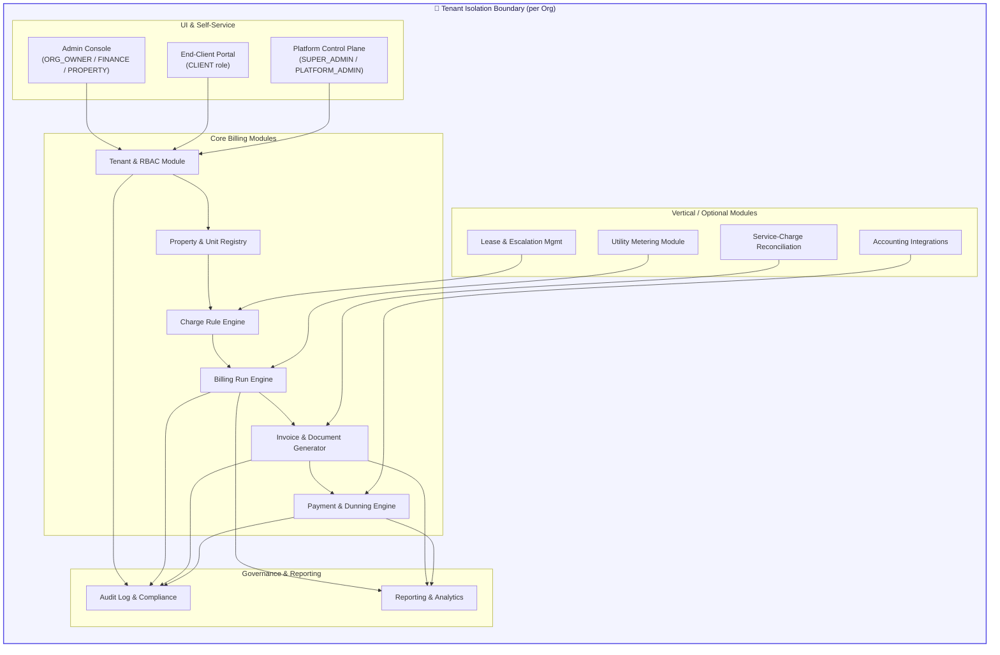
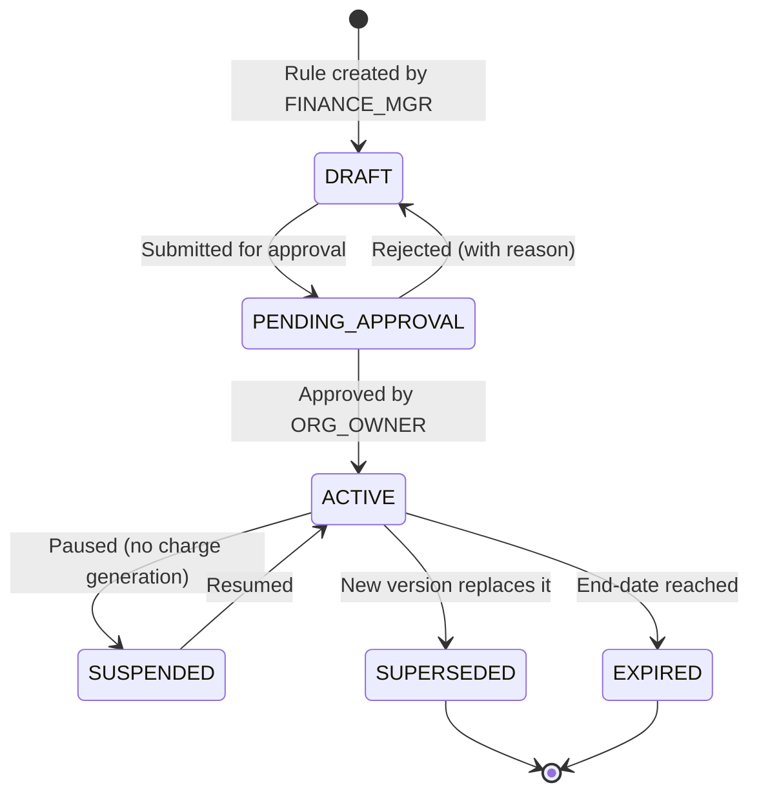
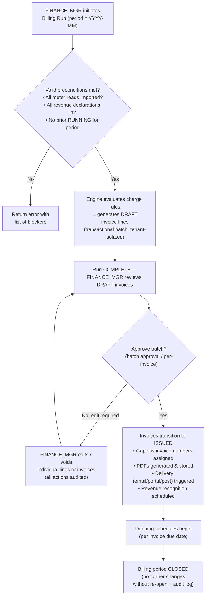
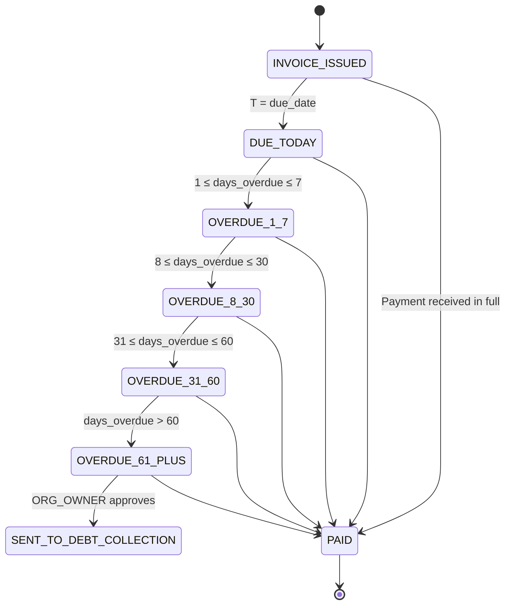
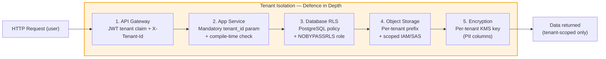

# myTenant Invoice — Functional Requirements

> Document ID: MTI-FR-003 | Version: 1.0 | Owner: CromStel IT Group — Engineering Lead | Status: APPROVED | Last Updated: 2026-09-20
>
> *Cross-references: [Product Vision](./product-vision.md) · [Business Requirements](./business-requirements.md) · [Non-Functional Requirements](./non-functional-requirements.md) · [Use Cases](./use-cases.md) · [Acceptance Criteria](./acceptance-criteria.md)*

---

## 1. Functional Architecture Overview

The platform is composed of 11 functional modules. Every module operates within a strict tenant isolation envelope. Cross-module data flows always include an explicit `tenant_id` boundary check at both the application layer (API gateway middleware) and the persistence layer (database RLS policy).

### 1.1 Traceability to Business Requirements

| Module | Primary BR Traces |
|---|---|
| Tenant & RBAC | BR-COM-01, BR-COM-05, BR-AUD-01, BR-AUD-02 |
| Property & Unit Registry | BR-PROP-01, BR-PROP-04 |
| Charge Rule Engine | BR-PROP-01, BR-PROP-02, BR-UTL-02, BR-FIN-04 |
| Billing Run Engine | TG-1, TG-4, TG-5, BR-UTL-03, BR-UTL-04, BR-UTL-05 |
| Invoice Generator | BR-FIN-01, BR-FIN-02, BR-FIN-03 |
| Payment & Dunning | TG-2, CG-1, BR-FIN-06 |
| Utility Metering | BR-UTL-01 … BR-UTL-05 |
| Service-Charge Reconciliation | BR-PROP-03 |
| Lease & Escalation Mgmt | BR-PROP-01, BR-PROP-02 |
| Accounting Integrations | TG-1, CG-1 |
| Audit & Reporting | BR-AUD-01 … BR-AUD-03, CG-4 |

---

## 2. Module 1 — Tenant & Role-Based Access Control (RBAC)

### 2.1 Tenant (Organisation) Lifecycle

| FR-ID | Requirement | BR Trace |
|---|---|---|
| FR-TR-001 | A **tenant organisation** record stores: `tenant_id` (UUID, immutable), legal name, trading name, tax ID(s), registration country, default currency, address, primary contact, subscription tier, status (TRIAL/ACTIVE/SUSPENDED/CANCELLED/DELETED), creation timestamp, and data-residency region. | BR-COM-01 |
| FR-TR-002 | Tenant creation is idempotent on `(legal_name, tax_id, region)`; duplicate requests return the existing tenant record. | CG-2 |
| FR-TR-003 | **Status transitions** enforce: TRIAL → ACTIVE (on payment method + first successful charge), ACTIVE → SUSPENDED (≥ 15 days arrears), SUSPENDED → ACTIVE (payment received), ACTIVE → CANCELLED (tenant-initiated, end of current period), CANCELLED → DELETED (retention expiry + hard delete). | BR-COM-02, BR-COM-06, BR-COM-07 |
| FR-TR-004 | A SUSPENDED tenant organisation has **read-only** access to all modules; **write operations** (POST/PUT/PATCH/DELETE) at the API gateway return HTTP 402 `ORG_SUSPENDED`. Data export (FR-TR-008) and login remain available. | BR-COM-02 |
| FR-TR-005 | Enterprise tenants may create **sub-organisations** (child tenants) with: independent user directories, independent data isolation, roll-up reporting to parent, and consolidated CromStel billing. Data sharing between siblings is OPT-IN per sub-org ORG_OWNER (default: disabled). | BR-COM-05 |
| FR-TR-006 | **Tenant data residency:** Every tenant record declares a `data_residency_region`. All PII, invoice documents, and backups are stored in the declared region. Cross-region data transfer is logged per BR-LEG-05. | BR-LEG-01, BR-LEG-05 |
| FR-TR-007 | A tenant-specific **AES-256-GCM encryption key** is generated on tenant creation and stored in the platform KMS (AWS KMS / Azure Key Vault). The key never leaves the KMS boundary in plaintext. All PII columns (name, email, phone, bank details) are encrypted client-side with this key. | NFR-SEC-003 |
| FR-TR-008 | **Self-serve data export:** ORG_OWNER can initiate a full export (all structured data as JSON/CSV + all PDFs in a zip). Export is queued as an async job, encrypted with a tenant-provided passphrase, and available for download for 7 days. Email is sent to ORG_OWNER on completion. All export actions are audited. | BR-LEG-04 |
| FR-TR-009 | **Self-serve data purge:** ORG_OWNER can request account deletion. Paid tenants trigger 7-year retention (cold); Free tenants trigger 90-day soft-delete then purge. Purged data is cryptographically erased (key deletion + overwrite). | BR-COM-06, BR-COM-07 |

### 2.2 Role-Based Access Control (RBAC)

| FR-ID | Requirement |
|---|---|
| FR-RBAC-001 | Six roles are defined (see [Personas](./personas.md) for detail): `SUPER_ADMIN`, `PLATFORM_ADMIN`, `ORG_OWNER`, `FINANCE_MANAGER`, `PROPERTY_MANAGER`, `CLIENT`. Two additional read-only roles exist: `AUDITOR` (tenant-scoped, per BR-AUD-02) and `CROMSTEL_SUPPORT` (platform-scoped, per BR-AUD-01). |
| FR-RBAC-002 | Role assignment is **tenant-scoped**. A user may have `ORG_OWNER` on tenant A, `CLIENT` on tenant B, and no access to tenant C — each assignment is a separate `(user_id, tenant_id, role)` tuple. |
| FR-RBAC-003 | Role inheritance: `SUPER_ADMIN` → includes all PLATFORM_ADMIN permissions + global cross-tenant visibility (CromStel internal only); `ORG_OWNER` → includes all FINANCE_MANAGER + PROPERTY_MANAGER permissions + tenant-level settings; `FINANCE_MANAGER` → includes invoicing, payments, reporting; `PROPERTY_MANAGER` → includes property/unit registry, meter reads, end-client management; `CLIENT` → self-service portal only (own invoices/payments). |
| FR-RBAC-004 | RBAC enforcement occurs **twice per request**: (1) API-gateway policy check (fast reject on role/method mismatch) and (2) application-service layer check (row-level + fine-grained action). Both checks must pass. |
| FR-RBAC-005 | `CROMSTEL_SUPPORT` access is **tenant-opt-in per incident**: ORG_OWNER issues a time-bound grant (max 72 h) for a specific support ticket; grant includes read-only or read-write scope and is fully audited. Expired grants cannot be re-asserted. | BR-AUD-01 |

#### 2.2.1 Permission Matrix (Excerpt)

| Capability | SUPER_ADMIN | PLATFORM_ADMIN | ORG_OWNER | FINANCE_MGR | PROPERTY_MGR | CLIENT | AUDITOR | CROMSTEL_SUPPORT |
|---|---|:---:|:---:|:---:|:---:|:---:|:---:|:---:|
| Create a tenant org | ✅ | ✅ | ❌ | ❌ | ❌ | ❌ | ❌ | ❌ |
| Modify tenant subscription tier | ✅ | ✅ | ✅ | ❌ | ❌ | ❌ | ❌ | ❌ |
| Manage roles within tenant org | ❌ | ❌ | ✅ | ❌ | ❌ | ❌ | ❌ | ⚠️ (opt-in) |
| Create property/unit | ❌ | ❌ | ✅ | ❌ | ✅ | ❌ | ❌ | ⚠️ (opt-in) |
| Record meter reads | ❌ | ❌ | ✅ | ❌ | ✅ | ❌ | ❌ | ⚠️ (opt-in) |
| Create/approve charge rules | ❌ | ❌ | ✅ | ✅ | ❌ | ❌ | ❌ | ⚠️ (opt-in) |
| Run billing batch | ❌ | ❌ | ✅ | ✅ | ❌ | ❌ | ❌ | ⚠️ (opt-in) |
| Void an invoice | ❌ | ❌ | ✅ | ✅ | ❌ | ❌ | ❌ | ⚠️ (opt-in) |
| Record a payment | ❌ | ❌ | ✅ | ✅ | ❌ | ❌ | ❌ | ⚠️ (opt-in) |
| View + pay own invoices | ❌ | ❌ | ❌ | ❌ | ❌ | ✅ | ❌ | ❌ |
| View audit log (tenant-scoped) | ❌ | ❌ | ✅ | ❌ | ❌ | ❌ | ✅ | ⚠️ (opt-in) |
| View platform-level analytics | ✅ | ✅ | ❌ | ❌ | ❌ | ❌ | ❌ | ❌ |

✅ = Grant, ❌ = Deny, ⚠️ = Conditional (opt-in per incident)

---

## 3. Module 2 — Property & Unit Registry

### 3.1 Property & Unit Data Model

| FR-ID | Requirement |
|---|---|
| FR-PR-001 | A **Property** record contains: `property_id`, `tenant_id`, name, code, address, geocode (lat/lon, optional), property type (Commercial Office / Retail / Industrial / Residential / Mixed-Use / Data-Center / Utility-Only), owner contact, default billing day-of-month, default currency (may override tenant default), tax jurisdiction, and service-charge budget fields. |
| FR-PR-002 | A **Unit** (or "Lot" / "Premises" / "Suite") belongs to exactly one Property and contains: `unit_id`, `tenant_id`, `property_id`, unit name/number, floor, area (sqft/sqm, numeric + UOM), use-type (office, retail, F&B, storage, car-park, residential, etc.), default bill-to-client (FR-CL-001), and status (VACANT/OCCUPIED/UNDER-REFURB). |
| FR-PR-003 | A **Client (End-Client)** record belongs to one `tenant_id` and stores: client reference, legal/trading name, billing address, contact details (encrypted per FR-TR-007), tax ID(s), preferred invoice delivery method (EMAIL/PORTAL/POST/BOTH), payment terms (Net 7/14/30/60), auto-pay flag, and bank/card tokens (stored in payment gateway only — PAN never stored). |
| FR-PR-004 | A **Tenancy (Lease)** links Client ↔ Unit with a validity period: start-date, end-date (nullable for rolling), notice period, rent-free periods, break dates, and references to lease-document PDF (stored in tenant's object-storage prefix). A Unit may have multiple tenancies over time; only one is ACTIVE per date. |
| FR-PR-005 | **Import & export:** Property, Unit, Client, and Tenancy records support bulk CSV import (with data-validation report showing row-by-row pass/fail + reason) and CSV export. Sample templates are downloadable from the UI. | BR-PROP-04 |

---

## 4. Module 3 — Charge Rule Engine

The charge rule engine is the heart of the billing system. It is **configuration-driven, tenant-isolated, and deterministic**. No charge logic is hardcoded in application code.

### 4.1 Charge Rule Types

| FR-ID | Rule Type | Description | Parameters | BR Trace |
|---|---|---|---|---|
| FR-CR-001 | **Fixed Recurring** | Flat amount per period | Amount, currency, period (MONTHLY/QUARTERLY/ANNUAL), prorate-on-midperiod-change (bool), GL code | BR-PROP-01 |
| FR-CR-002 | **Per-Area Recurring** | Amount × unit area | $/sqm or $/sqft rate, UOM, period | BR-PROP-01 |
| FR-CR-003 | **Percentage Rent / Turnover** | Base + % of revenue > breakpoint | Base amount, breakpoint ($), % rate, declaration frequency (monthly/quarterly), revenue GL | BR-PROP-02 |
| FR-CR-004 | **Metered Consumption** | $ × meter units consumed | Meter ID (FR-UTL-001), tariff schedule (FR-UTL-002), standing charge, UOM | BR-UTL-01, BR-UTL-02 |
| FR-CR-005 | **Service Charge Budget** | Allocated share of budget | Budget $, allocation method (EQUAL / AREA-WEIGHTED / CUSTOM-WEIGHT), period, reconciliation flag | BR-PROP-03 |
| FR-CR-006 | **One-Off / Ad-Hoc** | Manual line item | Amount, description, effective date, GL code, reason field | Core |
| FR-CR-007 | **Penalty / Late Fee** | Applies on overdue | Fixed $ or % of overdue, minimum $, cap $, grace period days | TG-2 |
| FR-CR-008 | **Escalation Clause** | Adjusts FR-CR-001/002 annually | Type (CPI/RPI INDEX / FIXED % / STEPPED), index source, effective month | BR-PROP-01 |

### 4.2 Charge Rule Engine Semantics

| FR-ID | Requirement |
|---|---|
| FR-CR-101 | Every charge rule is **versioned**. An update creates a new version with `effective_from` date; prior versions are preserved for historical reproduction. Version change is auditable (who, when, diff). |
| FR-CR-102 | Charge rules are **attached to (Tenancy OR Unit OR Property)**. Inheritance order: Tenancy (most specific, overrides) → Unit → Property (most general). The engine resolves this order deterministically. |
| FR-CR-103 | **Determinism guarantee:** Given identical input data (tenancies, units, meter reads, charge rules, FX rates), running the engine twice produces byte-identical invoice output for the same billing period. Non-deterministic fields (UUIDs, timestamps) are either seeded or excluded from the hash-comparison set. | TG-5 |
| FR-CR-104 | **Currency:** All charge rules are expressed in a currency. If rule currency ≠ tenant invoice currency, conversion uses ECB (or custom feed) FX rate at the invoice date with 8-decimal precision. FX gains/losses are tracked separately per FR-FIN-03. | BR-FIN-03 |
| FR-CR-105 | **Tax application:** Every charge line is tagged with a tax code. The engine computes tax as: inclusive (tax already in line amount, back-calculated) or exclusive (tax added on top). It supports compound tax (e.g., GST + PST in Canada). Withholding tax (WHT) is computed on payment allocation (FR-PY-008). | BR-FIN-04 |
| FR-CR-106 | **Rounding:** Currency amounts round to `currency.subunits` (typically 2 decimals) using "round half to even" (banker's rounding) per line. A discrepancy adjustment line is added to the invoice footer if Σ(lines) ≠ total by more than 1 minor unit. | TG-5 |

---

## 5. Module 4 — Billing Run Engine

A **billing run** is a deterministic, idempotent batch process that evaluates all charge rules for a given tenant organisation and billing period, producing draft invoices.

### 5.1 Billing Run Lifecycle & User Flow

### 5.2 Billing Run Functional Requirements

| FR-ID | Requirement | BR Trace |
|---|---|---|
| FR-BR-001 | Billing run period is **calendar month** default, with support for custom periods (e.g., 4-4-5 retail, lunar-month utility, quarterly service-charge). Period is closed once ISSUED; re-open requires ORG_OWNER role + recorded reason. | TG-4 |
| FR-BR-002 | Billing run is **idempotent**: two successive runs for identical inputs produce identical output. A hash of inputs + engine version is stored; a repeat request with the same hash short-circuits and returns cached results. | TG-5, TG-1 |
| FR-BR-003 | Billing run **scales horizontally**: for tenant organisations with >10,000 units, the run splits across multiple workers (tenant_id prefix sharded) with barrier sync at line-consolidation and invoice-number-assignment stages. Maximum 10,000 invoices per run in < 4 hours wall-clock. | NFR-PERF-001 |
| FR-BR-004 | **Pre-flight validation**: Before the run, the engine reports the count of (a) missing meter reads with the affected units, (b) missing revenue declarations (percentage-rent), (c) expired tenancies, (d) charge rules nearing end-date. User may choose to proceed (with warnings) or abort. | TG-5 |
| FR-BR-005 | **Loss-factor allocation (utility):** For properties with master-meter and sub-meters, the difference (master_total − Σ(sub_meter_total)) is allocated to sub-metered units pro-rata by consumption (default) or by floor area, configurable per Property. The allocation is shown as a separate line on each utility invoice with label "Distribution/Loss Adjustment". | BR-UTL-003 |
| FR-BR-006 | **Back-billing guardrails:** Correcting a past meter read or tenancy that affects an already-ISSUED invoice triggers a new debit/credit note (never edits the original invoice). Jurisdictional limits are enforced: e.g., if UK Ofgem 12-month rule is configured, back-billing beyond 12 months is blocked and flagged for manual review. | BR-UTL-004 |
| FR-BR-007 | **Estimated reads:** When no actual meter read is available for a period, the engine computes an estimated read as a configurable method (default: rolling 3-month average adjusted for seasonal index). Estimated lines are flagged `IS_ESTIMATED = true` on the invoice PDF (explicit watermark "ESTIMATED") and reconciled automatically on the next actual read (delta appears as correction line). | BR-UTL-05 |
| FR-BR-008 | **Mid-period proration:** When a tenancy starts or ends mid-period, fixed recurring charges (FR-CR-001, FR-CR-002) are prorated by the fraction of days occupied, unless the charge rule explicitly disables proration. Proration denominator is the actual number of days in the period. | BR-PROP-01 |

---

## 6. Module 5 — Invoice & Document Generator

### 6.1 Invoice Functional Requirements

| FR-ID | Requirement |
|---|---|
| FR-INV-001 | An **Invoice** record (tenant-scoped) stores: `invoice_id`, `tenant_id`, `invoice_number` (gapless sequential per tenant per fiscal year), period, issue_date, due_date, client_id, bill-to address (snapshot at issue), total_amount, total_tax, currency, status (DRAFT/ISSUED/PAID/PART_PAID/OVERDUE/VOID/CREDITED), template_id, tax_summary, FX_rate_if_applicable, and hash-of-line-items. |
| FR-INV-002 | **Invoice numbering:** Per tenant, per fiscal year, gapless, sequential. Gaps are prevented via a dedicated `invoice_number_sequence` table with `tenant_id + fiscal_year` uniqueness constraint and pessimistic locking during assignment. A VOID invoice retains its number; a new invoice takes the next number. A "Gap Report" is available in the Auditor view (FR-AUD-002). | BR-FIN-02 |
| FR-INV-003 | **Invoice templates:** Three default templates (Standard, Commercial Detailed, Utility Itemised) are provided per tenant with tenant-branding (logo, colours, header/footer text, payment instructions) configured in settings. Enterprise tier supports custom Handlebars/HTML templates uploaded by ORG_OWNER. |
| FR-INV-004 | **PDF generation:** Every ISSUED invoice renders to a PDF/A-1b compliant PDF, digitally signed with a tenant-specific signing certificate (CromStel-provisioned by default; Enterprise may upload own certificate). PDF is stored in tenant's object-storage prefix, served via a time-limited signed URL, and has SHA-256 hash stored for tamper evidence. |
| FR-INV-005 | **Invoice delivery:** Based on client preference (FR-PR-003): (a) EMAIL — PDF attached + portal-deep-link, tenant-branded email from a `billing@<tenant-domain>` (SPF/DKIM/DMARC required); (b) PORTAL — notification pushed to end-client portal + in-app bell; (c) POST — PDF batched daily and sent to print-and-post partner API (CromStel-integrated); (d) E-INVOICING — structured formats (Peppol BIS Billing 3, FacturaE, ZUGFeRD/Factur-X, XRechnung) delivered via Peppol network or API. All deliveries logged with status, opened timestamp (email open pixel + portal view). |
| FR-INV-006 | **Credit & Debit Notes:** A credit note references exactly one original invoice; a debit note may reference an original invoice or be standalone. Both follow same numbering sequence + PDF generation + delivery rules as invoices. |
| FR-INV-007 | **Revenue recognition (ASC 606 / IFRS 15):** For each invoice line tagged as "deferred income" (default: rent/service-charge with future periods), the amount is split across periods on a per-day basis and added to a deferred-income amortisation schedule. Each month a journal entry recognises the earned portion. Exportable to accounting systems per FR-ACC-001. | BR-FIN-01 |
| FR-INV-008 | **SAF-T export:** Per property's jurisdiction, tenants may export the fiscal period's invoices, payments, and master-data in SAF-T XML format (PT, PL, LT, NO variants) for tax authority submission. | BR-FIN-05 |

---

## 7. Module 6 — Payment & Dunning Engine

### 7.1 Payment Processing

| FR-ID | Requirement | BR Trace |
|---|---|---|
| FR-PY-001 | **Multi-gateway support:** Stripe (primary), Adyen (secondary failover), Checkout.com (optional). Failover: if primary gateway returns a 5xx or timeout, the transaction retries on the secondary gateway idempotently. | RSK-05 |
| FR-PY-002 | **PCI scope:** myTenant Invoice never stores, transmits, or processes PAN/CVV in plaintext. Tokenisation is performed via gateway-hosted fields (Stripe Elements, Adyen Web Drop-in) or hosted payment pages. Tokens are stored per `(tenant_id, client_id, gateway)`; tokens are never shared across tenants. | BR-FIN-06 |
| FR-PY-003 | **Accepted methods:** Credit/debit card (Visa, MC, Amex), bank debit (ACH, SEPA, BACS/Direct Debit UK, BECS AU), instant bank transfer (Sofort, iDEAL, POLi, Open Banking UK), digital wallets (Apple Pay, Google Pay, PayPal). Availability is configurable per tenant. |
| FR-PY-004 | **Auto-pay (recurring):** A CLIENT may enable auto-pay on a saved token. The system attempts to charge the full balance due on the invoice due date (or configurable grace-offset). Failure follows the dunning schedule (FR-PY-010). |
| FR-PY-005 | **Partial payments & overpayments:** A payment may be allocated to multiple invoices (FIFO default, re-allocatable by FINANCE_MGR). Overpayments are held as unallocated credit on the client account and auto-applied to the next invoice (configurable). |
| FR-PY-006 | **Refunds & reversals:** A FINANCE_MGR may initiate a full or partial refund against a payment (requires 2-eyes approval for refunds > $5,000). Reversal via gateway API; refund recorded as a negative payment and linked to the original. |
| FR-PY-007 | **Offline payments (cash / cheque / manual bank transfer):** FINANCE_MANAGER may record an offline payment with: method, reference, date, amount, attachment (cheque image / bank statement screenshot). Reconciliation marks invoices PAID. |
| FR-PY-008 | **Withholding tax deduction:** At payment-allocation time, a configurable WHT % (per client + jurisdiction) is deducted from the paid amount; the deducted portion is booked to a WHT liability account instead of revenue, and reported separately. | BR-FIN-04 |
| FR-PY-009 | **Auto-reconciliation import:** Daily bank statement CSV/MT940 import with fuzzy matching (amount ± tolerance, date ± 3 days, reference string) to suggest matches between statement lines and outstanding invoices. FINANCE_MGR confirms or overrides; auto-matched above 95% confidence are auto-applied. | TG-1 |

### 7.2 Dunning (Collections Automation)

| FR-ID | Requirement |
|---|---|
| FR-PY-010 | Dunning schedule is **tenant-configurable per client segment** (e.g., "commercial default", "residential default", "key-account custom"). Each schedule defines: communication cadence (email/SMS/letter), late-fee rules (FR-CR-007), credit-hold trigger, external-collection trigger. |
| FR-PY-011 | All dunning communications are: (a) tenant-branded, (b) include a one-click portal login link with JWT, (c) recorded in the audit log with delivery status. |
| FR-PY-012 | **Credit hold:** An overdue flag on CLIENT record blocks (a) new services, (b) further one-off charges if the tenant org has "credit hold blocks charges" setting enabled. ORG_OWNER may override per client with a reason. |

---

## 8. Module 7 — Utility Metering (Vertical Module)

| FR-ID | Requirement | BR Trace |
|---|---|---|
| FR-UTL-001 | **Meter register:** A Meter record stores: `meter_id`, `tenant_id`, `property_id`, `unit_id`, meter serial, commodity (ELECTRIC/WATER/GAS/HVAC-CHW/DATA/OTHER), UOM (kWh, m³, litres, tonnes, kVAh), installation date, read-frequency (MONTHLY/BI-MONTHLY/WEEKLY/DAILY/15MIN), master/sub flag, parent meter ID (if sub-meter). | BR-UTL-01 |
| FR-UTL-002 | **Tariff schedules:** A tariff is a versioned schedule per Meter type. Supports: (a) flat $/UOM; (b) increasing-block tiers; (c) time-of-use (peak/offpeak/shoulder with hour windows × day-of-week); (d) seasonal adjustment multipliers; (e) demand charges (kW peak × $/kW). Tariff source is auditable and versioned. | BR-UTL-02 |
| FR-UTL-003 | **Meter read ingestion:** Three methods: (a) manual entry by PROPERTY_MGR with photo attachment (optional); (b) CSV/Excel bulk import with row-level validation; (c) API/Webhook ingestion from AMR/AMI system (MQTT or HTTPS, per-meter credentials). All reads are timestamped and tagged by ingestion source. | BR-UTL-01 |
| FR-UTL-004 | **Read validation pipeline:** On ingest, a read is checked against: (a) sequential progression (cannot be less than prior read unless rollover flag set, with rollover threshold); (b) consumption outlier detection (> 3σ from 12-month average → flagged for review); (c) date plausibility (read date between tenancy dates). Failures route to a PROPERTY_MANAGER review queue. |
| FR-UTL-005 | **Consumption = current_read − prior_read** considering rollover and mid-period replacement. If meter is replaced mid-period, consumption = (old_end − old_start) + (new_end − new_start). Consumption is recorded as an immutable row. Billing line links directly to this row for drill-down. | TG-3 |

---

## 9. Module 8 — Service-Charge Reconciliation (Vertical Module)

| FR-ID | Requirement |
|---|---|
| FR-SC-001 | A **Service-Charge Budget** is defined per Property per fiscal year, broken down by cost category (cleaning, security, insurance, repairs, management fee, sinking-fund contribution, utilities, other). Each category has budget amount, GL code, and allocation method. |
| FR-SC-002 | **Periodic service-charge instalments** are charged during the year (per FR-CR-005), typically monthly or quarterly. |
| FR-SC-003 | **Year-end reconciliation:** Actual costs are entered (or imported from accounting system), compared to budget, and a balancing per-unit adjustment is calculated: each unit's share = (actual category spend × allocation weight) − Σ(instalments). If positive → additional invoice line; if negative → credit note. A transparent "Reconciliation Statement" PDF is generated per client, itemising every cost category with supporting invoice references. | BR-PROP-03 |
| FR-SC-004 | **Sinking-fund / reserve-fund tracking:** Contributions and expenditures are tracked separately; the balance per property is reported and reconciled. Draw-downs require ORG_OWNER approval. | BR-PROP-03 |

---

## 10. Module 9 — Lease & Escalation Management (Vertical Module)

| FR-ID | Requirement |
|---|---|
| FR-LS-001 | Lease document storage: PDFs stored in tenant-scoped object storage, OCR-indexed for search. |
| FR-LS-002 | Lease key-extraction wizard: OCR + manual review extracts dates, rent, escalator schedule, break-options, service-charge method. Data is presented as a structured form for ORG_OWNER confirmation before writing to tenancy + charge rule records. | BR-PROP-04 |
| FR-LS-003 | **Escalation scheduler:** The escalation engine runs nightly, detects that a charge rule has an escalator with effective date within 60 days, generates a preview of the new charge amount, and alerts FINANCE_MANAGER for approval before activation. Approvals are audited. | BR-PROP-01 |
| FR-LS-004 | **Break-option reminders:** 6 months before a lease break date, the system raises a task for PROPERTY_MANAGER to confirm tenant intent (renew, vacate, negotiate). |

---

## 11. Module 10 — Accounting Integrations

| FR-ID | Requirement |
|---|---|
| FR-ACC-001 | **Integrations (out of the box):** Xero, QuickBooks Online (Pro+), NetSuite, Sage Intacct, SAP Business One (Enterprise only). Custom REST webhook endpoint is available. |
| FR-ACC-002 | **Sync direction & content:** Primarily one-way push from myTenant Invoice → Accounting: invoices as Sales Invoices, payments as Receipts (or Payments on Account), credit notes as Credit Notes, WHT as Journal Entries, deferred-income amortisation as Manual Journals. Chart-of-accounts mapping is configured by FINANCE_MANAGER with a test-sync mode. |
| FR-ACC-003 | **Sync reconciliation:** A per-job report shows success/failure per record, with error codes returned by the accounting provider. Failures are retried with exponential backoff; permanent failures route to FINANCE_MANAGER queue. |
| FR-ACC-004 | **Two-way sync (Enterprise):** For NetSuite and Sage Intacct, actuals for service-charge reconciliation (FR-SC-003) can be pulled from the accounting system subject to ORG_OWNER-approved OAuth scope. |

---

## 12. Module 11 — Audit Log, Reporting & Analytics

### 12.1 Audit Log

| FR-ID | Requirement |
|---|---|
| FR-AUD-001 | **Every state mutation** is written to an immutable audit log table with: `event_id` (ULID), `timestamp`, `tenant_id`, `user_id` + role, `resource_type` (invoice, payment, etc.), `resource_id`, `action` (CREATE/UPDATE/DELETE/VOID/EXPORT/LOGIN/LOGOUT), `ip_address`, `user_agent`, `before_state` (JSON, encrypted), `after_state` (JSON, encrypted), `previous_event_hash`, `event_hash`. The hash chain is verifiable offline (BR-AUD-03). |
| FR-AUD-002 | **Tamper evidence:** Once written, audit log rows cannot be updated or deleted even by SUPER_ADMIN (enforced at DBMS trigger level + application layer). Write-only permission on audit table for app; read-only for Auditor role. |
| FR-AUD-003 | **Auditor role:** ORG_OWNER may assign `AUDITOR` role to an external user (email-based invite, time-bound). Auditor sees read-only: invoices, payments, adjustments, meter reads, full audit log filtered to the tenant, export of full dataset. Auditor cannot export PII (anonymised on export). |

### 12.2 Reporting & Analytics

| FR-ID | Requirement |
|---|---|
| FR-RPT-001 | **Tenant dashboard:** Embedded dashboard in admin console shows: invoiced amount MTD vs. budget, collections rate, DSO, dispute rate, auto-pay adoption, top-10 overdue clients, billing accuracy (all per §6.2 of BR doc). Drill-down to underlying invoices. |
| FR-RPT-002 | **Standard reports (CSV/PDF):** Aged Debtors, Aged Creditors (rare, for service-charge refunds), Trial Balance Summary, Revenue Recognition Schedule, Deferred Income Roll-Forward, Tax Summary (by tax code, per jurisdiction), Meter Consumption vs. Budget, Service-Charge Budget vs. Actual, Lease Renewal Pipeline (next 90/180 days). |
| FR-RPT-003 | **Custom reports:** Enterprise tier provides a drag-and-drop report builder with saved views + scheduled email delivery (PDF/CSV). All reports enforce RLS: the report runner sees only their tenant-scoped rows. |
| FR-RPT-004 | **Platform analytics (CromStel only):** SUPER_ADMIN/PLATFORM_ADMIN see platform-level MRR, tenant cohort retention, infrastructure cost, support-ticket volume, module adoption. No cross-tenant PII is visible — all metrics are aggregated. Platform analytics run on a separate, periodically synced analytics warehouse with PII stripped. | NFR-SEC-004 |

---

## 13. End-Client (Tenant) Portal Module

The **CLIENT role** accesses a dedicated, tenant-branded self-serve portal. This module is a first-class concern for reducing disputes and DSO.

| FR-ID | Requirement | BR Trace |
|---|---|---|
| FR-CP-001 | **Access methods:** (a) Email magic-link (no password required — one-time JWT per login); (b) Password + TOTP 2FA (optional, tenant-configurable default); (c) SSO (Enterprise tier, for tenants who federate with their own clients via SAML/OIDC). |
| FR-CP-002 | **Dashboard widgets for CLIENT:** Current balance, next invoice amount + due date, last 6 months invoicing trend, payment history, open disputes. | TG-3 |
| FR-CP-003 | **Invoice drill-down:** CLIENT opens an invoice → views PDF → clicks any line item → expands to see: (a) which charge rule produced it, (b) for metered lines: prior/current reads, photo (if taken), tariff calculation, loss-adjustment share, (c) for fixed lines: tenancy schedule reference, proration if any, escalator history. | TG-3 |
| FR-CP-004 | **Dispute submission:** CLIENT may flag a line item as disputed, selecting a reason code (quantity, rate, meter read, wrong recipient, other) + free-text comment + attachment. Dispute creates a task for PROPERTY_MANAGER with SLA. CLIENT sees status (OPEN/IN_REVIEW/RESOLVED/REJECTED) and timeline. | TG-3 |
| FR-CP-005 | **Revenue declaration (percentage rent):** For F&B/retail CLIENTs on percentage-rent leases, a secure widget accepts per-period revenue declaration (with optional POS-report PDF upload). Reminders sent 5 days before declaration due date. | BR-PROP-02 |
| FR-CP-006 | **Payment widget:** Pay all / selected invoices via saved method or new method (hosted fields). Installment-plan option (ORG_OWNER configures eligibility). Payment-receipt PDF emailed + downloadable. |
| FR-CP-007 | **Document vault:** All historical invoices, statements, credit notes, payment receipts, lease documents, notices downloadable in one click (bulk zip per tax year). 24/7 access; no expiry on portal documents. | BR-LEG-04 |
| FR-CP-008 | **Auto-pay management:** CLIENT can enable/disable auto-pay, change payment method, see next scheduled charge. Cancel takes effect before next due date. |
| FR-CP-009 | **White-labelling (Enterprise + add-on):** Tenant organisation sets: primary domain (CNAME to `billing.theircompany.com` with Let's Encrypt cert), logo, colour palette, typography, email sender address + reply-to, terms-of-service link, support contact details. Client-facing UI contains zero CromStel branding in white-label mode. |

---

## 14. Tenant Isolation Enforcement Points

The following table summarises every layer at which tenant isolation is enforced **structurally**, not just by policy. These are audited quarterly per CG-4.

| Layer | Enforcement Mechanism | FR ID / NFR ID |
|---|---|---|
| **API Gateway** | Every request carries `X-Tenant-Id` header (or JWT claim). Middleware validates: (a) JWT has a role-claim for that tenant, (b) request target (org ID in URL) == JWT tenant claim, (c) rate-limit bucket keyed on tenant ID. Reject on mismatch. | FR-RBAC-004, NFR-SEC-002 |
| **Application Service** | All repository / query-builder calls accept a mandatory `tenant_id` parameter; compile-time checker ensures no query omits it. Dynamic queries are rejected if they can't be proven tenant-scoped. | FR-RBAC-004 |
| **Database RLS** | Every table with tenant data has `tenant_id` non-null foreign key. PostgreSQL `RLS POLICY` enforces `current_setting('app.current_tenant') = tenant_id` on SELECT/INSERT/UPDATE/DELETE. DB role used by app cannot bypass RLS (NOBYPASSRLS). | NFR-SEC-001, NFR-SEC-002 |
| **Object Storage** | Per tenant: one prefix (S3) / folder (Azure Blob) in a region-matched bucket. IAM / SAS tokens are scoped to that prefix only; app service cannot list other prefixes. | FR-TR-007, NFR-SEC-003 |
| **Encryption** | PII columns encrypted with tenant-owned KMS key. Key alias includes tenant_id. Even if a raw DB dump is exfiltrated, PII is unreadable without the tenant key. | FR-TR-007, NFR-SEC-003 |
| **Analytics Warehouse** | ETL strips PII before loading to CromStel analytics warehouse. Aggregated metrics only; no per-client or per-invoice PII rows. | FR-RPT-004 |
| **Support Access** | CromStel support cannot read tenant data without per-incident, time-bound, revocable ORG_OWNER grant. Grant + access fully audited. | FR-RBAC-005, BR-AUD-01 |
| **UI Layer** | The SPA fetches a "session" object that includes `tenant_id`; all API calls auto-attach it. The UI never shows cross-tenant dropdowns or data even if a user has role on another tenant (workspace switcher is explicit, audited). | FR-RBAC-002 |
| **Audit Log** | Every audit row carries `tenant_id`; when an Auditor role runs a query, the log WHERE clause includes it. Even SUPER_ADMIN accessing a specific tenant's data is logged as such. | FR-AUD-001 |

---

## 15. Cross-References

| Document | Purpose |
|---|---|
| [Product Vision](./product-vision.md) | Strategic pillars that shaped this module breakdown. |
| [Business Requirements](./business-requirements.md) | Commercial requirements and BR IDs referenced throughout. |
| [Non-Functional Requirements](./non-functional-requirements.md) | NFRs governing performance, security, availability of each module. |
| [Personas](./personas.md) | Detailed descriptions of the 6 user roles. |
| [User Stories](./user-stories.md) | Role-based user stories that exercise these functional requirements. |
| [Use Cases](./use-cases.md) | Formalised use cases (with pre/post conditions) for top 20 workflows. |
| [Acceptance Criteria](./acceptance-criteria.md) | Testable criteria grouped by module — UAT sign-off against every FR-XXX ID. |
| [Feature Matrix](./feature-matrix.md) | Which tiers (Free/Pro/Enterprise) include which modules. |
| [Product Roadmap](./product-roadmap.md) | Delivery phases per module. |

---

*Document maintained by CromStel IT Group Engineering. Functional change proposals must reference an FR ID and trace to BR ID + pillar.*
