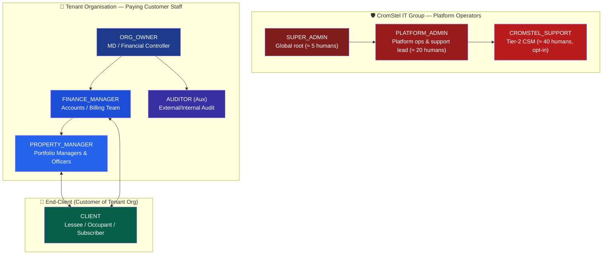
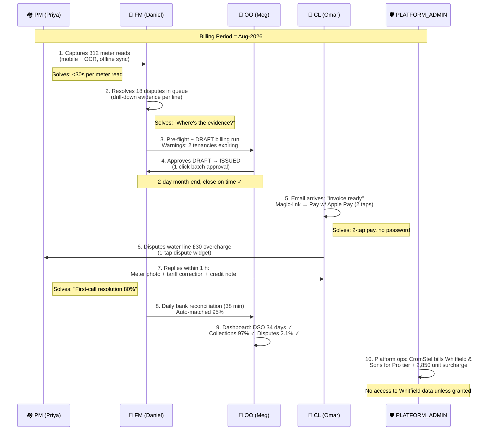

# myTenant Invoice — User Personas & Role Definitions

> Document ID: MTI-PERS-005 | Version: 1.0 | Owner: CromStel IT Group — Product Office + UX | Status: APPROVED | Last Updated: 2026-09-20
>
> *This document defines the six mandatory platform roles plus two auxiliary roles. Each persona represents a real, research-validated user archetype derived from 12 CromStel client interviews (2026 Q2–Q3). User stories in [user-stories.md](./user-stories.md) are mapped to these personas.
> Cross-references: [Functional Requirements (RBAC §2.2)](./functional-requirements.md#22-role-based-access-control-rbac) · [User Stories](./user-stories.md) · [Use Cases](./use-cases.md)*

---

## 0. Role Map & Hierarchy



**Cardinality per tenant organisation (typical Pro-tier customer):**
| Role | Typical Count | Ratio |
|---|---|---|
| ORG_OWNER | 1–2 | 1 per 500 units |
| FINANCE_MANAGER | 2–8 | 1 per 250 units |
| PROPERTY_MANAGER | 5–25 | 1 per 40–80 units |
| AUDITOR | 0–4 | Occasional, external |
| CLIENT | 200–10,000+ | 1 per unit × 1–2 contacts each |

---

## 1. SUPER_ADMIN

```mermaid
card "👑 SUPER_ADMIN — Platform Root"
  description "Global, CromStel-only role. Ultimate authority over the myTenant Invoice platform. Does NOT read tenant business data by default."
```

### 1.1 Profile

| Field | Detail |
|---|---|
| **Role name** | `SUPER_ADMIN` |
| **Real name** | Amara Kone |
| **Age / Location** | 41, London, UK (CromStel IT Group HQ) |
| **Job title** | Director of Platform Engineering / CTO designate |
| **Reports to** | CromStel CTO |
| **Team size** | Directly manages 2 Platform Architects + SRE team |
| **Technical literacy** | Expert. Can write SQL, deploy infra, read K8s manifests. |
| **Platform usage frequency** | Daily (1–2 h active). 24/7 on-call escalation. |
| **Typical devices** | MacBook Pro 16", iPhone 15 Pro, iPad Pro (on-call dashboards) |

### 1.2 Core Goals

1. **Protect the platform.** Ensure zero cross-tenant data leakage incidents (RSK-01). Be the first person notified of any Severity 1 incident.
2. **Honour the uptime SLA.** 99.9%+ for Pro, 99.95%+ for Enterprise (NFR-AVA). Sign off every production change above $risk threshold.
3. **Keep CromStel compliant.** SOC 2, ISO 27001, GDPR. Own the audit response for platform-level controls.
4. **Manage platform cost & capacity.** Optimise spend for 80% gross margin (CG-3). Approve new tenancies above 50,000 units so infrastructure can be pre-scaled.
5. **Protect revenue.** Handle extreme billing dispute escalations where FINANCE_MANAGER + PLATFORM_ADMIN cannot resolve. Approve platform-level credits/refunds > $10,000.

### 1.3 Frustrations & Pain Points

- **Can't see the forest for the trees.** Wants aggregate tenant health (suspended tenants, overdue on CromStel invoices, error rate trends) not individual invoices.
- **Audit fatigue.** External auditors ask the same 20 questions every 6 months; needs one-click export of RLS config, KMS policy, access logs.
- **Blast-radius fear.** A single platform-wide configuration change (e.g., tax-jurisdiction rule update) could affect 1,000+ tenants. Needs dry-run, canary, and rollback on every admin action.
- **Incident response tooling fragmented.** PagerDuty, Slack, Datadog, Sentry, Postgres logs — wishes the SUPER_ADMIN console could correlate a tenant-specific 5xx spike to the exact DB query and tenant tier.

### 1.4 Typical Week (Sample Tasks)

| Day | Tasks |
|---|---|
| Monday | Weekly SLO review (20 min). Approve 3 new Enterprise provisioning requests (each >5k units). Sign-off Q3 capacity plan. |
| Tuesday | Canary deployment of billing engine v1.4 → watch error budget for 2 h, then approve rollout. |
| Wednesday | Security committee: review pen-test findings, approve remediation plan for 2 medium findings. |
| Thursday | Audit walkthrough with SOC 2 auditor — provide KMS key policy docs, RLS schema, support access audit trail. |
| Friday | Review and approve 1 platform-level credit ($45k for Enterprise tenant affected by billing-run delay incident). |

### 1.5 Super-Admin Console: Must-Have Views

- **Platform SLO dashboard:** Error budget, uptime, p95/p99, top failing endpoints.
- **Tenant health:** List of all tenants sorted by ARR tier, status (ACTIVE/SUSPENDED/TRIAL), billing run success rate, support ticket count.
- **CROMSTEL_SUPPORT grant live view:** Which tenants currently have an active support grant, who on staff is using it, what modules they touched.
- **Release manager:** Canary/rollback controls, per-tenant feature flag override (Enterprise only).
- **Security event feed:** Real-time view of failed admin logins, unusual API call volumes, KMS key events.

---

## 2. PLATFORM_ADMIN

```mermaid
card "🛡️ PLATFORM_ADMIN — Platform Operations"
  description "CromStel operations staff. Day-to-day running of the SaaS: tenant provisioning, tier management, billing to tenant orgs, support coordination."
```

### 2.1 Profile

| Field | Detail |
|---|---|
| **Role name** | `PLATFORM_ADMIN` |
| **Real name** | Rajiv Mehta |
| **Age / Location** | 34, Bengaluru, India (CromStel operations centre) |
| **Job title** | Senior Platform Operations Analyst |
| **Reports to** | Head of SaaS Operations |
| **Team size** | Team of 4 sharing on-call (EU + APAC hours) |
| **Technical literacy** | Advanced. Comfortable with SQL SELECT, Jira admin, basic AWS Console. No code deploys. |
| **Platform usage frequency** | 6–8 h/day, every working day. |
| **Typical devices** | Dell XPS 15 (dual 4K monitors), Android. |

### 2.2 Core Goals

1. **Onboard tenants efficiently.** Day-1 provisioning, domain setup, SSO enablement, tier assignment. Target TTFT (Time to First Invoice) < 24 h for Pro, < 12 h for Enterprise.
2. **Resolve CromStel billing.** The tenant organisation pays CromStel. Chasing tier-overages, suspending tenants at 15 days arrears per BR-COM-02, sending CromStel-level statements.
3. **Support the CSMs & Tier 2:** Triage error reports from PROPERTY_MANAGERs; if it's a platform bug, file in Jira and track. If it's user-error, share KB article.
4. **Manage platform feature flags & config:** Safely roll out new tax tables, payment-gateway routing rules, white-label domains.
5. **Keep analytics accurate:** Reconcile MRR in platform vs Stripe weekly.

### 2.3 Frustrations & Pain Points

- **Manual onboarding steps for Enterprise:** SSO/SAML config, custom sub-org setup, custom invoice template upload — all require PLATFORM_ADMIN + a call with the customer. Wishes for a self-serve Enterprise onboarding wizard.
- **"I can't see it, but I know it's there" paradox:** Can't read tenant data per NFR-ISL-010, so when a tenant says "invoices are wrong", the PLATFORM_ADMIN has to (a) ask the tenant to screenshot, (b) request a temporary support grant, (c) wait for ORG_OWNER to approve. Slower than desired.
- **Suspending a tenant is emotionally hard.** 15-day arrears rule is firm, but small clients with cashflow issues beg for extensions. Wants the ability for CSMs to add ONE 7-day grace period flag per tenant per year (audited).

### 2.4 Typical Day

1. **09:00** — Queue review: 3 new sign-ups (2 Free, 1 Pro). Approve Pro tenant's domain whitelist. Send onboarding checklist to ORG_OWNER.
2. **10:00** — Weekly CromStel billing run: process 120 Pro tier invoices (surcharge tier overages for 28 tenants). Flag 6 tenants approaching 10-day arrears → notify CSM.
3. **11:30** — Triage: 1 tenant reports "payment via portal stuck". Check payment-gateway logs (Stripe → Adyen failover worked). Advise tenant it was a transient gateway issue; root-cause passed to SRE.
4. **14:00** — Enterprise onboarding: configure Azure AD SSO for 300-unit property group. Test SAML handshake; document for knowledge base.
5. **16:00** — Audit CROMSTEL_SUPPORT grants: 3 active grants, all within TTL; 1 grant needs to be revoked (incident closed). Revoke + confirm.
6. **17:00** — Weekly ops report draft: new signups, churn, tier conversions, support grant count, P1/P2 count.

---

## 3. ORG_OWNER

```mermaid
card "🏢 ORG_OWNER — Tenant Org Director / FC"
  description "The ultimate authority within a paying tenant organisation. Typically a Managing Director, Financial Controller, or Head of Property of a property management firm or utility bureau."
```

### 3.1 Profile

| Field | Detail |
|---|---|
| **Role name** | `ORG_OWNER` |
| **Real name** | Margaret "Meg" Whitfield |
| **Age / Location** | 52, Manchester, UK |
| **Job title** | Financial Controller, Whitfield & Sons Property Management Ltd. |
| **Customer tier** | Pro (2,850 units, mixed commercial/residential blocks) |
| **Reports to** | MD / CEO (family-owned) |
| **Team size** | 2 FINANCE_MANAGERs, 9 PROPERTY_MANAGERs, 1 part-time admin |
| **Technical literacy** | Intermediate. Excel wizard, QuickBooks/Xero power user. Not a coder. |
| **Platform usage frequency** | 3–5 h/week, mostly Mondays + month-end. |
| **Typical devices** | 27" iMac at desk, MacBook Air for WFH/meetings, iPad for property-site visits. |

### 3.2 Core Goals

1. **Protect cash flow.** Reduce DSO from 42 days → 35 days (TG-2). Keep bad debt under 0.8% of turnover.
2. **Hit month-end close on time.** Finalise invoices by day 2 of month, send all by day 3. Close the books day 5 (TG-4).
3. **Reduce billing-related complaints.** Property managers spend 20% of their time on invoice disputes; cut that in half with transparent, evidence-backed invoices.
4. **Stay compliant.** Year-end audit, tax filing (VAT, SAF-T), service-charge reconciliation s42 notices (UK). Everything needs a paper trail.
5. **Grow the business.** Onboard 3 new blocks (450 units) this year — the software must scale without adding finance headcount.

### 3.3 Frustrations & Pain Points

- **"My previous system was 3 spreadsheets + Xero, and it worked… sort of."** Sceptical of SaaS. Migrating 2,850 units feels like a huge risk; needs a parallel run for 2 months (shadow billing).
- **Service-charge year-end is 4 weeks of HELL.** Comparing budget vs. actual across 18 blocks, producing 2,000+ reconciliation statements with copies of every contractor invoice — last year this took the whole of August. Needs it automated (FR-SC-003).
- **"I can't just give anyone access to our clients' bank details."** Data security is a personal concern; the ORG_OWNER needs to know exactly who logged in, when, what they touched. Audit log is non-negotiable.
- **Penalty & late fee rules change constantly.** UK late-fee rules (Late Payment of Commercial Debts Act) + internal landlord-approved fee matrix are complex. Needs to configure the rules ONCE, confidently, and never have to re-examine them.

### 3.4 Decision Drivers (Tenant Retention / Expansion)

- If myTenant Invoice cuts month-end from 5 days → 1 day: will upgrade to Enterprise at $2,500/mo.
- If service-charge reconciliation module cuts 4 weeks → 1 week: will refer 2 peer property managers.
- If one invoice calculation error slips through: will consider churn.

---

## 4. FINANCE_MANAGER

```mermaid
card "💼 FINANCE_MANAGER — Accounts / Billing"
  description "Day-to-day operators of the billing and accounts-receivable function. Live in the invoice list, payment list, and accounting integration. Power users; errors directly impact their workload."
```

### 4.1 Profile

| Field | Detail |
|---|---|
| **Role name** | `FINANCE_MANAGER` |
| **Real name** | Daniel Okafor |
| **Age / Location** | 28, Birmingham, UK (Whitfield & Sons) |
| **Job title** | Management Accountant |
| **Reports to** | Meg Whitfield (ORG_OWNER) |
| **Team size** | 2 peers, same role |
| **Technical literacy** | Advanced Excel, Xero/QuickBooks Certified, basic SQL (learned on Khan Academy). Not a developer. |
| **Platform usage frequency** | 7 h/day, every day. Month-end: 10 h days. |
| **Typical devices** | Dual 24" monitors on a home-office PC, iPhone. |

### 4.2 Core Goals

1. **"Just make the invoices right, first time."** Accuracy is personal. When a PROPERTY_MANAGER gets a call from an angry lessee, Daniel gets the blame internally. Target < 3% dispute rate (TG-3).
2. **Collect money faster.** Automate dunning. Get auto-pay adoption from 10% → 60% of clients in 12 months (KPI on his bonus).
3. **Reconcile the bank in < 1 hour/day.** Currently 2.5 hours/day matching statement lines to invoices.
4. **Stop doing manual journal entries.** Deferred income, WHT, FX gains/losses — if the platform can push journals to Xero automatically, Daniel can re-invest the time in analysis.
5. **No month-end overtime.** This year's personal goal.

### 4.3 Frustrations & Pain Points

- **"I don't have time for a 10-click workflow."** Needs keyboard shortcuts. Needs batch approve, batch email, batch allocate.
- **Utility bill corrections are a nightmare.** A PROPERTY_MANAGER corrects a water meter read from 3 months ago. Daniel has to manually create a credit note + a new invoice, explain to the client, redo the VAT return line. Wishes back-billing were automated WITH guardrails (FR-BR-006).
- **Refunds need approval.** Overpayment of £3.20 shouldn't need ORG_OWNER sign-off. But a refund of £5,000 definitely does. Needs tiered approval.
- **"Where's the evidence?"** When an auditor or a client asks "How did you calculate this £1,240 service charge line?", he needs a one-click answer — not digging through 4 emails + 2 spreadsheets.

### 4.4 Typical Workflow (Day Before Billing Run)

1. Open **Dashboard** → check "Meter reads pending" count (246 of 1,210 meters outstanding).
2. Email the 9 PROPERTY_MANAGERs, tagging each person with the list of units they're responsible for.
3. Churn through "Dispute review queue" (18 open disputes):
   - 10 are "Meter read photo missing" → mark waiting on PROPERTY_MANAGER.
   - 5 are "Proration queried" → show tenancy start date + calculation steps → close.
   - 3 are legitimate errors (tariff lookup wrong for 3 commercial units) → adjust, create credit notes.
4. Kick off **pre-flight billing run** in REVIEW mode. Scan warnings (2 expired tenancies, 1 lease escalator awaiting approval). Resolve.
5. Approve billing run for DRAFT generation. Go home on time (new goal!).

---

## 5. PROPERTY_MANAGER

```mermaid
card "🏘️ PROPERTY_MANAGER — Site / Portfolio Operations"
  description "On-the-ground people. Know the clients, the units, the meters. Read meters, move tenants in/out, handle first-line billing queries. If the portal is hard to use, they go back to WhatsApp + notebook."
```

### 5.1 Profile

| Field | Detail |
|---|---|
| **Role name** | `PROPERTY_MANAGER` |
| **Real name** | Priya Shah |
| **Age / Location** | 26, Manchester, UK. Drives 1,200 miles/month visiting sites. |
| **Job title** | Property Officer (Midlands Portfolio: 7 blocks, 312 units) |
| **Reports to** | Senior Property Manager → ORG_OWNER |
| **Technical literacy** | Basic-intermediate. Loves well-made mobile apps. Frustrated by slow desktop interfaces that don't work on 4G. |
| **Platform usage frequency** | 2–4 h/day. Mobile (55%), desktop (45%). |
| **Typical devices** | iPhone 14 (always in hand), old laptop (only for bulk work in office). |

### 5.2 Core Goals

1. **Capture a meter read in < 30 seconds per unit.** Walk up → open app → take photo → OCR reads the dial → confirm → save. That's it.
2. **Know what's happening on "my" portfolio.** Priya owns 312 units. Needs a list: "Which tenants move in this week? Which leases break in 6 months? Which meters haven't been read?"
3. **Handle first-line client queries without escalating.** When a client calls "Why is my water bill £30 higher?", answer on the call: open invoice → tap line → show meter read photos, tariff. Close 80% of queries on first call.
4. **Move a tenant in / out in 5 minutes.** Update tenancy, upload signed lease, set move-out date, auto-prorate. No spreadsheet voodoo.
5. **Don't get blamed for Finance's mistakes.** If Finance generated an invoice wrong, Priya hears about it from the client first — needs to see WHO made WHAT change on an invoice, when.

### 5.3 Frustrations & Pain Points

- **"The mobile experience is an afterthought."** 60% of her work is on site with poor 4G. A 3-MB form that takes 10 seconds to load = she won't use it. Needs offline meter-read capture (syncs when back online).
- **OCR reads the meter wrong 1 in 10 times.** Priya is on the hook for the error. Needs an easy "correct + reason" flow.
- **Duplicate data entry.** She receives the signed tenancy agreement via DocuSign; then has to re-key the dates, rent amount, break clause into the platform. Wants 1-click import from the email.
- **"Why can't I see what the client sees?"** When on a call, she needs a "portal preview" mode — exactly the screen the CLIENT sees, to walk them through it.

### 5.4 Mobile App Must-Haves (MVP)

- ✅ Mobile-optimised meter read flow with camera + OCR, offline first.
- ✅ "My tasks" list: move-ins this week, move-outs this week, leases expiring 90 days, disputed invoices assigned to me.
- ✅ Client quick-card: click a client → see balance, last 3 invoices, last payment, one-tap call/email/WhatsApp.
- ✅ Offline queuing: every action saved locally, synced when network returns with conflict resolution UI.

---

## 6. CLIENT (End-Client / Tenant of Customer)

```mermaid
card "👤 CLIENT — End Customer (Lessee / Occupant)"
  description "The individual or business that actually receives and pays invoices. The least empowered but most numerous user. Their experience drives dispute rate and DSO. Zero training available."
```

### 6.1 Profile (Primary Persona: Small Business Owner)

| Field | Detail |
|---|---|
| **Role name** | `CLIENT` |
| **Real name** | Omar El-Sayed |
| **Age / Location** | 37, Manchester, UK |
| **Customer of** | Whitfield & Sons (ORG_OWNER: Meg) |
| **Occupation** | Owner, "Omar's Coffee Corner" (800 sq ft retail unit, ground floor of Hanover House) |
| **Technical literacy** | Intermediate. Uses Square for POS, Xero for accounts. No training. |
| **Platform usage frequency** | ~20 min/month. Opens email → views invoice → pays. |
| **Typical devices** | iPhone 13 (90% of interactions), desktop (10% — downloading tax docs at year-end). |

### 6.2 Profile (Secondary Persona: Corporate Facilities Manager)

| Field | Detail |
|---|---|
| **Real name** | Clara Bennett |
| **Occupation** | Facilities Co-ordinator, Midlands Regional Law LLP (4-floor office, 12,000 sq ft) |
| **Technical literacy** | Advanced (power user, but not trained on myTenant Invoice) |
| **Usage** | 1 h/month. Downloads all invoices for accounts-payable upload. Submits revenue declarations (percentage rent clause). |

### 6.3 Core Goals (Omar + Clara combined)

1. **"Tell me exactly what I'm paying for."** No mystery lines. No "miscellaneous" £450. Omar wants to see: meter photo, tariff calculation, proration.
2. **"Pay in 2 taps, then forget about it."** Apple Pay / Google Pay on the invoice email link. Auto-pay option. Receipt emailed instantly.
3. **"Don't make me create a password."** Magic-link login preferred. If password, at least Apple/Google SSO.
4. **"If something is wrong, tell me what to do."** Clear "Dispute this line" button, dropdown of reasons, timeline updates. No "call us on 0800…" — Omar hates phone calls.
5. **"Give me all my receipts in one zip when I do my taxes."** Self-serve; no waiting for the property manager to reply.

### 6.4 Frustrations & Pain Points

- **"I receive a 6-page PDF and 3 of those pages are legal jargon I don't understand."** Invoice line details are hidden on page 5 of 6. Needs a mobile-optimised line-item view ABOVE the PDF.
- **"The 'support' email address takes 3 days to reply."** Last time Omar had a question, he waited 3 days, then paid under protest, then vowed to move when his lease expires.
- **"I don't know what next month will cost."** Omar runs a small café with tight cashflow. Wants a "Next invoice preview" widget showing estimated rent + estimated utilities (rolling average).
- **"Password emails go to spam."** Magic link = better UX and better deliverability.

### 6.5 Client Portal: 3-Click Rule for Omar

- **Click 1** → Open email from Whitfield & Sons: "Your Hanover House invoice is ready" → Tap "View & Pay".
- **Click 2** → Auto-logged-in via magic link. See balance + big green "Pay £1,845.20".
- **Click 3** → Tap "Apple Pay" → Double-click side button → Paid. ✅
- **Bonus** → Next screen: "Turn on auto-pay so you never think about this again" → 1 click → On.

---

## 7. Auxiliary Roles (Non-Core but Specified in FRs)

### 7.1 AUDITOR

| Field | Detail |
|---|---|
| **Role name** | `AUDITOR` |
| **Assignee** | External Chartered Accountant (e.g., PwC, BDO) or internal audit — assigned temporarily by ORG_OWNER |
| **Permissions** | Read-only on: invoices, payments, adjustments, meter reads, service-charge reconciliations, full tenant-scoped audit log. Cannot see PII (names/emails redacted, replaced with IDs). Cannot export PII. Cannot edit anything. |
| **User story** | "As an external auditor, I want to verify the accuracy of the 2026 service-charge reconciliation for Hanover House (182 units) without requiring the ORG_OWNER to email me 3,000 PDFs, so I can sign off the year-end in 2 weeks instead of 8." |
| **Why it matters** | A statutory audit that takes 2 weeks vs. 8 weeks saves the ORG_OWNER ~$25k in audit fees — a tangible selling point for the Enterprise tier. |

### 7.2 CROMSTEL_SUPPORT

| Field | Detail |
|---|---|
| **Role name** | `CROMSTEL_SUPPORT` |
| **Assignee** | CromStel CSMs / Tier-2 support engineers |
| **Permissions** | ZERO by default (per NFR-ISL-010). Can only act on a tenant workspace when the tenant's ORG_OWNER grants a time-bound, scope-bound, revocable token (max. 72 h). Audited 100%. |
| **User story** | "As a CSM, I want tenant-org ORG_OWNER to grant me 2 hours of read-only access to their billing run, so I can debug why 12 invoices failed validation, WITHOUT having to hop on a screenshare and ask them to click 30 times." |
| **Why it matters** | Without this mechanism, support resolution time is 2–3 days per advanced ticket; with opt-in grant, resolution time drops to 1–2 hours. Directly reduces churn. |

---

## 8. Cross-Role Workflow: The Month-End Lifecycle

How the 6 core roles collaborate on a single month-end billing cycle, annotated with pain points solved:



---

## 9. Cross-References

| Document | How Personas Inform It |
|---|---|
| [Functional Requirements](./functional-requirements.md) | Permission matrix §2.2.1 traces directly to role capabilities. |
| [User Stories](./user-stories.md) | Every user story is tagged with the primary persona that benefits. |
| [Use Cases](./use-cases.md) | Each use case lists Primary Actor + Secondary Actors by role. |
| [Acceptance Criteria](./acceptance-criteria.md) | UI/UX acceptance criteria validated against persona usability targets. |
| [Business Requirements](./business-requirements.md) | Tenant Organisation Goals (TG-1 … TG-5) are quantified versions of ORG_OWNER / FINANCE_MANAGER pain points. |

---

*Persona maintenance: Updated annually with fresh client-interview data or when user research identifies a new high-frequency archetype. Owner: CromStel UX Lead.*
