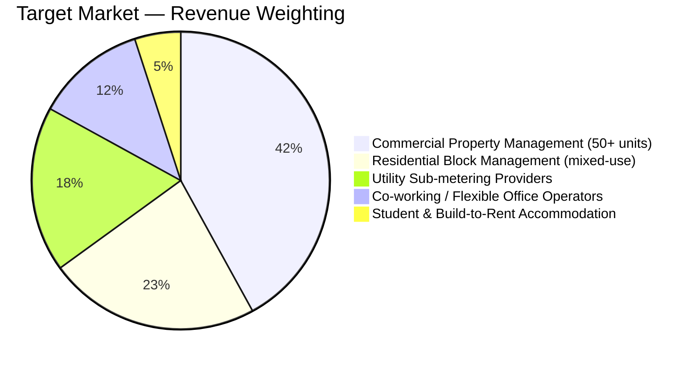
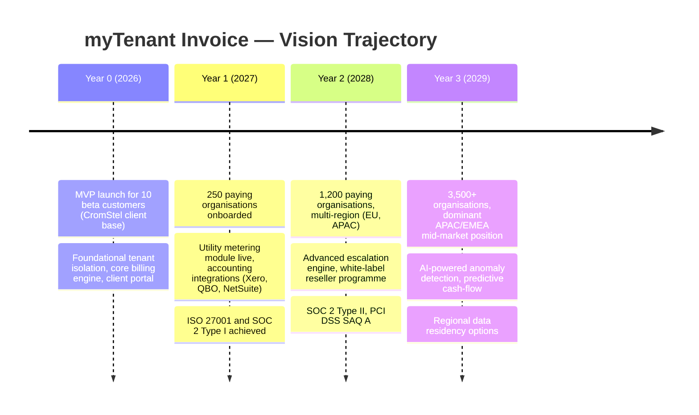
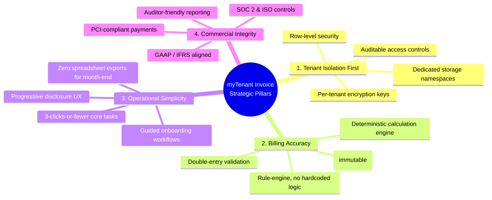

# myTenant Invoice — Product Vision

> Document ID: MTI-PROD-001 | Version: 1.0 | Owner: CromStel IT Group Product Office | Status: APPROVED | Last Updated: 2026-09-20

---

## 1. Executive Summary

**myTenant Invoice** is a SaaS multi-tenant billing and invoicing platform engineered by CromStel IT Group for commercial real-estate operators, property management firms, and utility service providers. The platform consolidates lease-based recurring charges, metered utility consumption (water, electricity, gas, HVAC), one-off service fees, and penalty calculations into a single tenant-aware billing engine. It delivers branded invoices via email, portal, and post; collects payments through multiple gateways; and produces GAAP/IFRS-aligned accounting exports with full audit trail.

The platform is built from first principles around **tenant data isolation**: every organisation (tenant) operates within a logically partitioned workspace backed by row-level security (RLS), per-tenant encryption keys, and dedicated storage namespaces. Cross-tenant data leakage is architecturally impossible by design, not enforced by policy alone.

### 1.1 Problem Statement

Commercial property managers today face five compounding pain points:

| Pain Point | Current Cost | myTenant Invoice Resolution |
|---|---|---|
| Disjointed systems for rent, utilities, and service charges | 15–40 hours/month of manual spreadsheet reconciliation | Unified billing engine with configurable charge categories |
| Utility sub-metering requires manual reads and spreadsheet proration | $8–25 per unit per month in labour overhead | Automated meter import, tiered tariff engine, and loss-factor allocation |
| Late-fee and lease-escalation calculations are error-prone | 3–7% revenue leakage per annum on average | Rule-engine driven penalty/escalation schedules, 100% auditable |
| Tenant (customer) dispute resolution requires digging through 3+ tools | 6+ hours per dispute on average | Self-service client portal with line-item drill-down, meter evidence, and payment history |
| Multi-property / multi-entity operators cannot safely share a single platform | Per-entity software licensing, expensive consolidation | Multi-org SaaS with strict tenant isolation, cross-org reporting for platform owners |

### 1.2 Target Market Segments

- **Primary Segment (Tier 1):** Commercial property management firms operating 50+ commercial units across multiple properties, with dedicated finance and property teams.
- **Secondary Segment (Tier 2):** Mixed-use residential-commercial block managers, utility sub-metering service bureaus.
- **Tertiary Segment (Tier 3):** Flexible office operators, purpose-built student accommodation (PBSA), and build-to-rent (BTR) providers.

---

## 2. Vision Statement

> **"To become the global standard for tenant-aware, property-centric billing by delivering the most secure, auditable, and operationally simple multi-tenant invoicing platform on the market — one that CromStel customers, their tenants, and their auditors trust unconditionally."**

### 2.1 Mission Statement

CromStel IT Group builds myTenant Invoice to:

1. **Eliminate revenue leakage** from manual calculations and human error by automating every charge rule, penalty schedule, and escalation clause.
2. **Guarantee tenant data privacy** by architecting isolation into every layer (application, database, storage, crypto) so that no CromStel customer ever has to trust a shared-space compromise.
3. **Reduce month-end close cycles** for finance teams from 5+ business days to under 24 hours through automated invoice generation, dunning, and accounting export.
4. **Empower end-clients (tenants)** with transparent, evidence-backed invoices that reduce dispute rates from industry averages of 12–18% to under 3%.

### 2.2 Vision Timeline

---

## 3. Core Value Propositions

### 3.1 For Platform Operators (CromStel IT Group)

| VP # | Value Proposition | Evidencing Metric |
|---|---|---|
| P-VP1 | **True multi-tenant SaaS with zero cross-tenant leakage risk** | Third-party penetration test: zero cross-tenant data reads |
| P-VP2 | **Per-tenant tiered pricing drives ARR growth** | Gross margin > 78% at steady state |
| P-VP3 | **Horizontal platform serves property, utility, and serviced-office verticals** | 30%+ of revenue from non-core segments by Year 2 |
| P-VP4 | **Low operational overhead per tenant** | < 0.1 FTE per 100 tenants in steady-state operations |

### 3.2 For Tenant Organisations (Paying Customers)

| VP # | Value Proposition | Evidencing Metric |
|---|---|---|
| O-VP1 | **One platform replaces rent-roll + utility billing + accounts-receivable tools** | 60% reduction in billing software stack cost |
| O-VP2 | **Auditable, rule-based charges eliminate manual spreadsheets** | > 99.5% invoice accuracy rate |
| O-VP3 | **Automated dunning and payment recovery** | 15–25% reduction in days sales outstanding (DSO) |
| O-VP4 | **Branded client portal reduces inbound disputes** | 60%+ reduction in billing-related support tickets |

### 3.3 For End-Clients (Tenants of the Customer)

| VP # | Value Proposition | Evidencing Metric |
|---|---|---|
| C-VP1 | **Transparent line-item invoices with meter evidence** | < 3% invoice dispute rate |
| C-VP2 | **Self-service payment, receipt, and document download** | 70%+ of payments made via portal auto-debit |
| C-VP3 | **Clear visibility into future charges and lease escalations** | N/A (qualitative satisfaction score ≥ 4.3/5) |

---

## 4. Strategic Pillars

Four non-negotiable pillars anchor every product decision. Any feature request that conflicts with a pillar is rejected or re-architected.

### 4.1 Pillar 1 — Tenant Isolation First
- Every database row carries `tenant_id`. All queries enforce `tenant_id` filters at the ORM/query-builder layer; bypass is architecturally prohibited.
- Per-tenant AES-256 encryption keys are stored in a dedicated KMS (not alongside application secrets).
- No shared S3 buckets; each tenant has its own object-storage prefix with tenant-scoped IAM policies.
- Audit logging includes `tenant_id` on every event and is tamper-evident.

### 4.2 Pillar 2 — Billing Accuracy
- All monetary calculations use integer-based minor units (cents/pence) and decimal arithmetic (no IEEE-754 floats).
- Every invoice line is traceable to a charge rule, a meter read, a lease schedule, or a manual adjustment with author identity.
- The billing engine is idempotent: running the same billing period twice produces identical output.

### 4.3 Pillar 3 — Operational Simplicity
- Core workflows (onboard a tenant, record a meter read, generate a month's invoices, reconcile payments) must be achievable in 3 clicks or fewer from the dashboard.
- Progressive disclosure: novice users see guided steps; power users access advanced configuration via contextually revealed sections.
- No forced spreadsheet export for any primary business workflow.

### 4.4 Pillar 4 — Commercial Integrity
- Revenue recognition follows GAAP ASC 606 / IFRS 15 schedules out of the box.
- SOC 2 Type I (Security, Availability, Confidentiality) by Month 12.
- Payments handled via PCI DSS SAQ A-compliant gateways only; no cardholder data ever touches CromStel infrastructure.

---

## 5. Tenets & Anti-Tenets

### 5.1 Tenets (What We Always Do)

1. **Default Secure**: Every new feature ships with tenant isolation, least-privilege RBAC, and audit logging enabled — never as "optional extras."
2. **Deterministic by Default**: Billing calculations produce byte-identical output for identical inputs. Randomness (e.g., for invoice numbers) must be cryptographically seeded and reproducible via audit trail.
3. **Audit Everything**: Every state mutation (create, update, delete, void) records actor, timestamp, before/after payload, and tenant context in an immutable log.
4. **Tenant Data In, Tenant Data Out**: Every tenant can export their complete structured dataset (invoices, contacts, meter reads, payments) via a self-serve, rate-limited API or UI — at any time, for any reason, without CromStel intervention.
5. **Fail Closed, Not Open**: On authentication or RBAC failure, the user receives a generic 403/404 (never an information-leaking 401 or detailed error).

### 5.2 Anti-Tenets (What We Will Never Do)

1. **Never expose tenant data to other tenants** via any vector — UI, API, reporting, support tooling, or export.
2. **Never hardcode tax rates, currencies, or penalty rules** into application code. All jurisdiction logic lives in tenant-configurable rule sets.
3. **Never permanently delete billing data** during the mandatory 7+ year retention window. A "delete" is implemented as a soft delete with full audit trace.
4. **Never ship a feature that can only be configured by CromStel SREs**. Tenant-facing configuration is self-serve; platform configuration is scriptable via infrastructure-as-code.
5. **Never build tenant-specific forks** of the platform. All customer requirements are expressed as configuration or (for Enterprise) paid platform-wide extensions.

---

## 6. Alignment with CromStel IT Group Strategy

| CromStel Corporate Objective | myTenant Invoice Contribution |
|---|---|
| Grow recurring revenue (ARR) to $25M by FY2029 | myTenant Invoice targets 40% of that target ($10M ARR) |
| Establish 3 market-leading SaaS vertical products | First flagship vertical SaaS product; playbook reused |
| Achieve SOC 2 Type II across all product lines | Security program built for myTenant Invoice becomes the CromStel standard |
| Expand EMEA & APAC presence | Multi-region, multi-currency, multi-tax-jurisdiction architecture from Day 1 |
| Deepen existing client relationships (upsell) | 35% of Year-1 revenue from existing CromStel property/IT clients |

---

## 7. Success Criteria (Vision Gate)

The vision is considered "achieved for the MVP milestone" when all of the following are true:

| ID | Criterion | Measurement Window | Target | Verification |
|---|---|---|---|---|
| VG-1 | ≥ 10 paying tenant organisations actively generating invoices | Month 6 post-launch | 10 | Billing database count + MRR > $0 |
| VG-2 | Zero cross-tenant data leakage incidents (internal, audit, or external) | Months 1–12 | 0 | Security log review + quarterly penetration test |
| VG-3 | Month-end invoice batch run completes in < 4 hours for 10k-invoice tenant | Month 6 | < 4 h wall-clock | Production telemetry |
| VG-4 | Customer NPS ≥ 40 | Month 8 quarterly survey | 40 | Qualtrics / in-app survey |
| VG-5 | Client portal adoption ≥ 50% of end-clients for customers active 3+ months | Month 8 | 50% | Portal login telemetry per tenant |
| VG-6 | Invoice accuracy rate ≥ 99.5% (disputed items / total items) | Rolling 90-day window | 99.5% | Dispute-tag audit |

---

## 8. Glossary & Cross-References

### 8.1 Glossary

| Term | Definition |
|---|---|
| **Tenant (of myTenant Invoice)** | The paying customer organisation — typically a property management firm, block manager, or utility bureau. |
| **End-Client / Client** | A customer of a Tenant organisation — the entity that receives and pays invoices (e.g., a shop lessee, apartment occupant, office subletter). |
| **Charge Rule** | A configurable rule (amount, formula, schedule, tiering) that produces an invoice line during a billing run. |
| **RLS** | Row-Level Security. Database mechanism that filters rows on `tenant_id` independent of application-layer logic. |
| **Dunning** | The automated process of communicating overdue invoices and applying fees. |
| **KMS** | Key Management Service. Dedicated system (AWS KMS, Azure Key Vault) that holds tenant encryption keys. |

### 8.2 Cross-References

- [Business Requirements](./business-requirements.md) — Quantified business goals, revenue model, compliance obligations.
- [Functional Requirements](./functional-requirements.md) — Detailed module-level functional specs including tenant isolation mechanisms.
- [Non-Functional Requirements](./non-functional-requirements.md) — Performance, security, scalability, availability, and hard tenant isolation SLAs.
- [Personas](./personas.md) — User role definitions for the 6 platform roles.
- [User Stories](./user-stories.md) — Role-based user stories with epic mapping.
- [Use Cases](./use-cases.md) — Formal use case specifications with Mermaid flow diagrams.
- [Acceptance Criteria](./acceptance-criteria.md) — Testable acceptance criteria per feature.
- [Feature Matrix](./feature-matrix.md) — Free/Pro/Enterprise tier comparison.
- [Product Roadmap](./product-roadmap.md) — 18-month phased delivery plan.

---

*Document maintained by CromStel IT Group Product Office. Amendments require Product Director sign-off and change-log entry in the internal document control system.*
