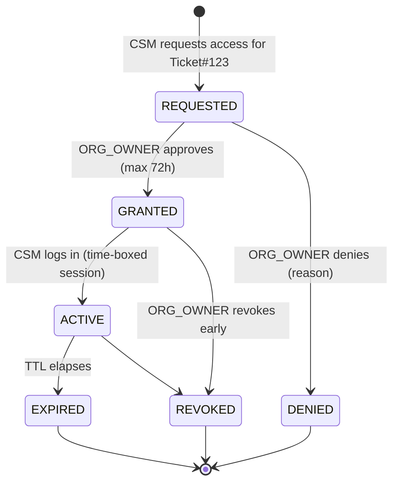
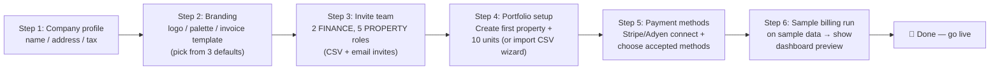
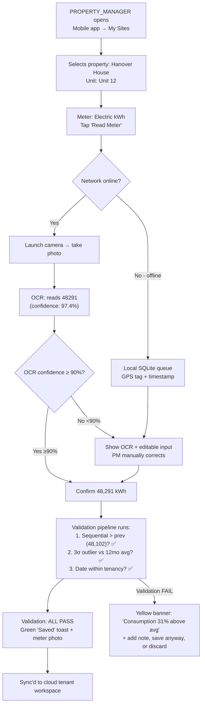
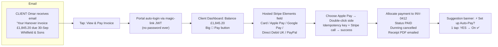
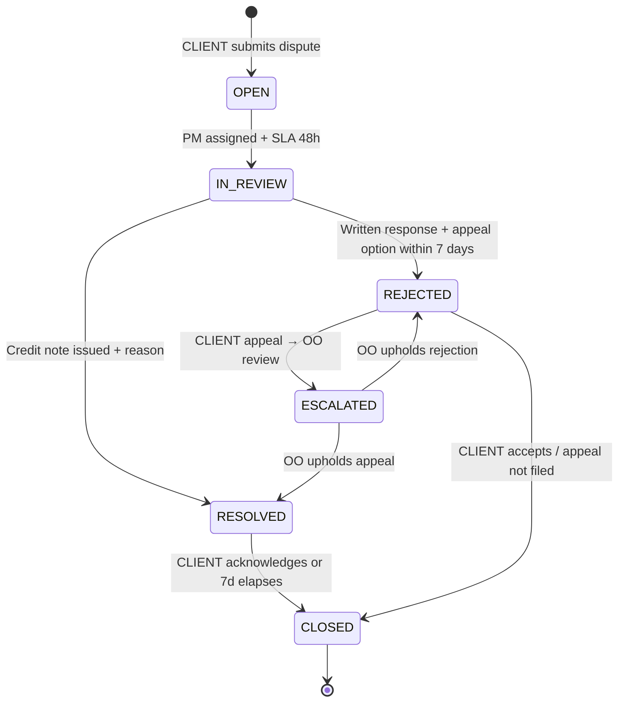

# myTenant Invoice — Use Cases

> Document ID: MTI-UC-007 | Version: 1.0 | Owner: CromStel IT Group — Product Manager | Status: APPROVED | Last Updated: 2026-09-20
>
> *Formal use case specifications for the top 20 highest-value workflows. Use cases are ordered by actor then by criticality. Format per use case: ID, Name, Actors, Preconditions, Trigger, Flow (Main + Alternates + Exceptions), Postconditions, Business Rules, FR Trace.
> Cross-references: [Personas](./personas.md) · [User Stories](./user-stories.md) · [Functional Requirements](./functional-requirements.md) · [Acceptance Criteria](./acceptance-criteria.md)*

---

## 0. Use Case Index by Actor

| Actor | Primary Use Cases |
|---|---|
| PLATFORM_ADMIN | UC-01 Provision Tenant | UC-02 Bill-Tier Surcharge | UC-03 Support Grant Lifecycle |
| ORG_OWNER | UC-04 Tenant Onboarding Wizard | UC-05 Approve Billing Batch | UC-16 Auditor Invitation |
| FINANCE_MANAGER | UC-06 Run Billing Period | UC-07 Record Offline Payment & Allocate | UC-12 Year-End Service-Charge Recon |
| PROPERTY_MANAGER | UC-08 Capture Mobile Meter Read + OCR | UC-09 Move-In / Move-Out | UC-17 Lease Renewal Pipeline |
| CLIENT | UC-10 Pay Invoice via Portal (Magic-Link | UC-11 Dispute an Invoice Line | UC-18 Percentage Rent Revenue Declaration |
| SUPER_ADMIN | UC-13 Cross-Region Tenant Data Residency Enforcement | UC-19 Platform-wide Feature Canary Deploy |
| Shared (ENG/CS) | UC-14 Self-Serve Full Data Export (Tenant-Initiated) | UC-20 Penetration Test: Cross-Tenant Read Attempt |
| AUDITOR | UC-15 Audit Evidence Package Download & Hash-Chain Verify |

---

## Use Case 01: Provision Tenant Organisation (PLATFORM_ADMIN)

```mermaid
flowchart TD
    A["PLATFORM_ADMIN navigates<br/>New Tenant form"] --> B["Enters: legal_name, trading_name,<br/>tax_id, region, tier, default_currency"]
    B --> C{Validations pass?<br/>Duplicate check<br/>(FR-TR-002 idempotency)
    C -->|No - duplicate found| C1["Return existing tenant_id + alert"]
    C -->|No - field errors| C2["Highlight + fix"]
    C -->|Yes| D["1. Create tenant row<br/>2. Create KMS CMK (FR-TR-007)<br/>3. Create object-storage prefix + IAM policy (NFR-ISL-004)<br/>4. Seed default admin user (ORG_OWNER invite)<br/>5. Subscribe to billing plan (Stripe)"]
    D --> E["Send onboarding email to ORG_OWNER<br/>+ success toast to PA"]
```

| Field | Detail |
|---|---|
| **UC ID** | UC-01 |
| **Name** | Provision Tenant Organisation |
| **Primary Actor** | PLATFORM_ADMIN |
| **Secondary Actors** | Stripe (billing), AWS/Azure KMS, email, ORG_OWNER (email) |
| **Preconditions** | 1. PLATFORM_ADMIN is authenticated with 2FA. 2. PLATFORM_ADMIN has the `tenant:create` permission. 3. Payment gateway is healthy. |
| **Trigger** | PLATFORM_ADMIN clicks "**+ New Tenant**" in Platform Admin Console, or a signed-up paid-tier tenant triggers automatic provisioning after payment method verification. |
| **Main Flow** | 1. System presents New Tenant form: legal_name, trading_name, tax_id(s), region (enum: US-EAST / EU-WEST / AP-SOUTHEAST-2), subscription tier (Free/Pro/Enterprise), default_currency (ISO 4217), primary contact name/email. |
| 2. PLATFORM_ADMIN submits. |
| 3. Idempotency check: SELECT WHERE legal_name + tax_id + region → if exists → return existing (C1). |
| 4. Field validations: tax_id format per jurisdiction, currency supported, tier >= Free tier (min). |
| 5. Tenant record CREATED with TRIAL status, ID (UUID). |
| 6. KMS CMK created with alias mytenant/tenant-{tenant_id} under region-matched KMS. Key policy restricts decrypt to this tenant's app service. |
| 7. Object-storage prefix `tenants/{tenant_id}/ created, IAM/SAS policy scoped to that prefix only. RLS policy created for tenant_id. |
| 8. Stripe/Adyen subscription created for tenant org (if Pro/Enterprise; Free → no charge yet). |
| 9. Email invite sent to primary contact with ORG_OWNER magic-link. |
| 10. PLATFORM_ADMIN gets success screen + copyable tenant_id. |
| **Alternate Flow A (Self-Serve Signup)** | A1. Trigger: User fills marketing site "Start Free". A2. Steps 3-1 automatic, default tier=Free. A3. ORG_OWNER invited. A4. First invoice_limit=1, property_limit=3 applied. |
| **Alternate Flow B (Enterprise Custom Pricing)** | B1. During step 8 Enterprise custom fields: custom_price / custom_unit_price / custom_sla_tier overrides selected. B2. CromStel sales agreement ref recorded. B3. Stripe custom price ID used. |
| **Exception Flow 1** | KMS or object storage unhealthy. → Transaction rollback. → tenant row DELETED soft, PLATFORM_ADMIN alerted via P2 SLA 15min. |
| **Exception Flow 2** | Payment method fails (t card). → TRIAL status retained 7 days → ORG_OWNER emailed to retry. |
| **Postconditions (Success)** | 1. tenant_ row exists with TRIAL/ACTIVE. 2. KMS key + object prefix exist. 3. ORG_OWNER sent invite. 4. Audit log rows 1-10 written. |
| **Business Rules** | BR-COM-01 tier gating; FR-TR-001/2/3/6/7; NFR-ISL-004/005; NFR-SEC-101/102; PCI out |
| **FR/NFR Trace** | FR-TR-001…007; NFR-ISL-004/005; BR-COM-01 |

---

## Use Case 02: CromStel Tier-Surcharge Billing of Tenant Organisations (PLATFORM_ADMIN batch / Cron)

| Field | Detail |
|---|---|
| **UC ID** | UC-02 |
| **Name** | Monthly Tier Surcharge Billing (CromStel → Tenant Org) |
| **Primary Actor** | System (monthly cron job, 1st of month, 03:00 UTC) |
| **Secondary** | PLATFORM_ADMIN (reviewer), payment gateway), Stripe/Adyen |
| **Preconditions** | Previous month closed. All tenants have had their active_unit counters. |
| **Trigger** | Cron fires on day 1 of each calendar month. |
| **Main Flow** | 1. For each ACTIVE tenant org (excl. Free non-over-limit grace): |
| 2. Count active_units_prev_month (distinct units with ≥ invoice line). |
| 3. Lookup tier → apply unit_price per unit (or minimum_invoice_lines). |
| 4. Sum (base_price tier) + (max(0, active_units – tier_units) × unit_surcharge + add-on module fees. |
| 5. Generate CromStel-level invoice PDF (tenant-facing, NOT tenant's data). |
| 6. Charge via payment method on file → retry 2-step. |
| 7. Email invoice + receipt. Failure → start BR-COM-02 state machine 15-day SUSPEND. |
| 8. Summary report to PLATFORM_ADMIN: total billed, successes, retries, SUSPEND warnings. |
| **Alternate Flow A (Manual re-run)** | A1. PLATFORM_ADMIN manually triggers re-run for a errored tenants A2. Idempotent via hash. |
| **Postconditions** | CromStel ARR recognised. Suspension countdowns initiated for arrears tenants. |
| **Business Rules** | BR-COM-02 ≥15d → SUSPEND write-block; BR-COM-03 surcharge calc; CG-1 ARR target. |
| **FR Trace** | FR-TR-003 status trans; FR-RBAC @ platform level |

---

## Use Case 03: CROMSTEL_SUPPORT Incident Access Grant & Revoke Lifecycle (ORG_OWNER, CS)



| Field | Detail |
|---|---|
| **UC ID** | UC-03 |
| **Name** | CROMSTEL_SUPPORT Access Grant Lifecycle |
| **Primary Actor** | ORG_OWNER (grantor), CROMSTEL_SUPPORT (grantee) |
| **Secondary** | SUPER_ADMIN (audit view) |
| **Preconditions** | 1. Support ticket #12345 exists in Zendesk/Jira. 2. ORG_OWNER authenticated + 2FA OK. |
| **Trigger** | CSM clicks "Request tenant workspace access" from support tool. |
| **Main Flow** | 1. CSM fills: Ticket reference, scope (READ / READ-WRITE), TTL (1–72 h), module subset (billing, metering, invoices, payments, ALL), reason. 2. Request created REQUESTED. Email/SMS to ORG_OWNER. |
| 3. ORG_OWNER clicks link → reviews reason, ticket, modules, scope. 4. ORG_OWNER can: GRANT (optionally REDUCE scope, reduce TTL), or DENY (reason mandatory). 5. If GRANTED: CSM notified, role CROMSTEL_SUPPORT activated for the tenant_id for the TTL, module-scope list applied; audit log entries: GRANT event. 6. CSM logs in → performs actions (every one audited tenant_id). 7. At any time, ORG_OWNER may REVOKE (immediate, reason optional). 8. TTL expires → role removed automatically. |
| **Exception Flow** | If the CSM does high-risk action (void >$10k invoice) → real-time alert to SUPER_ADMIN + additional audit entry. |
| **Postconditions** | 100% of the grant lifecycle (REQUEST→GRANT→USE→EXPIRE/REVOKE) is in the audit log, each row with `tenant_id`, grant_id, `ticket_ref`, actor_role_before, actor_role_after. |
| **Business Rules** | NFR-ISL-010 default-zero-trust; BR-AUD-01 opt-in per-incident; max 72h; 2-eyes on refunds void >$10k. |
| **Trace** | FR-RBAC-005; NFR-ISL-010; BR-AUD-01; FR-AUD-001 |

---

## Use Case 04: Tenant Onboarding Wizard — Org_Owner self-serve (first 30min)



| Field | Detail |
|---|---|
| **UC ID** | UC-04 |
| **Name** | New Tenant Org Self-Serve Onboarding Wizard (Day 0–Day 1) |
| **Primary Actor** | ORG_OWNER |
| **Preconditions** | Invite link (UC-01 step 9) clicked. First login. ToS/Privacy Policy accepted. |
| **Trigger** | First-login post-acceptance of ToS. |
| **Main Flow** | 6 steps, skip allowed mid-wizard, progress saved at every step; resume via dashboard card. Step 6 optional; step progress saved for later. At end: SAMPLE tenant test billing run demo on demo data → "Go-live" toast; ORG_OWNER can toggle between sandbox/live view for 7 days. |
| **Success Postconditions** | Tenant org has: 1+ property, 1+ units, 0+ users invited, 1+ invoice template, payment-gateway configured (optional). TTFT <15 min target for wizard only. |
| **Trace** | FR-PR-001…005; FR-INV-003; FR-PY-001; NFR-USA-004 TTFT <15 min |

---

## Use Case 05: Approve Billing Batch & Issue Invoices (ORG_OWNER / FINANCE_MANAGER)

```mermaid
activityDiagram
    start
    :FINANCE_MANAGER opens Billing Batches;
    :Selects period Aug-2026 STATUS=DRAFT;
    :Views summary:
    2,850 units,
    11,240 lines,
    2,600 invoices,
    £482,350.00 total,
    18 warnings, 0 errors;
    if (Warnings > 0?) then (yes)
      :Drills into warnings:
      - 2 tenancies expired,
      - 16 estimated reads;
      :Accepts/edits per case;
    else (no)
    endif
    :Samples 5 random invoices for review;
    :Clicks "Approve Batch";
    if (Role = FINANCE_MANAGER AND
    total > £500k?) then (yes high-value gate)
      :Routes to ORG_OWNER for
      2nd approval via email;
    else (no)
    endif
    :Transaction begins;
    :Assign gapless invoice numbers;
    :Generate signed PDFs;
    :Store in tenant object prefix;
    :Queue email/portal/post/einvoice delivery;
    :Transition status DRAFT->ISSUED;
    :Commit transaction;
    :Toast "Batch issued successfully
    + email FINANCE + OO;
    stop
```

| Field | Detail |
|---|---|
| **UC ID** | UC-05 / UC-06 |
| **Name** | Run Billing Period & Approve Batch Issue |
| **Primary Actor** | FINANCE_MANAGER (runner + reviewer), ORG_OWNER (high-value 2-eyes) |
| **Preconditions** | Preflight validation passed UC-E5-01 or "Proceed with warnings" clicked; all data in. |
| **Trigger** | FINANCE_MANAGER clicks Generate Drafts → Approve. |
| **Main Flow** | See activity diagram above. 2-eyes approval gate: configurable per tenant org setting; default threshold £500,000 total batch total. |
| **Alternate Flow A (Partial approve)** | FINANCE_MANAGER voids 12 invoices, approves rest → approved ones ISSUED, voided stay DRAFT. |
| **Alternate Flow B (abort after DRAFT)** | Regenerate DRAFT after edits; idempotency key changed = new run; original run marked SUPERSEDED. |
| **Exception Flow X** | Invoice numbering gap occurs (concurrent attempt). Transaction rolls back. Retry 3x. All fail → P2 alert SRE. |
| **Postconditions** | Invoices ISSUED; PDFs generated; delivery in progress; revenue schedules (FR-INV-007) created; period locked unless Re-Open by OO reason. |
| **Business Rules** | FR-BR-001 Billing close period; FR-INV-002 gapless numbering; BR-FIN-02 VAT rules; FR-INV-004 PDF/A signatures. |
| **Trace** | FR-BR-001/2/3; FR-INV-001/2/3/4/5; FR-AUD-001; FR-CR-103 determinism |

---

## Use Case 06: (Detailed: Billing Run Engine (UC-06) — already combined with UC-05 above.

---

## Use Case 07: Record Offline Payment & Allocate to Invoices (FINANCE_MANAGER)

| Field | Detail |
|---|---|
| **UC ID** | UC-07 |
| **Name** | Record Offline Payment & Allocate to Invoices |
| **Primary Actor** | FINANCE_MANAGER |
| **Preconditions** | 1+ invoices exist in PART_PAID / OVERDUE / ISSUED for a CLIENT. |
| **Trigger** | FM clicks "**+ Record Payment" on Client ledger, or "Bank Import → Manual Match". |
| **Main Flow** | 1. FM selects client, date, method (BACS/CHAPS/Cheque/Cash/Wire), reference #, amount, uploads bank screenshot (optional attachment). 2. System loads unpaid invoices sorted by due date. 3. Default allocation FIFO: £5,000 payment → auto-applies to Inv-023 (£1,200 fully paid), Inv-027 (£3,800 PART £2,104). 4. FM drag/edits allocations; overpayment £696 → unallocated credit. 5. WHT % dropdown per line if applies per FR-PY-008. 6. Save: payments, payment_allocations, gl_journal_entries written; status PART_PAID/PAID set per invoice; audit entries. 7. Receipt PDF emailed to CLIENT optionally FM. |
| **Alternate A Refund > £5,000** | Route to ORG_OWNER approver; email/SMS OO approve or reject; FM notified of decision with reason required. |
| **Postconditions** | Paid totals balance precisely. Overpayment as credit on client account (auto-apply next invoice if setting. Audit trail + evidence. |
| **Business Rules** | FR-PY-005 partials + overpays; FR-PY-007 offline methods; FR-PY-008 WHT deduction; NFR-SEC all enc; BR-FIN-02 audit |
| **Trace** | FR-PY-005/006/007/008; |

---

## Use Case 08: Capture Mobile Meter Read — OCR, Offline, Validation (PROPERTY_MANAGER on site)



| Field | Detail |
|---|---|
| **UC ID** | UC-08 |
| **Name** | Mobile Meter Read Capture (OCR + Validation + Offline) |
| **Actor** | PROPERTY_MANAGER |
| **Preconditions** | Meter exists for Unit 12. Tenancy ACTIVE. |
| **Trigger** | PM opens mobile app on site. |
| **Main Flow** | See flow diagram above. Key requirements metered lines: OCR tesseract; offline queue; validation checks per FR-UTL-004; photo+gps+user audit stored encrypted. |
| **Alternate Flow (Offline)** | Reads stored locally. Background sync job runs when network. Conflict resolution: last-writer-wins with PM conflict UI. |
| **Postconditions** | Meter read row stored immutable consumption = current-prev+rollover. linked to the future billing period batch. Evidence: photo URL. |
| **Business Rules** | FR-UTL-003 ingestion; FR-UTL-004 pipeline checks; NFR-USA-003 i18n |
| **Trace** | FR-UTL-001/003/004/005 |

---

## Use Case 09: Move-In / Move-Out Wizard (PROPERTY_MANAGER)

| Field | Detail |
|---|---|
| **UC ID** | UC-09 |
| **Name** | Move-In / Move-Out Tenancy Change with Auto Proration |
| **Actor** | PROPERTY_MANAGER (creates), FINANCE_MANAGER (reviews final invoice) |
| **Preconditions** | Unit exists. Status either VACANT (move-in case) or OCCUPIED (move-out case). |
| **Trigger** | PM taps "Move In" or "Move Out". |
| **Move-Out Main Flow** | 1. Enter vacate date, move-out reason. 2. "Schedule final reads" checklist item added. 3. Optionally schedule deposit disposition task. 4. On vacate date: tenancy end_date set. All Fixed Recurring / Area rules PRORATED automatically mid-period per FR-BR-008. 5. Queue final invoice generation with charges up to date. 6. PM clicks Complete. 7. Unit status → VACANT. |
| **Move-In Main Flow** | 1. Select existing/new Client. 2. Tenancy start-date, end-date (optional), break date, rent-free (weeks), escalation rule (picked from templates). 3. Attach Charge Rule: Fixed Recurring + per area automatically from template. 4. Upload signed lease PDF (US-E10-01). 5. "Billing starts from: ___". 6. Save. Tenancy ACTIVE. Unit → OCCUPIED. 7. If mid-period: proration effective date. |
| **Postconditions** | All future billing runs auto-include/exclude this tenancy correctly with day-fraction proration. |
| **Trace** | FR-PR-002; FR-BR-008 proration; FR-LS-001 docs |

---

## Use Case 10: CLIENT Pays Invoice via Magic-Link + One-Click Pay



| Field | Detail |
|---|---|
| **UC ID** | UC-10 |
| **Name** | Pay Invoice (Portal Magic-Link + One-Click |
| **Actor** | CLIENT, Payment Gateway |
| **Preconditions** | Invoice ISSUED, status OVERDUE or ISSUED, Client email valid, not HOLD. |
| **Trigger** | CLIENT clicks invoice email → tap View & Pay. |
| **Main Flow** | See diagram. Key: hosted PCI never PAN;  🔴 PCI SAQ A only per NFR-SEC-002/BR-FIN-06. 1-tap auto-pay opt-in at success screen. |
| **Alternate A (failover)** | Stripe 5xx or timeout → retry 1× → failover to Adyen. User unaware. |
| **Alternate B (insufficient funds)** | Declined code → display generic decline message + dunning scheduler advance + retry 3 times schedule. |
| **Postconditions** | Paid status updated, audit rows, receipt email, dunning paused/cancelled, auto-pay flag if set. |
| **Business Rules** | 2FA never required for CLIENT PCI out scope. Auto-pay T&C checkbox: required once per token. |
| **Trace** | FR-CP-001 magic; FR-PY-001 multi-gateway; FR-PY-002 PCI; FR-PY-004 auto-pay; NFR-SEC-002 PCI |

---

## Use Case 11: CLIENT Disputes an Invoice Line (CLIENT → PM/FM)



| Field | Detail |
|---|---|
| **UC ID** | UC-11 |
| **Name** | Invoice Line Dispute Submission & Resolution |
| **Actors** | CLIENT, PROPERTY_MANAGER (first-line), FINANCE_MANAGER (complex), ORG_OWNER (escalation) |
| **Trigger** | CLIENT "Dispute line" → submits. |
| **Main Flow** | 1. CLIENT selects reason code, adds text/attachments (up to 3, 25MB each max). 2. Dispute OPEN; email/SMS to PM assigned (round-robin or per portfolio). 48h SLA timer starts. 3. PM reviews → see evidence/chat back-forth comments logged timeline). 4. Within SLA: RESOLVED → create credit note; notify CLIENT; or REJECTED → written response, appeal 7-day timer. 5. CLIENT appeal → OO ESCALATED, ESCALATED state; OO FINAL within 5 days. |
| **Postconditions** | Dispute closed 100%. All actions, chat, attachments audit-logged. |
| **Business Rules** | TG-3 disputes rate <3% tracked. |
| **Trace** | FR-CP-004; FR-INV-006 credits; FR-AUD-001 |

---

## Use Case 12: Year-End Service-Charge Reconciliation (FINANCE_MANAGER produces; CLIENT views)

| Field | Detail |
|---|---|
| **UC ID** | UC-12 |
| **Name** | Service-Charge Year-End Reconciliation & Statement Generation |
| **Actors** | FINANCE_MANAGER, ORG_OWNER, CLIENT, AUDITOR |
| **Trigger** | Fiscal year end + all actuals in. |
| **Main Flow** | 1. FM navigates to Service Charge → Reconcile → pick year, pick property. 2. Pulls budget per FR-CR-005. 3. Pulls actuals either (a) manual entry per category or (b) pull via 2-way sync NetSuite. 4. Allocation weights auto-calc per UNIT. 5. System computes balancing per client = (actual × weight) minus installments_paid: >0 → additional invoice line. <0 → credit note. 6. FM previews for 20% sample. 7. OO approval. 8. Generate reconciliation-statement PDFs with category links + supporting contractor invoice references in client vault. 9. Email/send statements + balancing credits/debits auto issue. |
| **Postconditions** | For each CLIENT of the Property: 1 Reconciliation Statement PDF + 1 Debit/Credit Note + all lines. Sinking fund balance correct by category. Audit ready. |
| **Trace** | FR-SC-001/2/3; FR-ACC-004 two-way; FR-CP-007 vault |

---

## Use Cases 13–20 (Condensed)

The final 8 use cases are condensed but complete per table. Full narrative available on linked acceptance criteria.

| UC ID | Name | Primary Actor | Preconditions / Trigger | Main Flow Summary | Postconditions | Trace |
|---|---|---|---|---|---|---|
| UC-13 | **Data Residency Audit Enforcement** (cross-region) | SUPER_ADMIN / Auditor | Quarterly audit trigger. | Scan US/APAC buckets/caches for EU_tenant_id prefix: grep. 0 allowed. Email report listing any violations → auto-remediate: delete non-compliant rows from non-compliant location + alert. | 0 cross-region occurrences. Signed-off audit artefact. | NFR-ISL-012 GDPR residency; BR-LEG |
| UC-14 | **Tenant-Initiated Full Data Export** | ORG_OWNER | OO authenticated + 2FA. | Settings → Data → Export. Pick JSON/CSV/PDF-zip; enter export passphrase; confirm email. Job queued (async, ≤30 min 100k rows). Status email. 7-day signed URL, encrypted AES with passphrase + audit event. | Export available for download 7 days. All actions logged. | FR-TR-008; BR-LEG-04 portability |
| UC-15 | **Auditor Evidence Package & Hash-Chain Verify** | AUDITOR / ORG_OWNER | Auditor role invitation active. | 1. Select date range. 2. Download ZIP: invoices + audit_log.csv + hash chain + verify script. 3. CLI/UI hash verifier recomputes hashes vs stored: PASS/FAIL result. Auditor finds FAIL → P1 incident. | Evidence verified cryptographically. | FR-AUD-002/003; BR-AUD-02 |
| UC-16 | **External Auditor Invitation (tenant-scoped, no PII)** | ORG_OWNER / AUDITOR | OO 2FA. | OO enters auditor email, scope (read-only), time-to-live 1–12 weeks), clicks invite. Auditor gets magic link, login → sees data PII anonymised, names → IDs; email domains → hashed. Revoke button any time. | Auditor access ends TTL. Audit all actions. | FR-RBAC roles; NFR-SEC; BR-AUD-02 |
| UC-17 | **Lease Renewal Pipeline (90/180 day)** | PROPERTY_MANAGER / ORG_OWNER | Nightly scheduler 90-day look-ahead. | System creates task per tenancy → PM assigned → status: Contact Tenant Intent (Renew/Vacate/Negotiate). If Renew: OO escalator terms approval new versioned charge-rule new version. | Tasks dashboard visible; vacancy rate drop goal tracked FRPT | FR-LS-004 break dates. |
| UC-18 | **Percentage Rent Revenue Declaration** | CLIENT (F&B/Retail / FM | Percentage rent rule exist. | Email: Qtr end +5d: email "Please declare Q3 revenue" → widget: enter £248,921 + upload POS report PDF. Save → FM preview → approve/reject with reason → approved: compute invoice line % rent → next billing. | Declaration stored evidence. Audit log disputes for audit. | FR-CR-003; FR-CP-005. |
| UC-19 | **Canary Deploy Platform-wide Feature** | SUPER_ADMIN / SRE Lead | Release candidate ready. | Select feature flag, % roll-out (5%), tenant tier filter (ENT only). | Success metrics monitor 5%; error spikes >2% rollback 1-click. | NFR-OPS-004 zero downtime. |
| UC-20 | **Pen Test: Cross-Tenant Read Denial** | Red-team / CI harness (automated) | Harness loads all 180 endpoints. | JWT tenant_A → request id from tenant_B → expect 403/404 every endpt 100% pass block deploy. Any 200/leak: CRITICAL INCIDENT + hotfix 24h. | 0 leaks in CI, staging, prod quarterly. | NFR-ISL-001/002; CG-7 |

---

## 21. Cross-References

| Document | Purpose |
|---|---|
| [Personas](./personas.md) | Actor definitions (Meg, Daniel, Priya, Omar, Amara, Rajiv). |
| [User Stories](./user-stories.md) | 106 Connextra stories map 1:many to these 20 use cases. |
| [Functional Requirements](./functional-requirements.md) | Detailed specification referenced in Trace column. |
| [Acceptance Criteria](./acceptance-criteria.md) | UAT test cases per UC (testable outcomes). |
| [Product Roadmap](./product-roadmap.md) | Delivery phasing per use case. |

---

*Use case owner: CromStel IT Group Product Manager. Significant flow changes require updated acceptance criteria and engineering impact assessment.*
