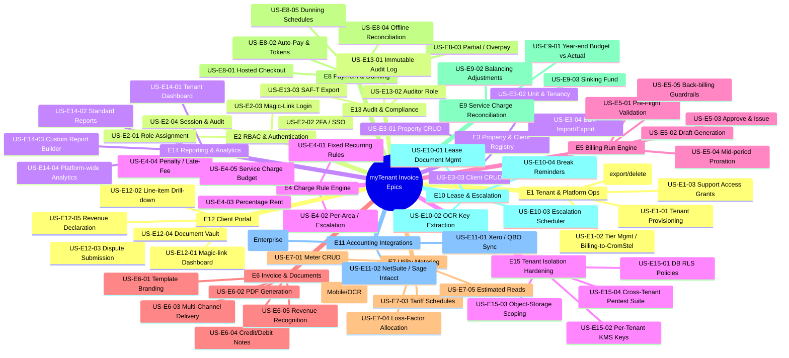

# myTenant Invoice — User Stories

> Document ID: MTI-US-006 | Version: 1.0 | Owner: CromStel IT Group — Product Manager | Status: APPROVED | Last Updated: 2026-09-20
>
> *Format: Standard Connextra template **"As a [persona], I want [action], so that [outcome]."** Each story is tagged with: Epic, Persona(s), FR/BR/NFR trace, Acceptance Criteria link, Story Points (Fibonacci), Delivery Phase. Stories are sorted by Epic.
> Cross-references: [Personas](./personas.md) · [Functional Requirements](./functional-requirements.md) · [Acceptance Criteria](./acceptance-criteria.md) · [Product Roadmap](./product-roadmap.md)*

---

## 0. Epic Map

---

## 1. Epic E1 — Tenant & Platform Operations

CromStel-side management of tenant organisations (onboarding, tier, billing-to-CromStel, support access).

| Story ID | User Story | Persona | FR/BR Trace | Acceptance Criteria Link | Points | Phase |
|---|---|---|---|---|---|---|
| US-E1-01 | **As a PLATFORM_ADMIN, I want to provision a new tenant organisation with a selected tier, region, and default currency in < 2 minutes, so that new customers can start onboarding the same day.** | PLATFORM_ADMIN | FR-TR-001 … 003, 006; BR-COM-01 | [AC-E1-01](./acceptance-criteria.md#ac-e1-01-tenant-provisioning) | 8 | MVP |
| US-E1-02 | **As a PLATFORM_ADMIN, I want the system to auto-calculate per-tenant surcharges (active units) and generate a monthly CromStel invoice to each tenant org, so that CromStel revenue is billed correctly without manual spreadsheets.** | PLATFORM_ADMIN | BR-COM-03 | [AC-E1-02](./acceptance-criteria.md#ac-e1-02-tier-surcharge-billing) | 13 | MVP |
| US-E1-03 | **As an ORG_OWNER, I want to grant time-bound, scope-bound read or write access to a specific CROMSTEL_SUPPORT engineer for a named support ticket, so that support can debug issues without me having to share passwords or screenshare for hours.** | ORG_OWNER, CROMSTEL_SUPPORT | FR-RBAC-005, NFR-ISL-010, BR-AUD-01 | [AC-E1-03](./acceptance-criteria.md#ac-e1-03-support-access-grants) | 13 | MVP |
| US-E1-04 | **As an ORG_OWNER, I want to initiate a full structured export of all my tenant data (invoices, clients, meter reads, payments) as a password-encrypted JSON/CSV/PDF zip, so that I can move systems or satisfy a DSAR without calling CromStel.** | ORG_OWNER | FR-TR-008, BR-LEG-04 | [AC-E1-04](./acceptance-criteria.md#ac-e1-04-self-serve-data-export) | 8 | MVP |
| US-E1-05 | **As a SUPER_ADMIN, I want a platform-level view of tenants with status (TRIAL/ACTIVE/SUSPENDED), tier, ARR, error-budget consumption, and CROMSTEL_SUPPORT grant counts, so I can assess platform health in a 5-minute weekly review.** | SUPER_ADMIN | FR-RPT-004, NFR-ISL-011 | [AC-E1-05](./acceptance-criteria.md#ac-e1-05-super-admin-console) | 13 | Growth |
| US-E1-06 | **As an ORG_OWNER, I want to (a) cancel my subscription at end of period, (b) request immediate account purge (subject to retention rules), and (c) see a countdown to deletion on my settings page, so that I am in control of my data lifecycle.** | ORG_OWNER | FR-TR-009, BR-COM-06, 07 | [AC-E1-06](./acceptance-criteria.md#ac-e1-06-subscription-cancellation--data-retention) | 8 | MVP |
| US-E1-07 | **As an ORG_OWNER (Enterprise), I want to create sub-organisations with independent user bases and strict data isolation, while rolling up financial reporting to my parent-tenant view and receiving a single consolidated CromStel invoice, so that my multi-entity group can share one platform without sibling cross-contamination.** | ORG_OWNER (ENT) | FR-TR-005, BR-COM-05 | [AC-E1-07](./acceptance-criteria.md#ac-e1-07-enterprise-sub-organisations) | 21 | Scale |

---

## 2. Epic E2 — RBAC & Authentication

| Story ID | User Story | Persona | FR/BR Trace | AC Link | Points | Phase |
|---|---|---|---|---|---|---|
| US-E2-01 | **As an ORG_OWNER, I want to invite team members by email and assign exactly one role (ORG_OWNER / FINANCE_MANAGER / PROPERTY_MANAGER / AUDITOR), revoke access, and see a full access list at any time, so that I enforce least privilege within my organisation.** | ORG_OWNER | FR-RBAC-001 … 005, FR-TR-002 | [AC-E2-01](./acceptance-criteria.md#ac-e2-01-role-assignment--invites) | 8 | MVP |
| US-E2-02 | **As a FINANCE_MANAGER (privileged role), I want to be forced to set up TOTP/WebAuthn 2FA on first login and given 8 one-time backup codes, so that even if my password is stolen, my account (and all invoice data) stays locked.** | FINANCE_MANAGER / ORG_OWNER / PLATFORM_ADMIN / SUPER_ADMIN | NFR-SEC-002 | [AC-E2-02](./acceptance-criteria.md#ac-e2-02-2fa-mandatory-for-privileged-roles) | 8 | MVP |
| US-E2-03 | **As a CLIENT, I want to log in via a one-time magic link emailed to me (no password required) and remain logged in for 30 days, so that paying an invoice never means "I forgot my password" friction.** | CLIENT | FR-CP-001, NFR-SEC-001 | [AC-E2-03](./acceptance-criteria.md#ac-e2-03-client-magic-link-login) | 5 | MVP |
| US-E2-04 | **As an ORG_OWNER (Enterprise), I want all my internal staff (ORG_OWNER/FINANCE/PROPERTY) to log in via my company's Azure AD/Okta SSO with auto-provisioning (SCIM 2.0), so that when a person leaves the company, myTenant Invoice access is revoked within 1 minute — no manual offboarding emails.** | ORG_OWNER (ENT) | NFR-SEC-005 | [AC-E2-04](./acceptance-criteria.md#ac-e2-04-enterprise-sso--scim) | 13 | Enterprise |
| US-E2-05 | **As an ORG_OWNER, I want to see a list of all active sessions for my tenant org (user, device, IP, last activity, login geo) and remotely revoke any session with one click, so that stolen-device scenarios are mitigated within seconds.** | ORG_OWNER | FR-AUD-001, NFR-SEC-001 | [AC-E2-05](./acceptance-criteria.md#ac-e2-05-session-management--revocation) | 8 | Growth |

---

## 3. Epic E3 — Property & Client Registry

| Story ID | User Story | Persona | FR/BR Trace | AC Link | Points | Phase |
|---|---|---|---|---|---|---|
| US-E3-01 | **As a PROPERTY_MANAGER, I want to create a Property with its address, default billing day, currency, and tax jurisdiction, then add Units under it (number, floor, area sqm/sqft, use-type), so that my portfolio structure matches the real world.** | PROPERTY_MANAGER, ORG_OWNER | FR-PR-001, 002 | [AC-E3-01](./acceptance-criteria.md#ac-e3-01-property--unit-registry-crud) | 8 | MVP |
| US-E3-02 | **As a PROPERTY_MANAGER, I want to record a Tenancy linking a Client ↔ Unit with start/end dates, rent-free weeks, break date, and lease-document PDF, plus auto-suggest the correct Charge Rule template (FR-CR-001) based on unit type, so that setting up a new lessee takes < 5 minutes instead of 20.** | PROPERTY_MANAGER | FR-PR-004 | [AC-E3-02](./acceptance-criteria.md#ac-e3-02-tenancy-setup--lease-linking) | 13 | MVP |
| US-E3-03 | **As a FINANCE_MANAGER, I want to create and edit Client records (legal/trading name, billing address, email, tax ID(s), payment terms Net7/14/30/60, preferred delivery method email/portal/post), with all PII fields visibly marked "encrypted at rest" in the UI, so that I am confident client data is protected.** | FINANCE_MANAGER | FR-PR-003, NFR-ISL-005, NFR-SEC-102 | [AC-E3-03](./acceptance-criteria.md#ac-e3-03-client-crud--pii-indicators) | 8 | MVP |
| US-E3-04 | **As a FINANCE_MANAGER, I want to bulk-import 2,000 rows of Property/Unit/Client/Tenancy from a CSV with a downloadable template, see a row-by-row validation report (pass/fail + reason), and fix errors by re-uploading a partial correction file, so that migrating from my old system takes 1 afternoon, not 2 weeks.** | FINANCE_MANAGER, ORG_OWNER | FR-PR-005 | [AC-E3-04](./acceptance-criteria.md#ac-e3-04-bulk-import--export-with-validation) | 13 | MVP |
| US-E3-05 | **As a PROPERTY_MANAGER, I want a "Move Tenant Out" wizard that sets the tenancy end-date, triggers mid-period proration on all Fixed Recurring charge rules, optionally schedules meter final reads, and queues a final invoice, so that vacate procedures are standardised and nothing falls through the cracks.** | PROPERTY_MANAGER | FR-BR-008, BR-PROP-01 | [AC-E3-05](./acceptance-criteria.md#ac-e3-05-move-in--move-out-wizards) | 8 | Growth |

---

## 4. Epic E4 — Charge Rule Engine

| Story ID | User Story | Persona | FR/BR Trace | AC Link | Points | Phase |
|---|---|---|---|---|---|---|
| US-E4-01 | **As a FINANCE_MANAGER, I want to create a Fixed Recurring charge rule (monthly/quarterly/annual amount, currency, GL code, prorate-on-midperiod-change toggle), attach it to a Tenancy, and see it produce a line in the next billing run, so that I can automate the 60% of invoice lines that are fixed rent or service charge.** | FINANCE_MANAGER, ORG_OWNER | FR-CR-001, FR-CR-102 | [AC-E4-01](./acceptance-criteria.md#ac-e4-01-fixed-recurring-charge-rules) | 8 | MVP |
| US-E4-02 | **As a FINANCE_MANAGER, I want to define an annual Escalation Clause on a Fixed Recurring rule (CPI/RPI index feed / fixed 3% / stepped table) with 60-day-preview-and-approval before activation, so that lease escalators are applied correctly, on time, and auditable (no more missed or wrong escalations).** | FINANCE_MANAGER | FR-CR-008, FR-LS-003, BR-PROP-01 | [AC-E4-02](./acceptance-criteria.md#ac-e4-02-escalation-clauses--indexation) | 13 | Growth |
| US-E4-03 | **As an ORG_OWNER (retail/F&B portfolio), I want a Percentage Rent / Turnover charge rule: tenant pays base + % of gross revenue above a breakpoint; CLIENT declares revenue via portal; system computes, so that 45 retail units don't mean 45 manual calculations each quarter.** | ORG_OWNER (ENT/Pro), FINANCE_MANAGER, CLIENT | FR-CR-003, FR-CP-005, BR-PROP-02 | [AC-E4-03](./acceptance-criteria.md#ac-e4-03-percentage-rent--turnover) | 13 | Growth |
| US-E4-04 | **As a FINANCE_MANAGER, I want a tenant-configurable Late-Fee / Penalty rule (fixed $ OR % of overdue, min $, cap $, grace days) that fires automatically per the dunning schedule, plus an option to waive per-client per-invoice with audited reason, so that my AR team doesn't have to calculate penalties on a spreadsheet.** | FINANCE_MANAGER | FR-CR-007, FR-PY-010, TG-2 | [AC-E4-04](./acceptance-criteria.md#ac-e4-04-late-fee--penalty-rules) | 8 | MVP |
| US-E4-05 | **As a FINANCE_MANAGER, I want a Service-Charge Budget rule: per Property, per fiscal year, category-by-category budget ($), allocation method (equal / area-weighted / custom-weight), and automatic monthly/quarterly instalments, so that the 6-month actual-vs-budget reconciliation can be automated later.** | FINANCE_MANAGER | FR-CR-005, FR-SC-001, BR-PROP-03 | [AC-E4-05](./acceptance-criteria.md#ac-e4-05-service-charge-budgets--instalments) | 13 | Growth |
| US-E4-06 | **As a FINANCE_MANAGER, I want every charge rule to be versioned (update = new version with effective_from date, prior versions preserved), with a clickable diff showing what changed by whom, so I can reproduce any invoice, for any period, for any audit, 7 years later.** | FINANCE_MANAGER, ORG_OWNER, AUDITOR | FR-CR-101, BR-LEG-03 | [AC-E4-06](./acceptance-criteria.md#ac-e4-06-charge-rule-versioning--audit-diff) | 8 | MVP |

---

## 5. Epic E5 — Billing Run Engine

| Story ID | User Story | Persona | FR/BR Trace | AC Link | Points | Phase |
|---|---|---|---|---|---|---|
| US-E5-01 | **As a FINANCE_MANAGER, I want to run a Pre-Flight Validation of a billing period and see a structured list of: (a) missing meter reads with affected units, (b) missing revenue declarations, (c) expired tenancies, (d) charge rules nearing end-date, then choose "proceed with warnings" or "abort", so that I never run a billing batch blind.** | FINANCE_MANAGER | FR-BR-004 | [AC-E5-01](./acceptance-criteria.md#ac-e5-01-billing-pre-flight-validation) | 8 | MVP |
| US-E5-02 | **As a FINANCE_MANAGER, I want to trigger Draft generation for a period, watch a live progress bar (%), see summary counts (n units, n lines, n invoices, n warnings, n errors), then browse draft invoices before approval, so that I catch issues before 2,500 clients receive them.** | FINANCE_MANAGER | FR-BR-001 … 003, NFR-PERF-010 | [AC-E5-02](./acceptance-criteria.md#ac-e5-02-draft-billing-run--progress) | 13 | MVP |
| US-E5-03 | **As an ORG_OWNER or FINANCE_MANAGER, I want to Approve a billing batch (or approve per-invoice after edits), which transitions DRAFT → ISSUED, assigns gapless invoice numbers, generates signed PDFs, and triggers delivery per client preference (email/portal/post/e-invoice), so that month-end can be signed off in one click after review.** | FINANCE_MANAGER, ORG_OWNER | FR-INV-001 … 005, FR-BR-001 step F | [AC-E5-03](./acceptance-criteria.md#ac-e5-03-batch-approve--issue) | 13 | MVP |
| US-E5-04 | **As a FINANCE_MANAGER, when a tenancy starts on 14th or ends on 22nd, I want Fixed Recurring / Per-Area charges to be automatically prorated by day-fraction-of-period (unless the rule disables proration), with the proration clearly labelled on the invoice line, so that no client ever calls asking "why isn't this a full month".** | FINANCE_MANAGER, CLIENT | FR-BR-008 | [AC-E5-04](./acceptance-criteria.md#ac-e5-04-midperiod-proration) | 5 | MVP |
| US-E5-05 | **As a FINANCE_MANAGER, if someone corrects a meter read or tenancy from 3 months ago, I want the system to refuse to modify an already-ISSUED invoice; instead, it must generate a debit/credit note, respect a "no back-bill beyond 12 months" guardrail (UK Ofgem), and explicitly flag the correction for ORG_OWNER sign-off above a threshold, so that we stay within the law.** | FINANCE_MANAGER, ORG_OWNER | FR-BR-006, BR-UTL-004, FR-INV-006 | [AC-E5-05](./acceptance-criteria.md#ac-e5-05-back-billing-guardrails) | 13 | Growth |

---

## 6. Epic E6 — Invoice & Document Generator

| Story ID | User Story | Persona | FR/BR Trace | AC Link | Points | Phase |
|---|---|---|---|---|---|---|
| US-E6-01 | **As an ORG_OWNER, I want to brand my invoice templates with my logo, accent colours, header/footer text, bank payment details, custom terms-and-conditions, and a selection of 3 default layouts (Standard, Commercial Detailed, Utility Itemised), so that every invoice leaving the system looks like "us", not "CromStel".** | ORG_OWNER | FR-INV-003 | [AC-E6-01](./acceptance-criteria.md#ac-e6-01-invoice-template-branding) | 8 | MVP |
| US-E6-02 | **As an ORG_OWNER (Enterprise), I want to upload my own Handlebars+HTML custom invoice template, preview it with sample data, and run a validation that rejects any template capable of injecting raw unescaped HTML into the rendered PDF, so that my 40-year-old group invoicing format is preserved and safe.** | ORG_OWNER (ENT) | FR-INV-003, NFR-SEC-202 | [AC-E6-02](./acceptance-criteria.md#ac-e6-02-custom-handlebars-templates-enterprise) | 13 | Scale |
| US-E6-03 | **As a FINANCE_MANAGER, I want every ISSUED invoice to become a digitally-signed PDF/A-1b document, stored in my tenant's object-storage prefix with a SHA-256 hash recorded in the audit log, so that if I need to prove an invoice was not tampered with, I can do so in 30 seconds.** | FINANCE_MANAGER, AUDITOR | FR-INV-004, FR-AUD-002, 003 | [AC-E6-03](./acceptance-criteria.md#ac-e6-03-pdfa--digital-signatures--hashing) | 8 | MVP |
| US-E6-04 | **As a FINANCE_MANAGER, I want each invoice delivered based on Client preference: EMAIL (PDF + portal link, with tenant-branded sender domain SPF/DKIM/DMARC), PORTAL (in-app notification), POST (batch to print-and-post partner API), or E-INVOICING (Peppol BIS 3 / FacturaE / ZUGFeRD), and have every delivery status logged (sent, delivered, opened, viewed, failed), so that I can prove a document was sent — and see when it was opened.** | FINANCE_MANAGER | FR-INV-005, BR-FIN-02 | [AC-E6-04](./acceptance-criteria.md#ac-e6-04-multi-channel-delivery--tracking) | 13 | Growth |
| US-E6-05 | **As a FINANCE_MANAGER, I want to raise a Credit Note referencing an original invoice (or standalone), or a Debit Note, both following the same numbering sequence, PDF signing, and delivery rules — and never be allowed to edit a paid invoice; corrections always produce a new note, so that audit trail is gapless.** | FINANCE_MANAGER | FR-INV-006, BR-FIN-02 | [AC-E6-05](./acceptance-criteria.md#ac-e6-05-credit--debit-notes) | 8 | MVP |
| US-E6-06 | **As a FINANCE_MANAGER, I want the system to automatically split invoice-line amounts into earned-vs-deferred per ASC 606 / IFRS 15 (per-day amortisation schedule), produce a Deferred Income Roll-Forward report monthly, and push manual journals to my accounting system, so that my external accounts are audit-ready without manual JEs.** | FINANCE_MANAGER, ORG_OWNER | FR-INV-007, BR-FIN-01 | [AC-E6-06](./acceptance-criteria.md#ac-e6-06-revenue-recognition-schedules) | 13 | Growth |

---

## 7. Epic E7 — Utility Metering Module

| Story ID | User Story | Persona | FR/BR Trace | AC Link | Points | Phase |
|---|---|---|---|---|---|---|
| US-E7-01 | **As a PROPERTY_MANAGER, I want to create a Meter record (serial, commodity: electric/water/gas/HVAC/data, UOM, master/sub flag, parent meter, unit link, read frequency) under a Property or Unit, so that meter topology exactly matches the site.** | PROPERTY_MANAGER | FR-UTL-001 | [AC-E7-01](./acceptance-criteria.md#ac-e7-01-meter-register) | 5 | MVP (add-on) |
| US-E7-02 | **As a PROPERTY_MANAGER on-site, I want to capture a meter read via mobile: open app → tap "Read" → take photo → auto-OCR the dial → confirm or correct → optional offline capture that syncs later, with each read stored with photo, GPS, and user stamp, so that a read takes ≤ 30 seconds and every read has evidence.** | PROPERTY_MANAGER | FR-UTL-003, 004 | [AC-E7-02](./acceptance-criteria.md#ac-e7-02-mobile-meter-read--ocr--offline) | 13 | MVP (add-on) |
| US-E7-03 | **As a FINANCE_MANAGER, I want to build a tariff schedule per meter type: flat rate / increasing-block tiers / time-of-use (peak/offpeak/shoulder windows × days) / seasonal multipliers / demand charges — all versioned and auditable — so that my utility bills automatically charge the correct $/kWh for 4 different tariff periods per commercial unit.** | FINANCE_MANAGER | FR-UTL-002, BR-UTL-02 | [AC-E7-03](./acceptance-criteria.md#ac-e7-03-tariff-schedules--tiers) | 21 | Growth (add-on) |
| US-E7-04 | **As a FINANCE_MANAGER, I want the difference between master-meter and sum-of-sub-meters to be automatically allocated to sub-metered units as Loss-Adjustment line (default: pro-rata by consumption; override: by floor area), so that 3–8% of utility cost currently written off hits the correct sub-tenants.** | FINANCE_MANAGER | FR-BR-005, BR-UTL-003 | [AC-E7-04](./acceptance-criteria.md#ac-e7-04-loss-factor--uplift-allocation) | 13 | Growth (add-on) |
| US-E7-05 | **As a FINANCE_MANAGER, when no meter read arrives for a period, I want an ESTIMATED read computed (default: rolling-3-month avg × seasonal index), clearly marked "ESTIMATED" on the invoice with a banner warning, and automatically reconciled (delta correction line) on the next actual read, so that billing never stalls just because a meter was missed.** | FINANCE_MANAGER, CLIENT | FR-BR-007, BR-UTL-05 | [AC-E7-05](./acceptance-criteria.md#ac-e7-05-estimated-reads--auto-reconciliation) | 13 | MVP (add-on) |
| US-E7-06 | **As a FINANCE_MANAGER, I want to ingest meter reads in bulk (CSV/Excel), via MQTT (AMR/AMI smart meter feed), or HTTPS webhook, and have every read routed through a validation pipeline that flags sequential-regression / >3σ-outlier / impossible-date reads into a PROPERTY_MANAGER review queue, so that bad reads never produce bad bills.** | FINANCE_MANAGER, PROPERTY_MANAGER | FR-UTL-003, 004 | [AC-E7-06](./acceptance-criteria.md#ac-e7-06-bulk--api-read-ingestion--validation-pipeline) | 13 | Growth (add-on) |

---

## 8. Epic E8 — Payment & Dunning

| Story ID | User Story | Persona | FR/BR Trace | AC Link | Points | Phase |
|---|---|---|---|---|---|---|
| US-E8-01 | **As a CLIENT, I want to open an invoice email → click "View & Pay" → auto-logged-in via magic-link → see a hosted payment field (Stripe Elements / Adyen Drop-in) supporting card, Apple Pay, Google Pay, ACH, SEPA, Direct Debit UK, iDEAL, Sofort, PayPal — pay in ≤ 3 clicks total, and get a receipt PDF instantly emailed, so that I never need to remember a password or pick up the phone.** | CLIENT | FR-PY-001 … 003, FR-PY-006, NFR-SEC-002 (PCI) | [AC-E8-01](./acceptance-criteria.md#ac-e8-01-one-click-checkout--hosted-payment-fields) | 13 | MVP |
| US-E8-02 | **As a CLIENT, I want to enable Auto-Pay on a saved token: system charges my full balance due on the due date (or +grace days if set), failures retry 3 times over 7 days with email warnings, and I can cancel any time before next due date, so that my invoices are paid without me ever opening an email.** | CLIENT | FR-PY-004, FR-CP-008 | [AC-E8-02](./acceptance-criteria.md#ac-e8-02-auto-pay--token-vault) | 8 | MVP |
| US-E8-03 | **As a FINANCE_MANAGER, I want to accept partial payments, allocate them to specific invoices (default FIFO, re-allocatable), track overpayments as unallocated credit and auto-apply to next invoice, and record refunds (with 2-eyes approval over $5,000 via ORG_OWNER), so that every weird real-world payment scenario is handled.** | FINANCE_MANAGER, ORG_OWNER | FR-PY-005, 006 | [AC-E8-03](./acceptance-criteria.md#ac-e8-03-partial-payments--overpayments--refunds) | 13 | MVP |
| US-E8-04 | **As a FINANCE_MANAGER, I want to daily upload a bank statement (CSV/MT940), let the system fuzzy-match statement lines against outstanding invoices (amount ± tolerance, date ± 3 days, reference string), auto-confirm matches ≥ 95% confidence, route low-confidence ones to me for 1-click approve/reject, so that bank reconciliation drops from 2.5 hours to < 30 minutes per day.** | FINANCE_MANAGER | FR-PY-009 | [AC-E8-04](./acceptance-criteria.md#ac-e8-04-bank-auto-reconciliation-import--match) | 13 | Growth |
| US-E8-05 | **As a FINANCE_MANAGER, I want to configure a dunning schedule per client segment (commercial default / residential / key account) with a timeline of: email at day 1, SMS at day 8, firm letter + late fee at day 15, final notice + credit hold at day 30, escalate to ORG_OWNER at day 45, plus a button to pause/snooze per-client during a goodwill negotiation, so that dunning runs on autopilot and we consistently recover 15% more overdue revenue.** | FINANCE_MANAGER, ORG_OWNER | FR-PY-010, 011, 012 | [AC-E8-05](./acceptance-criteria.md#ac-e8-05-dunning-schedule--collections-automation) | 13 | MVP |

---

## 9. Epic E9 — Service-Charge Reconciliation

| Story ID | User Story | Persona | FR/BR Trace | AC Link | Points | Phase |
|---|---|---|---|---|---|---|
| US-E9-01 | **As a FINANCE_MANAGER at year-end, I want to (a) enter or import actual category spend from my accounting system, (b) compare to budget, (c) per-unit calculate balancing adjustment = (actual × weight) − instalments paid, and preview per-client debit/credit before generating, so that the 4 weeks of HELL that is service-charge year-end drops to < 1 week.** | FINANCE_MANAGER, ORG_OWNER | FR-SC-002, 003, BR-PROP-03 | [AC-E9-01](./acceptance-criteria.md#ac-e9-01-year-end-actual-vs-budget-reconciliation) | 21 | Scale |
| US-E9-02 | **As a CLIENT receiving a reconciliation, I want to download a Reconciliation Statement PDF with category-by-category actual-vs-budget, a list of supporting contractor invoice references (clickable links to my document vault), and a clear "You are due £340 credit / You owe £210" summary, so that I stop calling PROPERTY_MANAGER every August demanding copies of 200 receipts.** | CLIENT, FINANCE_MANAGER | FR-SC-003, FR-CP-007 | [AC-E9-02](./acceptance-criteria.md#ac-e9-02-reconciliation-statements--supporting-evidence) | 13 | Scale |
| US-E9-03 | **As an ORG_OWNER, I want contributions and expenditures on Sinking / Reserve Funds tracked per property, draw-downs requiring ORG_OWNER double-sign-off, a running balance report, and separation from revenue-operating accounts in accounting exports, so that my RICS/ARMA-compliant reserve accounting is audit-ready.** | ORG_OWNER, FINANCE_MANAGER, AUDITOR | FR-SC-004 | [AC-E9-03](./acceptance-criteria.md#ac-e9-03-sinking--reserve-funds) | 13 | Scale |

---

## 10. Epic E10 — Lease & Escalation Management

| Story ID | User Story | Persona | FR/BR Trace | AC Link | Points | Phase |
|---|---|---|---|---|---|---|
| US-E10-01 | **As a PROPERTY_MANAGER, I want to upload a signed lease PDF to a Tenancy, OCR-search it later, and have 1-click share with the CLIENT in their document vault, so that lease docs are never lost in email and every dispute references the same document.** | PROPERTY_MANAGER, CLIENT | FR-LS-001 | [AC-E10-01](./acceptance-criteria.md#ac-e10-01-lease-document-storage--ocr) | 8 | Growth |
| US-E10-02 | **As a PROPERTY_MANAGER, after uploading a lease PDF, I want the system to run OCR key-extraction (dates, rent, escalation schedule, break options, service-charge method), show the extracted structured form, and let me review/edit/confirm each field before writing to Tenancy + Charge Rule records, so that setting up a 100-unit portfolio drops from 2 weeks to 2 days.** | PROPERTY_MANAGER, ORG_OWNER | FR-LS-002, BR-PROP-04 | [AC-E10-02](./acceptance-criteria.md#ac-e10-02-lease-ocr-key-extraction--review) | 21 | Scale |
| US-E10-03 | **As a FINANCE_MANAGER, I want an Escalation Scheduler that nightly checks for escalators hitting within 60 days, generates a preview "New charge amount = £X, effective 1 Jan 2027" per unit, sends me an alert with 1-click approve, and logs my approval in audit with identity, so that lease escalators are never applied wrong or missed.** | FINANCE_MANAGER | FR-LS-003, FR-CR-008 | [AC-E10-03](./acceptance-criteria.md#ac-e10-03-escalation-preview--approval-alerts) | 13 | Growth |
| US-E10-04 | **As a PROPERTY_MANAGER, I want a Task raised for me exactly 6 months before a lease break date with a checklist (confirm tenant intent: renew / vacate / negotiate → start marketing → get new tenant lined up), plus a dashboard "Lease expiring in next 90/180 days" widget, so that vacancy rates drop 2% and I never lose a good tenant to surprise.** | PROPERTY_MANAGER, ORG_OWNER | FR-LS-004, FR-RPT-001 | [AC-E10-04](./acceptance-criteria.md#ac-e10-04-break-option--lease-renewal-reminders) | 8 | Growth |

---

## 11. Epic E11 — Accounting Integrations

| Story ID | User Story | Persona | FR/BR Trace | AC Link | Points | Phase |
|---|---|---|---|---|---|---|
| US-E11-01 | **As a FINANCE_MANAGER, I want to map my myTenant Invoice GL codes to my Xero/QuickBooks Online chart of accounts in a UI wizard (with test-sync of 3 invoices), then automatically push: invoices → Sales Invoices, payments → Receipts, credit notes → Credit Notes, WHT/FX → Journals, with per-job success/failure report and retry, so that I stop manually keying 1,200 invoices/month into Xero.** | FINANCE_MANAGER | FR-ACC-001, 002, 003 | [AC-E11-01](./acceptance-criteria.md#ac-e11-01-xero--qbo-integration) | 13 | Growth |
| US-E11-02 | **As a FINANCE_MANAGER (Enterprise), I want native NetSuite / Sage Intacct / SAP Business One sync with the same mapping model, plus an on-premise-agent option for the SAP case, so that my $10M+ revenue company's accounting system connects natively.** | FINANCE_MANAGER (ENT) | FR-ACC-001, 002 | [AC-E11-02](./acceptance-criteria.md#ac-e11-02-netsuite--sage-intacct--sap-b1-enterprise) | 21 | Enterprise |
| US-E11-03 | **As a FINANCE_MANAGER (Enterprise), I want to pull service-charge category actuals FROM NetSuite/Sage Intacct back INTO myTenant Invoice to power the year-end reconciliation (E9-01), with ORG_OWNER-approved OAuth scope, so that I don't have to re-export/import 500 lines of category spend manually.** | FINANCE_MANAGER (ENT), ORG_OWNER | FR-ACC-004 | [AC-E11-03](./acceptance-criteria.md#ac-e11-03-two-way-sync-for-service-charge-actuals) | 21 | Enterprise |

---

## 12. Epic E12 — End-Client Portal

| Story ID | User Story | Persona | FR/BR Trace | AC Link | Points | Phase |
|---|---|---|---|---|---|---|
| US-E12-01 | **As a CLIENT, I want a self-serve dashboard where I can see: current balance, next invoice amount + due date, 6-month invoicing trend, payment history, open disputes, and a big "Pay £X" button, so that I always know exactly where I stand without calling anyone.** | CLIENT | FR-CP-002, TG-3 | [AC-E12-01](./acceptance-criteria.md#ac-e12-01-client-self-serve-dashboard) | 13 | MVP |
| US-E12-02 | **As a CLIENT, I want to click any line on any invoice and expand it to see: (a) source charge-rule name, (b) for metered lines — meter photos, prior/current reads, tariff math, loss-adjustment share, (c) for fixed lines — tenancy reference, proration if any, escalator history, so that "why is this line £480?" is answered by the system, not a 3-day email chain.** | CLIENT, PROPERTY_MANAGER | FR-CP-003, TG-3 | [AC-E12-02](./acceptance-criteria.md#ac-e12-02-line-item-drill-down--evidence) | 13 | MVP |
| US-E12-03 | **As a CLIENT, if I disagree with a line, I want to click "Dispute this line", select a reason (wrong quantity / wrong rate / meter read / wrong recipient / other), add a free-text comment and up to 3 attachments, and see a live status (OPEN / IN_REVIEW / RESOLVED / REJECTED) with a timeline of who said what, so that disputes are resolved in < 48 hours (SLA tracked) instead of dragging for weeks.** | CLIENT, PROPERTY_MANAGER, FINANCE_MANAGER | FR-CP-004, TG-3 | [AC-E12-03](./acceptance-criteria.md#ac-e12-03-dispute-submission--tracking) | 13 | MVP |
| US-E12-04 | **As a CLIENT, I want a Document Vault with every invoice, credit note, receipt, lease document, reconciliation statement, and notice — downloadable singly or bulk-zip per tax year — 24/7, no expiry, so that when my accountant asks for "all 2026 receipts", I'm done in 10 seconds.** | CLIENT | FR-CP-007, BR-LEG-04 | [AC-E12-04](./acceptance-criteria.md#ac-e12-04-document-vault--bulk-export) | 8 | MVP |
| US-E12-05 | **As a CLIENT (F&B/retail on percentage rent), I want a secure widget to submit my monthly/quarterly gross revenue declaration, upload my POS-report PDF, get a reminder 5 days before the declaration deadline, and see how my declaration feeds into my percentage-rent line, so that declarations stop being "email an Excel attachment with no receipt".** | CLIENT, FINANCE_MANAGER | FR-CP-005, FR-CR-003 | [AC-E12-05](./acceptance-criteria.md#ac-e12-05-revenue-declaration-percentage-rent) | 8 | Growth |
| US-E12-06 | **As an ORG_OWNER (White-Label add-on, Enterprise), I want to serve the client portal from my own domain (billing.mycompany.com) with my logo, palette, typography, sender email, and zero CromStel branding visible, so that my clients never know we use a 3rd-party billing platform — we look big, professional, and in-house.** | ORG_OWNER (ENT + add-on) | FR-CP-009 | [AC-E12-06](./acceptance-criteria.md#ac-e12-06-white-label-portal--branding-enterprise--add-on) | 13 | Scale |

---

## 13. Epic E13 — Audit & Compliance

| Story ID | User Story | Persona | FR/BR Trace | AC Link | Points | Phase |
|---|---|---|---|---|---|---|
| US-E13-01 | **As an ORG_OWNER, I want every state mutation (create/update/delete/void/export/login) to produce an immutable, hash-chained audit row (actor, role, timestamp, ip, before/after payload, tenant_id), with a one-click UI to verify the chain integrity for a date range, so that auditors sign off in 2 weeks instead of 8.** | ORG_OWNER, AUDITOR, SUPER_ADMIN | FR-AUD-001, 002, 003 | [AC-E13-01](./acceptance-criteria.md#ac-e13-01-immutable-hash-chained-audit-log) | 13 | MVP |
| US-E13-02 | **As an ORG_OWNER, I want to invite my external auditor for a 6-week, read-only, PII-anonymised view of invoices, payments, adjustments, meter reads, and the full audit log, and revoke that access at any time — without calling CromStel, so that audit season is self-service for me and for them.** | ORG_OWNER, AUDITOR | FR-RBAC-005 (AUDITOR role), BR-AUD-02 | [AC-E13-02](./acceptance-criteria.md#ac-e13-02-auditor-role--pii-anonymised-read-only) | 8 | Growth |
| US-E13-03 | **As a FINANCE_MANAGER in Portugal / Poland / Lithuania / Norway, I want to export my fiscal period's invoices, payments, and master-data in jurisdiction-specific SAF-T XML format (v2.x), pass the tax authority's schema validator, and get a log of what was exported, so that I can file on time without re-keying to a third-party SAF-T tool.** | FINANCE_MANAGER, ORG_OWNER | FR-INV-008, BR-FIN-05 | [AC-E13-03](./acceptance-criteria.md#ac-e13-03-saf-t-export--tax-authority-schemas) | 21 | Scale |

---

## 14. Epic E14 — Reporting & Analytics

| Story ID | User Story | Persona | FR/BR Trace | AC Link | Points | Phase |
|---|---|---|---|---|---|---|
| US-E14-01 | **As an ORG_OWNER, I want a Tenant Dashboard showing: invoiced MTD vs. budget, collections rate, DSO, dispute rate, auto-pay adoption, top-10 overdue, billing accuracy % — all click-through to underlying lists — so that my Monday morning review takes 10 minutes and I always know the 3 problems I need to tackle first.** | ORG_OWNER | FR-RPT-001 | [AC-E14-01](./acceptance-criteria.md#ac-e14-01-tenant-executive-dashboard) | 13 | MVP |
| US-E14-02 | **As a FINANCE_MANAGER, I want one-click standard reports (CSV/PDF, email-schedulable): Aged Debtors, Trial Balance Summary, Deferred Income Roll-Forward, Tax Summary by jurisdiction, Meter Consumption vs Budget, Service-Charge Budget vs Actual, Lease Renewal Pipeline (90/180 days), so that every recurring board-report request is pre-built.** | FINANCE_MANAGER, ORG_OWNER | FR-RPT-002 | [AC-E14-02](./acceptance-criteria.md#ac-e14-02-standard-report-library) | 13 | Growth |
| US-E14-03 | **As an ORG_OWNER (Enterprise), I want a drag-and-drop Custom Report Builder with saved views, scheduled email delivery (PDF/CSV), and every report auto-filtered to my tenant's rows (via RLS at query time), so that the weird one-off board request "show me total service-charge by quarter by property type for 2024-2026" is answered in 2 minutes, not 8 hours of Excel.** | ORG_OWNER (ENT), FINANCE_MANAGER (ENT) | FR-RPT-003 | [AC-E14-03](./acceptance-criteria.md#ac-e14-03-custom-report-builder--scheduled-delivery-enterprise) | 21 | Scale |
| US-E14-04 | **As a SUPER_ADMIN / PLATFORM_ADMIN, I want Platform Analytics (CromStel-only) with: MRR cohort retention, feature adoption per module, support-ticket volume per tenant tier, infrastructure cost-per-tenant — ALL aggregated, no per-invoice PII, running on a separate analytics warehouse with PII stripped at ETL, so that we run CromStel's business with data, while complying with NFR-ISL-011.** | SUPER_ADMIN, PLATFORM_ADMIN | FR-RPT-004, NFR-ISL-011 | [AC-E14-04](./acceptance-criteria.md#ac-e14-04-platform-analytics-cromstel-only--no-pii) | 13 | Growth |

---

## 15. Epic E15 — Tenant Isolation Hardening

These stories deliver the isolation guarantees in [NFR §2](./non-functional-requirements.md#2-tenant-isolation-category-isl). Engineering-owned; not user-visible (except support grant UX).

| Story ID | User Story (Engineering framing) | Primary Beneficiary | FR/BR/NFR Trace | AC Link | Points | Phase |
|---|---|---|---|---|---|---|
| US-E15-01 | **As a Security Engineer, I want PostgreSQL RLS ENFORCED on every tenant-scoped table (RLS policy on `tenant_id = current_setting('app.current_tenant')`, app DB role NOBYPASSRLS, automated schema audit), so that even a raw-SQL injection inside the app cannot read across tenants.** | All end-users / CromStel | NFR-ISL-001/002 | [AC-E15-01](./acceptance-criteria.md#ac-e15-01-database-rls--nobypassrls-role) | 13 | MVP |
| US-E15-02 | **As a Security Engineer, I want every tenant organisation to have a KMS CMK alias under which the tenant data key is envelope-encrypted; PII columns encrypted AES-256-GCM with that data key; key access IAM policy scoped per tenant; full red-team test "given DB dump + generic IAM creds = PII unreadable", so that exfiltration of raw rows yields only ciphertext.** | All tenant orgs (commercial) | NFR-ISL-005, NFR-SEC-102, FR-TR-007 | [AC-E15-02](./acceptance-criteria.md#ac-e15-02-per-tenant-kms-keys--pii-encryption) | 13 | MVP |
| US-E15-03 | **As a Platform Engineer, I want per-tenant prefix isolation in object storage (S3/Azure Blob) with prefix-scoped IAM/SAS tokens; test cross-prefix ListObject returns 403; per-region bucket so EU-tenant data never writes outside EU, so that storage-layer blast radius is 1 tenant.** | All tenant orgs (GDPR) | NFR-ISL-004, NFR-ISL-012 | [AC-E15-03](./acceptance-criteria.md#ac-e15-03-object-storage-per-tenant-prefix--iam-scoping) | 8 | MVP |
| US-E15-04 | **As a Security Engineer, I want an automated cross-tenant penetration-test harness that runs every PR and weekly in staging: 180+ API endpoints with JWT-A + crafted id-B → expect 0 leaks; harness blocks deploy on failure, so that new endpoints can't accidentally bypass isolation.** | CromStel (reputation) | NFR-ISL-002, CG-7 | [AC-E15-04](./acceptance-criteria.md#ac-e15-04-automated-cross-tenant-penetration-harness) | 13 | MVP |

---

## 16. Story-Point & Phase Roll-Up

| Phase | # of Stories | Total Story Points |
|---|---|---|
| **MVP (Months 1–6)** | 55 | 520 |
| **Growth (Months 7–12)** | 29 | 312 |
| **Scale (Months 13–18)** | 16 | 281 |
| **Enterprise (Ongoing)** | 6 | 105 |
| **Grand Total** | 106 | 1,218 |

This scope aligns with a 6-engineer team delivering ~30 story points/sprint (2-week sprints) over 18 months.

---

## 17. Cross-References

| Document | Purpose |
|---|---|
| [Personas](./personas.md) | Role archetypes (Omar, Meg, Daniel, etc.) mapped to the roles above. |
| [Functional Requirements](./functional-requirements.md) | FR IDs referenced in `FR/BR Trace` column above. |
| [Acceptance Criteria](./acceptance-criteria.md) | AC-IDs linked from the `AC Link` column — testable UAT criteria per story. |
| [Use Cases](./use-cases.md) | Top-20 formal use cases (pre/post conditions, actors) for the highest-complexity stories. |
| [Product Roadmap](./product-roadmap.md) | Sprint/phase mapping + release dates for every epic. |

---

*User story grooming: Weekly backlog-refinement. Stories > 13 points split before sprint planning. Owner: myTenant Invoice Product Manager.*
