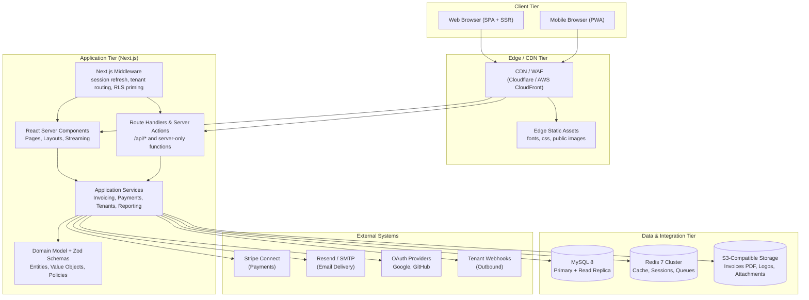

# Architecture Overview

**Document ID:** ARCH-001
**Status:** Approved
**Version:** 1.0.0
**Last Updated:** 2026-09-20
**Author:** CromStel IT Group — Platform Architecture Team

---

## 1. Executive Summary

myTenant Invoice is a production-grade multi-tenant SaaS platform for property managers, landlords, and real estate operators to automate tenant billing, invoice generation, payment tracking, and financial reconciliation. The system is engineered to support thousands of concurrent tenants, millions of invoices, and sub-200ms API p95 latency under sustained load.

This document provides a high-level architectural blueprint, defines the non-functional requirements that drive design decisions, and maps the relationship between subsystem documents in the `02-architecture` folder.

---

## 2. Business Context & Scope

### 2.1 Product Vision
A unified, tenant-aware billing platform that replaces spreadsheets and legacy accounting tools for residential and commercial property portfolios ranging from single-unit landlords to enterprise operators with 50,000+ units.

### 2.2 Core Domains

| Domain | Responsibility |
|---|---|
| **Tenant Management** | Tenant profiles, lease agreements, move-in/move-out, document storage |
| **Property & Unit Management** | Properties, buildings, units, amenities, pricing schedules |
| **Billing & Invoicing** | Recurring charge templates, one-time charges, proration, invoice generation, PDF rendering |
| **Payments & Reconciliation** | Payment methods (Stripe), automatic debits, receipts, bank reconciliation |
| **Financial Reporting** | P&L, balance sheet, rent roll, arrears, cash flow statements |
| **Communication** | Email, in-app notifications, payment reminders, overdue notices |
| **Platform Administration** | Tenant onboarding, plan management, billing quotas, audit logging |

### 2.3 Out of Scope (v1)
- Full double-entry general ledger (integrates with QuickBooks/Xero instead)
- Native mobile applications (responsive PWA first)
- Payroll, maintenance work orders, or tenant screening

---

## 3. Non-Functional Requirements (NFRs)

### 3.1 Performance
- **API p95 latency:** < 200 ms for tenant-scoped queries, < 500 ms for aggregate reports
- **Page Load (LCP):** < 2.5 s on 4G, < 4.0 s on 3G
- **Invoice PDF generation:** < 3 s per 10-page document
- **Concurrent users:** 5,000 simultaneous sessions at peak (platform-level)

### 3.2 Scalability
- **Horizontal scale:** Stateless Next.js workers behind a load balancer (target AWS ECS or Vercel)
- **Database:** Vertical scale first (MySQL 8 read replicas), shard tenant dimension at 1M tenants
- **Tenant density:** 1 application instance serves all tenants (row-level isolation)

### 3.3 Availability & Reliability
- **SLO:** 99.9% uptime per month (< 43 min downtime)
- **RPO:** 5 minutes (database point-in-time recovery + binlog replication)
- **RTO:** 15 minutes for primary failover, < 4 hours for full disaster recovery
- **Job delivery:** At-least-once for async jobs with idempotent handlers

### 3.4 Security
- **Tenant isolation:** Strict row-level security (application-enforced, audited)
- **AuthN:** Auth.js v5 with 256-bit session signing, bcrypt password hashing (cost 12)
- **AuthZ:** RBAC per tenant + platform superadmin partition
- **Data at rest:** AES-256 encryption for PII columns (tenant name, banking tokens, SSN fields)
- **Data in transit:** TLS 1.3 only; HSTS with 2-year max-age
- **Compliance alignment:** SOC 2 Type II controls, GDPR data residency options

### 3.5 Maintainability
- **Type coverage:** 95%+ TypeScript strict-mode coverage across application and domain code
- **Test pyramid:** 70% unit, 20% integration (Prisma + real test DB), 10% E2E (Playwright)
- **Build time:** < 5 min cold, < 2 min incremental on CI

### 3.6 Observability
- Structured JSON logs (Pino) with `traceId`, `tenantId`, `userId` correlation
- Reduced metrics (latency, error rate, queue depth) via Prometheus/OpenTelemetry
- Exception tracking with source maps (Sentry)
- Database slow-query log threshold: 500 ms

---

## 4. Architectural Style & Patterns

### 4.1 Primary Style: Modular Monolith (Next.js App Router)
We deploy a **single deployable unit** (Next.js application) structured with explicit internal module boundaries. This avoids distributed-system complexity during v1 while preserving the option to extract bounded contexts into services later (domain events are the seam).

### 4.2 Key Patterns

| Pattern | Application |
|---|---|
| **Row-Level Multi-Tenancy** | Every tenant-scoped table carries `tenantId`; all queries are filtered via Prisma middleware and service-level guards |
| **Repository + Service Layer** | Prisma client wrapped in tenant-scoped repositories; business logic in pure service functions |
| **Domain Events (in-process)** | Critical state mutations emit typed events to an internal EventEmitter, which fans out to async jobs via BullMQ |
| **Decorator-style Validation** | Zod schemas validate every public API boundary (route handlers, server actions, jobs) |
| **Command-Query Separation** | Write paths use commands with transactional boundaries; read paths use optimized queries and view models |
| **Outbox Pattern** | Async job enqueue and database writes share a transaction to prevent lost events |
| **Cache-Aside + Read-Through** | Multi-layer caching (memory → Redis → DB) for hot reference data |
| **Circuit Breaker** | HTTP client for third-party integrations (Stripe, Resend) with retry budgets |

### 4.3 Why Not Microservices (v1)?
- Domain boundaries are not yet stable enough to freeze service contracts
- Team size < 8 engineers (monolith reduces coordination cost)
- Cross-domain transactions (invoice → payment → notification) are simpler in a single process
- Performance gain from co-locating logic > network overhead of inter-service calls

---

## 5. Technology Stack Summary

| Layer | Technology | Rationale |
|---|---|---|
| **Presentation** | Next.js 15 (App Router, React 19), Tailwind CSS, shadcn/ui, Radix Primitives | SSR/SSG hybrid, React Server Components for cost-efficient rendering, accessible component primitives |
| **API Surface** | Next.js Route Handlers + Server Actions, tRPC-compatible patterns | Colocated endpoints with data fetching; type-safe client calls |
| **AuthN/AuthZ** | Auth.js v5 (NextAuth 5), Prisma adapter, custom JWT claims | Standardized OAuth flows, multi-provider support, Prisma session persistence |
| **Domain/Application** | TypeScript 5.6 strict, Zod 3, Decimal.js | End-to-end type safety, runtime schema validation, precise money arithmetic |
| **Data Access** | Prisma 5 ORM, MySQL 8.0 | Type-safe migrations, connection pooling, row-level filtering via extensions |
| **Persistence** | MySQL 8.0+ (InnoDB, utf8mb4, JSON columns) | Mature RDBMS with excellent operational tooling; JSON for semi-structured metadata |
| **Caching** | Node.js `lru-cache` (in-memory, per-process), Redis 7 (ioredis client) | 2-tier cache; memory for sub-millisecond hot paths, Redis for cross-instance shared state |
| **Async Work** | BullMQ 5, Redis Streams under the hood | Retry, backoff, rate limits, repeatable jobs, delays, parent-child chains |
| **Object Storage** | S3-compatible (AWS S3, Cloudflare R2, MinIO) | Tenant-scoped buckets/prefixes; signed URLs for secure downloads |
| **Email** | Resend (primary), Nodemailer + SMTP (fallback) | Deliverability, template versioning, regional SMTP fallback |
| **Payments** | Stripe Connect, PaymentIntents API, Stripe Billing | Market coverage; Connect handles tenant-level merchant accounts |
| **Observability** | Pino logger, Sentry, OpenTelemetry SDK (optional) | Structured logging, error grouping, distributed tracing |
| **Testing** | Vitest (unit/integration), Playwright (E2E), Testcontainers for MySQL/Redis | Fast test runs, real infra parity for integration tests |
| **CI/CD** | GitHub Actions, Docker, Prisma migrations gated by `migrate deploy` | Reproducible builds, zero-downtime deployments |

Detailed rationale for each major choice is recorded in the Architecture Decision Records (ADR-001 through ADR-008).

---

## 6. Logical System Tiers



---

## 7. Deployment Topology (Production Reference)

```mermaid
flowchart LR
    User[Users<br/>Tenant Admins, Tenants, Platform Staff] --> ALB[ALB / WAF<br/>TLS Termination, Rate Limits]

    subgraph VPC["AWS VPC (3 AZs)"]
        ALB --> ECS[ECS Fargate Tasks<br/>Next.js x3+ (auto-scaled)]
        ECS --> Aurora[("Aurora MySQL 8<br/>Primary + 2 Readers")]
        ECS --> Elasticache[("ElastiCache Redis 7<br/>3-node cluster")]
        ECS --> S3GW[S3 Gateway Endpoint]
        ECS --> Secrets[Secrets Manager]
        S3GW --> Buckets[(S3 Buckets:<br/>mytenant-docs<br/>mytenant-assets)]
        Aurora --> Snapshots[Automated Snapshots<br/>(PITR 35 days)]
    end

    subgraph MGMT["Observability & Management"]
        CloudWatch[CloudWatch Metrics / Logs]
        Sentry[Sentry.io]
        Github[GitHub Actions CI/CD]
    end

    ECS --> CloudWatch
    ECS --> Sentry
    Github --> ECS
    ECS -- Stripe / Resend --> Ext[External APIs]
```

---

## 8. Subsystem Document Roadmap

This document is the entry point. The following documents drill into each concern:

| Document | Contents |
|---|---|
| [system-context.md](./system-context.md) | C4 System Context diagram, actors, external system interfaces, boundary contracts |
| [component-architecture.md](./component-architecture.md) | C4 Container + Component diagrams, module boundaries, internal dependency graph |
| [multi-tenancy-architecture.md](./multi-tenancy-architecture.md) | Row-level isolation model, tenant ID propagation, onboarding workflow, quota enforcement |
| [database-architecture.md](./database-architecture.md) | Schema design, indexing strategy, partitioning, backup/RPO, migration process |
| [api-architecture.md](./api-architecture.md) | Endpoint taxonomy, route conventions, request/response envelopes, versioning, error model |
| [authentication-architecture.md](./authentication-architecture.md) | Auth.js v5 flows, session lifecycle, credential + OAuth flows, 2FA roadmap |
| [authorization-model.md](./authorization-model.md) | RBAC roles (platform vs tenant), permission matrix, policy evaluation, data scoping rules |
| [event-architecture.md](./event-architecture.md) | Domain event catalog, event dispatcher, outbox pattern, consumers, idempotency keys |
| [file-storage-architecture.md](./file-storage-architecture.md) | Object key layout, signed URL flows, virus scan, retention and lifecycle |
| [caching-strategy.md](./caching-strategy.md) | Cache hierarchy, TTL policy, invalidation, cache stampede protection, metrics |
| [background-jobs.md](./background-jobs.md) | BullMQ queue topology, job catalog, retry policy, dead-letter queue, worker scaling |
| [architecture-decisions/](./architecture-decisions/) | ADR-001 to ADR-008 covering stack, data, auth, tenancy, queues, storage, UI, validation |

---

## 9. Cross-Cutting Concerns

### 9.1 Correlation & Telemetry Context
Every inbound request carries a `traceId` (W3C Trace Context when available, otherwise auto-generated). All log entries, spans, database queries, and outbound HTTP calls are stamped with:
```
{ traceId, tenantId, userId, requestId, spanId }
```

### 9.2 Configuration & Secrets
- Non-sensitive config: `process.env` + Zod-parsed config singleton (fail-fast on missing vars)
- Sensitive secrets: AWS Secrets Manager (production) or `.env.local` (development); never logged or serialized to client
- Per-tenant overrides: stored in encrypted JSON column `tenant.config`

### 9.3 Error Handling Strategy
- **Domain errors:** typed discriminated unions (`InvoiceStateError`, `PaymentDeclinedError`) returned from services
- **API errors:** standard envelope `{ error: { code, message, details, requestId } }` with HTTP status mapping
- **Unhandled errors:** caught by Next.js error boundary, logged with full context, user shown generic 500 page
- **Partial failure:** payment and email integrations use explicit retries with exponential backoff + circuit breaker

### 9.4 Change Management & Migration
- Database migrations are backward compatible (additive columns; deletions span 2 releases)
- Feature flags (unleash-compatible) stored in Redis for gradual rollout
- Dark launches for UI features behind tenant-level feature toggles

---

## 10. Quality Attributes Matrix

| Quality Attribute | Tactic | Verification |
|---|---|---|
| Performance | Pagination, DB indexing, 2-tier cache, RSC streaming | k6 load test, Lighthouse CI |
| Scalability | Stateless workers, Redis shared cache, async offload | Horizontal scale-out test to 10x baseline |
| Availability | Multi-AZ deployment, health checks, graceful degradation | Chaos Monkey, zone-failure drill |
| Security | RLS, TLS, bcrypt, encrypted PII, CSP, input validation | Quarterly pen-test, Semgrep in CI |
| Modifiability | Layered modules, typed boundaries, domain events | Lint rule for cross-layer imports; dependency cruiser |
| Testability | DI-compatible service constructors, testcontainers | Coverage gate 85% line / 80% branch |

---

## 11. Appendix: Glossary

| Term | Definition |
|---|---|
| **Platform Admin** | CromStel / hosting-provider operator with cross-tenant visibility |
| **Tenant (Organization)** | A billing organization with its own property portfolio (row-level scoping unit) |
| **Tenant Admin** | User with `ORG_ADMIN` role inside a tenant organization |
| **User** | Person authenticated to the platform; may belong to one or more tenant orgs |
| **RLS** | Row-Level Security — application-enforced query filtering by `tenantId` |
| **Billing Tenant vs Product Tenant** | Product tenant = row-level org; billing tenant = Stripe Connect account |
| **Domain Event** | Immutable, timestamped record of something that happened in the domain (e.g., `InvoiceFinalized`) |
| **Job** | Asynchronous unit of work queued on BullMQ and processed by a worker |
| **SLO/SLA** | Service Level Objective (internal target) vs Agreement (customer contract) |
