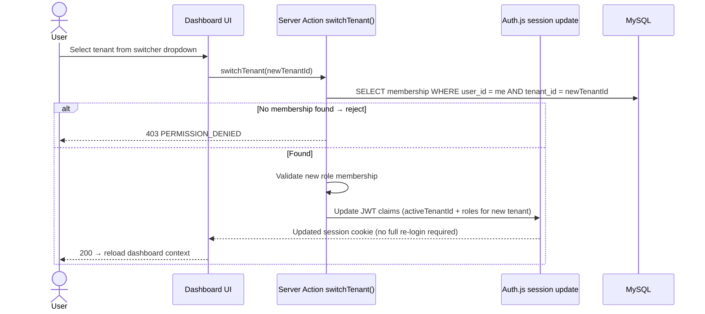

# Authentication Architecture — Auth.js v5

**Document ID:** ARCH-007
**Status:** Approved
**Version:** 1.0.0
**Last Updated:** 2026-09-20
**Author:** CromStel IT Group — Platform Architecture Team

---

## 1. Overview

Authentication in myTenant Invoice is built on **Auth.js v5 (NextAuth 5 beta GA-track)** with the Prisma adapter for database-backed sessions and credential + OAuth providers. Auth.js provides standardized flows, battle-tested CSRF protection, and audited cryptographic session handling; its session middleware integrates seamlessly with Next.js App Router edge-middleware for sub-millisecond route gating and tenant-context priming before any code runs.

Why Auth.js v5 over custom auth or Clerk/Supabase Auth is recorded in ADR-003.

---

## 2. Auth Components Layout

```mermaid
flowchart TB
    subgraph Browser["Browser / Client"]
        C1[Session cookie<br/>authjs.session-token<br/>HttpOnly, Secure, SameSite=Lax]
        C2[CSRF Token cookie + header]
        C3[Client-side session hook<br/>useSession()]
    end

    subgraph Edge["Next.js Middleware (Edge Runtime)"]
        M1[Decrypt session JWT via AUTH_SECRET]
        M2[Route allow-list check<br/>public vs authenticated]
        M3[Tenant-context prime for RLC]
        M4[CSRF validation for state-changing methods]
    end

    subgraph App["Next.js App Layer"]
        A1["Auth.js Route Handlers<br/>/api/auth/*
        - signin, signout, callback, session, providers, csrf"]
        A2[Server-side helpers<br/>auth() — getSession<br/>requireUser() — guard]
        A3[Auth.js Prisma Adapter<br/>writes User, Session, Account, VerificationToken]
        A4[Custom JWT callbacks<br/>inject roles, activeTenantId, impersonation state]
    end

    subgraph Data["Data Tier"]
        D1[(MySQL 8<br/>user, session, account,<br/>verification_token tables)]
        D2[("Redis 7 Cluster<br/>Session blacklist / rate-limit / login attempt counters")]
    end

    subgraph External["Identity Providers (OAuth/OIDC"]
        E1[Google OIDC]
        E2[GitHub OAuth]
    end

    C1 --> M1
    C2 --> M4
    M1 --> M2
    M2 --> M3
    A1 --> A4
    A4 --> A3
    A3 --> D1
    A1 --> D2
    A1 --> E1
    A1 --> E2
```

---

## 3. Session Architecture

### 3.1 Session Strategy: JWT + Database-backed Session Hybrid

Auth.js v5 strategy chosen: **Database sessions + JWT token encoding** via the Prisma adapter.

- `authjs.session-token` cookie contains a signed session identifier `sid`.
- Session row in MySQL `session` table stores `userId`, `expires`, `tenantRoles` snapshot at login.
- Session refresh reads DB and writes new snapshot to JWT every 10 minutes (rolling window).
- **Why not pure JWT?** We need instant revocation (logout, password reset, account compromise). DB-backed sessions = immediate logout.
- **Why not pure DB?** Middleware runs at edge; DB lookup at every request is too slow. Hybrid: short TTL JWT with roles cached and DB re-read on refresh interval.

### 3.2 Session Payload (Decrypted)

```jsonc
{
  "sub": "usr_01J8KXYZ...",              // userId
  "sid": "ses_01J8K...",                 // session id (PK in DB)
  "name": "Alex Johnson",
  "email": "alex@example.com",
  "emailVerified": true,
  "activeTenantId": "tnt_01J8K...",      // tenant currently in context
  "impersonatedTenantId": null,          // non-null when platform admin impersonates
  "impersonatedBy": null,                // platform admin userId
  "roles": {                             // roles per tenant (indexed by tenantId)
    "tnt_01J8K...": ["ORG_ADMIN"]
  },
  "mfa": { "enabled": false, "verifiedAt": null },
  "sessionStart": 1711000000,            // epoch seconds for max session age enforcement
  "iat": 1711000010,
  "exp": 1711604810                      // 7 days absolute max
}
```

### 3.3 Session Cookie Security Properties

| Property | Value |
|---|---|
| Name | `authjs.session-token` |
| Secure | `true` in production, `false` only for `localhost` dev |
| HttpOnly | `true` (XSS cannot read) |
| SameSite | `Lax` |
| Path | `/` |
| Domain | Set without leading dot; allows subdomain sharing for `admin.*` if needed |
| Max-Age | `604800` seconds (7 days) — sliding window; rolling refresh every 1h |
| Signing | HMAC SHA-256 with `AUTH_SECRET` (≥ 32 bytes hex) |

---

## 4. Authentication Flows

### 4.1 Flow: Credentials (Email + Password) Login

```mermaid
sequenceDiagram
    actor User
    participant MW as Middleware
    participant SignIn as /api/auth/signin (credentials)
    participant Auth as Auth.js authorize()
    participant UserSvc as modules/users/services
    participant DB as shared/database
    participant Redis as Redis Session
    participant Comm as Communications

    User->>SignIn: POST email + password + csrfToken
    SignIn->>MW: Middleware checks CSRF
    MW-->>SignIn: proceed
    SignIn->>Auth: authorize(credentials)
    Auth->>Redis: Rate limit check: login_attempts:{email} < 10/10min
    Redis-->>Auth: ok
    Auth->>DB: SELECT user WHERE email = ?
    DB-->>Auth: user row + password_hash (bcrypt cost 12)
    Auth->>Auth: bcrypt.compare(password, hash) — constant time
    alt invalid
        Auth->>Redis: INCR login_attempts (TTL 10min)
        Auth-->>User: 401 "Invalid credentials"
    else valid
        Auth->>DB: UPDATE last_login_at, login_count
        Auth->>DB: INSERT session (expires +7d)
        Auth->>DB: Query membership → roles[] per tenantId; pick default active tenant
        Auth-->>SignIn: user object
        SignIn->>User: Set-Cookie authjs.session-token; 302 redirect to /dashboard
        Auth->>Comm: New login alert email if user has device notifications enabled
    end
```

Brute-force mitigations:
- Max 10 failed attempts / 10 min per email → 30 min lockout.
- Max 100 attempts / IP per 5 min.
- bcrypt cost 12 (≥ 250ms per hash on server CPU — slows offline attacks).

### 4.2 Flow: OAuth (Google / GitHub)

```mermaid
sequenceDiagram
    actor User
    participant App as /api/auth/signin/:provider
    participant Provider as Google OIDC / GitHub
    participant Callback as /api/auth/callback/:provider
    participant Auth as Auth.js Prisma Adapter
    participant DB as MySQL

    User->>App: Click "Continue with Google"
    App->>Provider: 302 redirect to /authorize<br/>response_type=code, client_id, redirect_uri, scope, state, PKCE challenge
    Provider-->>User: Consent screen (if first time)
    User->>Provider: Grant consent
    Provider->>Callback: 302 with ?code=&state=
    Callback->>Provider: POST /token with code + PKCE verifier
    Provider-->>Callback: access_token + id_token (OIDC)
    Callback->>Callback: Verify id_token signature (RS256), nonce, audience, expiry
    Callback->>DB: Prisma Adapter → link Account row (provider, providerAccountId) → User
    alt New user (email not previously seen)
        Callback->>DB: Create user + send "Welcome" email
    end
    alt Email collision with existing credential user
        Callback-->>User: Render "Link this provider?" confirmation page
        User->>Callback: Confirm → re-auth with existing password
        Callback->>DB: Link account (silent merge forbidden to prevent account-takeover)
    end
    Callback->>DB: INSERT session
    Callback-->>User: Set-Cookie; redirect /dashboard
```

OAuth linking security rule: **An existing user must explicitly confirm provider link**; never auto-merge by email alone. Email-only merge would enable account-takeover via a provider that does not enforce verified email claim (though both Google and GitHub do, we defense-in-depth anyway).

### 4.3 Flow: Magic Link (Passwordless)

Used for tenant-user access, forgotten password, and onboarding invitation.

```
POST /api/auth/signin/email
  → INSERT verification_token (expires +10 minutes)
  → Send email with clickable link: /api/auth/callback/email?token=X&email=Y
  → User clicks link → verify token → sign in + clear token row (single-use)
```

Rate limit: 3 magic links per email / 15 minutes. Token reuse invalidates all existing tokens for email.

---

## 5. Middleware — Per-Route Auth Gate

All routes (except explicitly public ones) run middleware. Configuration lives in `middleware.ts` with glob matchers:

| Route Pattern | Auth Required | Redirect When Not Authed |
|---|---|---|
| `/login`, `/signup`, `/pay/*`, `/api/auth/*`, `/api/pay/*`, `/_next/static/*`, `/favicon.ico` | Public (no session required) | N/A |
| `/admin*` | Session + `PLATFORM_ADMIN` role claim + source IP in allow-list CIDR | `/platform/login` |
| `/api/platform/*` | Same as above | 401/403 JSON |
| `/api/v1/*` | Valid session + non-null `activeTenantId` | 401 |
| Everything else in app | Valid session | `/login?callbackUrl=` |

Middleware in addition:
- Performs silent session refresh if JWT `iat` older than 1h without hitting DB (fast path).
- Re-reads DB every 24h or when role changes are detected (cache invalidation via Redis bump key).

---

## 6. Sign-out & Session Revocation

### 6.1 Voluntary Sign-out
- User clicks sign out → DELETE session row in DB → clear cookie → redirect `/login`.
- Also revokes all OAuth refresh tokens (if provider supports revoke endpoint).

### 6.2 Involuntary / Global Revocation Triggers
| Event | Scope | Mechanism |
|---|---|---|
| Password changed / password reset | All sessions for userId | DELETE all `session` rows for userId |
| User removed from tenant | Tenant context invalidation | Update memberships; middleware re-reads roles → JWT claims stale session rejected at next refresh |
| Platform account compromise | Platform superadmin sessions only | Platform emergency red button → truncate sessions where user has `PLATFORM_ADMIN` role |
| Mass logout (security event) | All sessions | Rotate `AUTH_SECRET` (breaks all cookies) — used only in critical incidents |

### 6.3 Session Max Lifetime
- Absolute max: 7 days (enforced by `sessionStart` claim).
- Inactivity timeout: 3 days (sliding refresh window; resets on each validated request).

---

## 7. Multi-Tenant Context Switching



The cookie-setting step is a no-password session update: Auth.js v5 supports `update()` session call via server action (no round-trip to OAuth provider). Tenant RLS on following queries will enforce new scope.

---

## 8. Platform Admin Impersonation

Platform admins can temporarily view the system as if they were a tenant's user to troubleshoot. Strict controls:

1. **Triggered only** via `/api/platform/tenants/:id/impersonate` route (IP allow-listed + 2FA-verified session).
2. **Audit event** written to `platform_audit_log` with `{ action: "IMPERSONATE_START", tenantId, impersonatedUserId, impersonatedByUserId, reason }`.
3. **JWT claims** `impersonatedTenantId` and `impersonatedBy` set.
4. **Visual banner** rendered on every page indicating active impersonation; banner has "Stop" button to end.
5. **Write restriction:** some sensitive writes (banking payout changes, data deletion) blocked when impersonated; audit reason required.
6. **Duration:** 1 hour maximum, auto-ends. Or sign-out, whichever first.
7. **Termination event** also written with `IMPERSONATE_END` reason.

---

## 9. 2FA (TOTP + WebAuthn) — v1.1 Roadmap

v1 ships with optional 2FA. Enforcement:
- Platform admins: **MANDATORY TOTP + WebAuthn hardware key before login**.
- Tenant admins: recommended (shown persistent banner until enabled).
- Tenant users: optional.

Implementation:
```
user_mfa_method table
  userId, provider (TOTP|WEBAUTHN|BACKUP_CODE), secret(encrypted), verifiedAt, enabled
```

Login flow:
1. Validate credentials → check `mfa.enabled` → if false, issue full session.
2. If true, issue half-session `{ sub, mfaPending: true }` + redirect `/mfa/challenge`.
3. User enters code → validate TOTP / WebAuthn assertion → issue full session with `mfa: { enabled: true, verifiedAt: now }`.

---

## 10. Password Reset

Flow:
1. User enters email on `/forgot-password`.
2. Generate single-use token in `verification_token` (15 min TTL).
3. Send email with link `/reset-password?token=X`.
4. User opens → enters new password → bcrypt(new_pw, 12).
5. **Security:** Invalidate ALL existing sessions for this user after password reset.

Rate limits: 5 requests / email per hour.

---

## 11. Secret Management — AUTH_SECRET

- Generated via `openssl rand -hex 32` (≥256 bits entropy).
- Stored in AWS Secrets Manager / `.env.local` only.
- Never logged, never committed.
- Rotation procedure: keep old + new secret in env for 7 days rolling window (Auth.js accepts either during rotation), then drop old.
- Rotate immediately if secret exposure suspected (forces all users re-login; rotate also all sessions invalidated by DB truncate anyway).

---

## 12. Account Lockout & Fraud Signals

| Signal | Action |
|---|---|
| 10 failed passwords 10 min | 30 min email-specific lockout; CAPTCHA on next attempt |
| Impossible travel (GeoIP) | Challenge — verify email token + alert user |
| New device (UA-parser hash not previously seen) | Send "New sign-in" alert email with location, time, browser |
| Disposable email domain (check against maintained blocklist) | Block signup (tenant user level only; optional per tenant config) |
| Shared IP / VPN detection (commercial feed for fraud) | Challenge email for platform admin logins |

---

## 13. Audit Logging of Auth Events

All authentication events written to immutable `auth_audit_log` table:
```
{ timestamp, userId?, email, event, sourceIp, userAgent, geoCountry,  success:boolean, failureReason? }
```

Event types:
- LOGIN_SUCCESS, LOGIN_FAILURE (with reason: BAD_PASSWORD, LOCKED, NO_USER), LOGOUT
- MFA_CHALLENGE_ISSUED, MFA_CHALLENGE_SUCCESS, MFA_CHALLENGE_FAILURE
- PASSWORD_RESET_REQUESTED, PASSWORD_RESET_SUCCESS, PASSWORD_CHANGED
- OAUTH_LINKED, OAUTH_UNLINKED, PROVIDER_MERGE_BLOCKED
- SESSION_REVOKED, IMPERSONATE_START, IMPERSONATE_END, IMPERSONATE_REJECTED
- MAGIC_LINK_SENT, MAGIC_LINK_CLAIMED, MAGIC_LINK_EXPIRED

Retention: 7 years, append-only (no DELETE, no UPDATE on log rows — enforced by DB trigger + platform-only GRANT INSERT).
