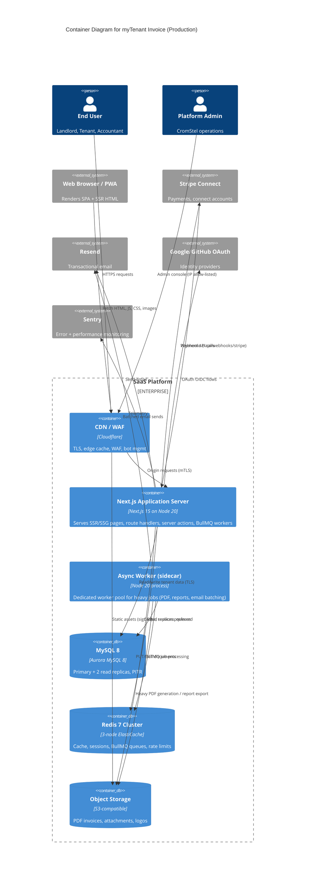
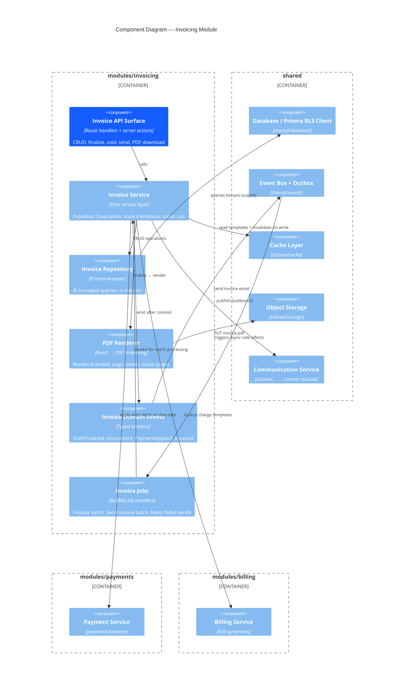
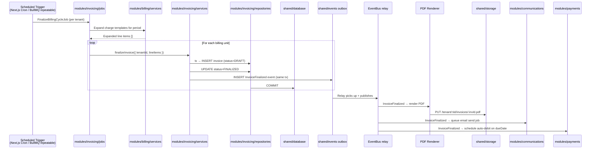

# Component Architecture — C4 Levels 2 & 3

**Document ID:** ARCH-003
**Status:** Approved
**Version:** 1.0.0
**Last Updated:** 2026-09-20
**Author:** CromStel IT Group — Platform Architecture Team

---

## 1. Purpose

This document decomposes myTenant Invoice into its deployable containers (C4 Level 2) and into internal components (C4 Level 3). It defines the module boundaries within the modular monolith, the allowed dependency direction between them, and the component responsibilities that enable safe parallel development.

---

## 2. Container Diagram (C4 Level 2)

Deployable and runtime containers for a production environment.



### 2.1 Container Responsibilities

| Container | Responsibility | Scaling Unit | Resource Profile |
|---|---|---|---|
| **CDN / WAF** | TLS termination, static asset caching (JS/CSS/fonts), edge rate limiting, WAF rule set, bot/challenge management, regional routing | Global edge POP | N/A (managed) |
| **Next.js Application Server** | SSR/SSG pages, React Server Components, route handlers, server actions, middleware, cron/scheduled triggers, light-weight inline job processing, inbound webhook ingestion | ECS Service, auto-scale by CPU/RPM | 2 vCPU / 4 GB minimum (4-8 containers baseline) |
| **Async Worker Sidecar** | Dedicated heavy-job consumer: invoice finalization batches, PDF rendering, nightly reports, large email campaigns, accounting export, Stripe reconciliation. **Does not serve HTTP.** | ECS Service, auto-scale by queue depth | 4 vCPU / 8 GB minimum; memory-heavy for PDF rendering |
| **MySQL 8 (Primary)** | Source of truth for all writes. ACID transactions. Single writer. | Vertical first, then shard tenant dimension | db.r6g.2xlarge+ |
| **MySQL 8 (Read Replicas x2** | Report queries, tenant list pages, worker read path. | Vertical scale individual | db.r6g.xlarge each |
| **Redis 7 Cluster** | Shared cache across app instances, BullMQ queues/delayed sets, session store, rate limit counters, idempotency keys, feature flags. | 3 data + 0 replicas (6 nodes) | cache.r6g.large |
| **S3 Object Storage** | All tenant-scoped PDF invoices, logos, lease documents, attachments, export CSVs. Immutable once finalized. | N/A (managed) | N/A (managed) |

---

## 3. Modular Monolith — Internal Module Structure

Source layout under `src/`. Dependency rule: **inner layers may not import outer layers**. Cross-module imports are permitted only from the module's public `index.ts` barrel. No direct coupling to private files of sibling modules.

```
src/
├── app/                          # Presentation (Next.js App Router)
│   ├── (platform)/              # Platform-admin routes (subdomain guarded)
│   ├── (tenant)/              # Tenant portal — dashboard, properties, invoices, tenants, reports
│   ├── (auth)/                # Login, signup, password reset, OAuth callbacks
│   ├── pay/                  # Anonymous tenant payment portal (no auth)
│   ├── api/                  # Route handlers: /api/*
│   └── layout.tsx
│
├── modules/                   # Feature modules (vertical slices)
│   ├── tenants/             # Tenant org, onboarding, plans, quotas
│   │   ├── domain/         # Entities, value objects, Zod schemas
│   │   ├── repositories/   # Prisma repositories (tenant-scoped)
│   │   ├── services/     # Use cases / business logic
│   │   ├── events/       # Domain events + consumers
│   │   ├── jobs/         # BullMQ job definitions + handlers
│   │   └── index.ts
│   │
│   ├── users/               # User profiles, memberships, invitations
│   ├── properties/        # Properties, buildings, units, amenities
│   ├── billing/          # Charge templates, one-time charges, proration
│   ├── invoicing/       # Invoice lifecycle, line items, PDF generation
│   ├── payments/        # Payment intents, receipts, reconciliation
│   ├── communications/  # Email, SMS, in-app notifications
│   ├── reporting/       # Read models, report engines, CSV/XLSX export
│   ├── integrations/   # Stripe, QBO, Xero (ports, webhook outbound
│   └── platform/        # Cross-tenant management (superadmin only)
│
├── shared/                    # Cross-cutting, reusable, module-internal lib
│   ├── auth/            # Auth.js config, session helpers, RLS priming
│   ├── authorization/   # RBAC policy engine, permission checks
│   ├── cache/           # 2-tier cache client, stampede guard
│   ├── database/      # Prisma client factory, transaction helpers, RLS extension
│   ├── events/        # Event bus, outbox, typed domain event envelope
│   ├── jobs/          # BullMQ queue factory, worker base, retry policy
│   ├── logging/      # Pino logger factory, correlation
│   ├── storage/      # S3-compatible client, presigned URL helper
│   ├── validation/  # Shared Zod schemas, validation pipeline
│   └── config/       # Zod-parsed environment config singleton
│
├── components/ui/        # shadcn/ui components (Radix wrappers)
├── lib/                   # Utilities (non-domain helpers)
└── types/                 # Global ambient types
```

### 3.1 Dependency Direction (Layering)

```mermaid
flowchart BT
    subgraph Outer["Outer Ring — Presentation"]
        AppRouter["app/ (Next.js Route Handlers, Server Actions, RSC"]
    end

    subgraph Middle["Middle Ring — Feature Modules"]
        Modules["modules/*<br/>tenants, invoicing, payments, properties, users"]
    end

    subgraph Inner["Inner Ring — Shared Kernel"]
        Shared["shared/*<br/>auth, db, cache, events, jobs, storage"]
    end

    subgraph Core["Core — Types & Schemas"]
        Schemas["Zod schemas, Value Objects<br/>no runtime dependencies
    end

    AppRouter --> Modules
    AppRouter --> Shared
    Modules --> Shared
    Modules --> Schemas
    Shared --> Schemas
```

**Strict rules enforced by ESLint `import/no-restricted-paths`:**
1. `app/` imports from `modules/*/index.ts` and `shared/*` only — never internal module files.
2. Modules import from `shared/*` and sibling `modules/*/index.ts` only.
3. `shared/*` is forbidden from importing any module.
4. Circular module → module coupling is minimized and audited quarterly.

---

## 4. Component Diagram — Invoicing Module (C4 Level 3)

The invoicing module is the most complex; its structure is representative.



### 4.1 Component Responsibilities — Invoicing

| Component | Public Contracts | Key Decisions |
|---|---|---|
| **Invoice API Surface** | `createInvoice`, `updateInvoice`, `finalizeInvoice`, `voidInvoice`, `sendInvoice`, `downloadInvoicePdf` | Inputs validated by Zod; returns DTO; permission-checked before service call |
| **Invoice Service** | Business invariants: `status machine (DRAFT→FINALIZED→PAID/VOLLED/VOID). Applies proration, late fees, tax | Pure functions for arithmetic (decimal.js); tx boundary at repository layer. |
| **Invoice Repository** | `findById`, `listForTenant`, `create`, `updateStatus`, `findOverdue` | All queries implicitly filtered by `tenantId` (RLS extension); read replica for list; primary for writes |
| **PDF Renderer** | `renderToStream(invoice, branding)` | React server components → Puppeteer/Playwright render → stream to S3; cached once invoice finalized |
| **Domain Events** | `InvoiceCreated`, `InvoiceFinalized`, `InvoiceSent`, `InvoicePaid`, `InvoiceOverdue`, `InvoiceVoided` | Each has `{ aggregateId, tenantId, occurredAt, payload}`; immutable once persisted to outbox |
| **Jobs** | `FinalizeBillingCycleJob`, `SendInvoicesJob`, `GenerateMonthlyRentRollJob` | Repeatable schedules; idempotent by billingPeriod+tenant |

---

## 5. Shared Kernel Component Details

### 5.1 Shared Auth Component

```
shared/auth/
├── auth.ts                 # Auth.js v5 config (authjs.config + JWT + session callbacks
├── session.ts            # getCurrentSession(), requireUser() server-side guards
├── rls-context.ts      # Tenant scoping context + setTenantId() helper
└── providers/
    ├── credentials.ts
    ├── google.ts
    └── github.ts
```

Key behavior: Session cookie httpOnly, Secure, SameSite=Lax. JWT carries `userId`, `activeTenantId`, `roles[]`, `sessionId`. Middleware refreshes session and primes RLS context before any route handler runs.

### 5.2 Shared Database Component

```
shared/database/
├── prisma.ts           # Singleton PrismaClient with RLS extension
├── rls-extension.ts   # Prisma client extension: auto-injects WHERE tenantId = X
├── transaction.ts    # withTenantTx() helper — ensures one active tenant per tx
└── helpers/              # Soft-delete, audit columns, versioned migrations
```

**RLS Extension Contract:** `import { prisma } from './prisma'` returns a tenant-scoped client. Attempting queries without a set context throws a hard error for all writes. Platform superadmin uses separate `platformPrisma` client without RLS.

### 5.3 Shared Events + Outbox

```
shared/events/
├── bus.ts                 # Typed EventBus<TEvent> — in-process emitter
├── outbox.ts            # Outbox table writer + relay
├── types.ts                 # Event envelope type map
└── relay-job.ts            # BullMQ job that drains outbox → publishes to bus
```

Flow: service writes event rows to `outbox` table in same tx as state change. After commit, relay job picks up row, publishes on bus, marks delivered. At-least-once delivery; consumers idempotent by event.id.

### 5.4 Shared Jobs (BullMQ factories)

```
shared/jobs/
├── queue-factory.ts        # createQueue(name, opts) — default retry + DLQ
├── worker-factory.ts # createWorker(name, handler, concurrency)
├── retry-policy.ts    # retry: exponential 2s → 30min, 8 attempts
└── idempotency.ts      # dedupe by job key prefix
```

All queues are prefixed with `{tenantId}` hash for Redis cluster slotting.

---

## 6. Cross-Module Interaction Matrix

| Consumer → | tenants | users | properties | billing | invoicing | payments | comms | reporting | integrations | platform |
|---|---|---|---|---|---|---|---|---|---|---|
| **tenants** | — | ✅ invites | ✅ prop limits | ✅ plan quotas | ✅ | ✅ | ✅ billing emails | ✅ | ✅ connect setup | ⚠️ only from platform |
| **users** | ✅ memberships | — | ✅ unit access | | | ✅ pay history | ✅ user notif | | | ⚠️ |
| **properties** | | ✅ | — | ✅ default charges | ✅ | | | ✅ rent roll | | ⚠️ |
| **billing** | ✅ plan | | ✅ units | — | ✅ templates | | | | | ⚠️ |
| **invoicing** | ✅ | | ✅ | ✅ | — | ✅ apply pmt | ✅ send inv | ✅ | ✅ export | ⚠️ |
| **payments** | ✅ stripe | | | | ✅ mark paid | — | ✅ receipts | ✅ | ✅ reconciled | ⚠️ |
| **comms** | ✅ | ✅ | | | | | — | | | ⚠️ |
| **reporting** | read-only | read-only | read-only | read-only | read-only | read-only | read-only | — | | ✅ platform reports |
| **integrations** | ✅ per-tenant tokens | | | | ✅ push inv | ✅ push pmt | | | — | ⚠️ |
| **platform** | ✅ | ✅ | ✅ | ✅ | ✅ | ✅ | ✅ | ✅ | ✅ | — |

Legend: ✅ = allowed import via public barrel. ⚠️ = platform module is the sole importer (platform→X is always allowed but never X→platform). Blank = no direct coupling, use domain events instead.

---

## 7. Data Flow Through Components — Finalize Invoices for Billing Cycle



---

## 8. Component Design Constraints

1. **No direct HTTP fetch between modules:** If Invoice needs from another module, call its service class or emit a domain event; do not call internal files.
2. **All public surfaces validated:** Every public component validates inputs at its entry with Zod schemas — never trust callers inside same process.
3. **Prisma repositories are internal:** Only repositories interact with Prisma directly; services do not import `@prisma/client` (enforced by ESLint rule).
4. **Single writer per aggregate:** Invoice aggregate modified via invoicing module only. Payments creates payments; payments never inserts into invoice via service.
5. **No shared DB views across modules:** Reads across modules go through the service layer, not SQL joins across module-owned tables.
6. **Feature modules are independent buildable:** Each module can be unit-tested in isolation from app router (mocks only for sibling modules).
7. **Worker-only heavy CPU work (PDF, exports):** Always run on worker sidecar pool; never in the HTTP request path.
