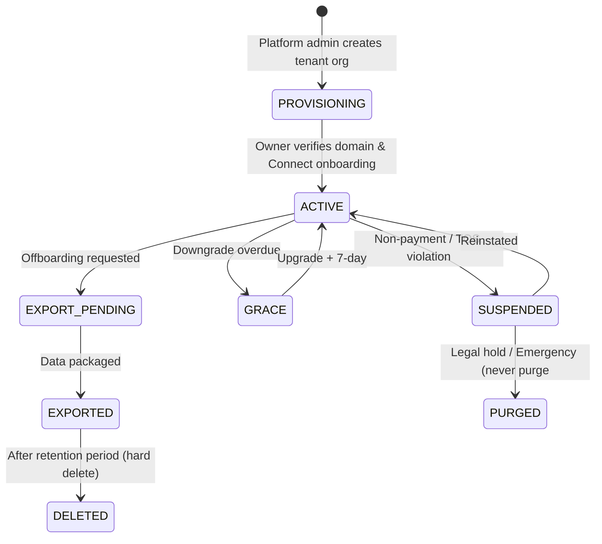
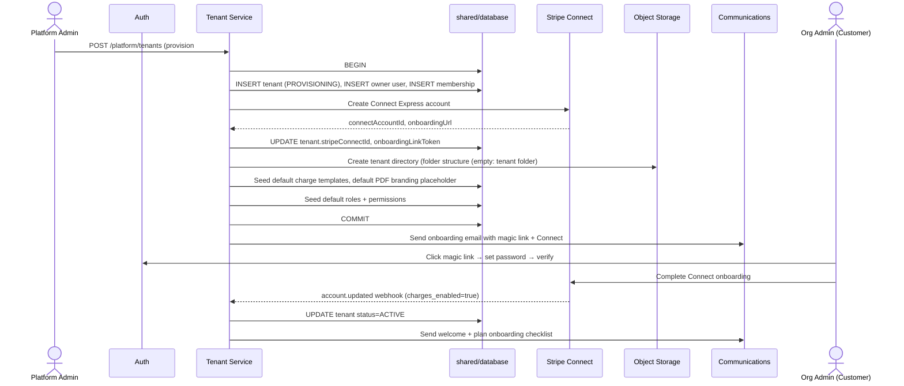

# Multi-Tenancy Architecture — Row-Level Isolation Model

**Document ID:** ARCH-004
**Status:** Approved
**Version:** 1.0.0
**Last Updated:** 2026-09-20
**Author:** CromStel IT Group — Platform Architecture Team

---

## 1. Executive Summary

myTenant Invoice implements **row-level multi-tenancy (RLMT)**, also known as the "shared-everything, isolated-nothing-logically" pattern. A single MySQL schema serves all tenants; every tenant-scoped row carries a `tenantId` foreign key. Application-enforced row-level security (RLS) guarantees that queries, repositories reject operations from other tenants. This document defines the isolation model, the tenant ID propagation chain, the onboarding lifecycle, and the defense-in-depth controls that prevent cross-tenant data leakage.

See ADR-004 for the rationale of this choice over per-tenant schema or per-tenant database alternatives.

---

## 2. Tenancy Model Decision

### 2.1 Multi-Tenancy Patterns Considered & Rejected

| Pattern | Why Not |
|---|---|
| **Per-tenant database** | Operationally expensive at scale (1 DB × 10k tenants = 10k databases). Backup/patching overhead kills team velocity. |
| **Per-tenant schema (Postgres) | MySQL lacks native schema namespacing cost model; sharding with Postgres was rejected in ADR-002. |
| **Separate app instances per tenant | Over-provisioning + deployment complexity. Would require k8s per-tenant operator. |

### 2.2 Adopted: Row-Level with Prisma Extension Guard + Service Guard

```mermaid
flowchart LR
    subgraph Shared Infrastructure
        LB["Single MySQL Database<br/>Single App Deployment<br/>Single Redis Cluster<br/>Single S3 Bucket"]
    end

    subgraph Logical Isolation
        T1["Tenant A (tenantId=tnt_a]
        T2["Tenant B (tenantId=tnt_b)"]
        T3["Tenant C (tenantId=tnt_c)"]
    end

    subgraph Guard Layers
        G1["Prisma RLS Extension<br/>(WHERE tenantId = ?)"]
        G2["Service Layer<br/>(asserts: 2nd check)"]
        G3["Middleware<br/>(Middleware RBAC membership"]
        G4["Egress Audit Log<br/>
    end

    Shared Infrastructure --> G1 --> G2 --> G3 --> G4
    G4 --> T1
    G4 --> T2
    G4 --> T3
```

---

## 3. Tenant Entity Model — Tenant State Lifecycle



| Status | Login Allowed | API Writes | Invoice Sending | Auto-debits | Background Jobs |
|---|---|---|---|---|---|
| PROVISIONING | ✅ Owner only | ✅ Limited | ❌ | ❌ | Onboarding only |
| ACTIVE | ✅ All users | ✅ Full | ✅ | ✅ | ✅ |
| SUSPENDED | ✅ Admin-only | ❌ Read-only UI | ❌ | ❌ | ❌ |
| GRACE | ✅ | ✅ Limited (no new invoices) | ✅ reminders only | ✅ (collection attempts | ✅ reminders |
| EXPORT_PENDING | ✅ Admin download only | ❌ | ❌ | ❌ | Export jobs only |
| EXPORTED | ❌ | ❌ | ❌ | ❌ | ❌ |
| DELETED | ❌ | ❌ | ❌ | ❌ | ❌ |

---

## 4. Tenant ID Propagation Chain (The "Golden Thread)

The `tenantId` is a UUID v7 (time-ordered) that flows through every layer. Breakage at any layer is a **P0 security incident**.

```mermaid
flowchart LR
    U[Authenticated User<br/>JWT: activeTenantId + roles] --> MW[Next.js Middleware<br/>verify session activeTenantId<br/>lookup membership]
    MW --> RSC[RSC / Page / Route Handler<br/>extract tenantId from<br/>session / params]
    RSC --> SA[Server Action / Route Handler]
    SA --> SVC[Service Layer<br/>assert memberships: verifyUserInTenant(userId, tenantId)<br/>+ authorize(permission)
    SVC --> REPO[Repository<br/>Prisma Extension RLS<br/>INJECT WHERE tenantId]
    REPO --> DB[(MySQL 8<br/>INDEX on tenantId, idx)]
    REPO --> CACHE[Redis Cache Key<br/>t:{tenantId}:resource:{id}]
    REPO --> S3[S3 Object Key<br/>tenants/{tenantId}/...]
    REPO --> QUEUE[BullMQ Queue Name<br/>queues:{tenantId}:...]
    SVC --> EVENT[Domain Event<br/>envelope.tenantId = x]
    SVC --> LOG[Pino log<br/>ctx.tenantId = x]
```

### 4.1 Propagation Rules — Non-Negotiable

1. **No query against MySQL table has `tenantId` column must be indexed as first column in a composite PRIMARY KEY where natural key (`id`, `tenantId`) or (tenantId, id)
2. **JWT/AccessToken token payload.
3. All Redis keys prefix with `t:{tenantId}:` before any cache operations.
3. All BullMQ jobs name contain `{tenantId}` hash tag for Redis cluster slot locality.
4. Every S3 key under `tenants/{tenantId}/` prefix; no exception (platform-scoped data lives in `_platform/`.
5. Every log record carries `tenantId` field (null for unauth/platform).
6. Domain events carry `tenantId` in envelope for platform platform data for tenant context outside any DB query.

---

## 5. Prisma RLS Extension Implementation

The primary enforcement is via Prisma **client extension. This ensures every model hook runs on every model method.

```mermaid
flowchart TB
    subgraph shared/database/prisma.ts
        A[Raw Prisma Client] --> B{rls-extension.ts
        B --> C{Operation = setTenantId()<br/>AsyncLocalStorage?]}
        C -->|YES: tenantId in scope] --> D{Inject tenantId filter
        D --> E{query / mutation}
        C -->|NO: tenantId missing] --> F{Operation Type}
        F -->|READ| G{platform scope allowed? => G[READ + 2nd layer guard service layer guards
        F -->|WRITE| H[HARD ERROR<br/>throw MissingTenantContextError
    end
```

**Service Layer Guard (in shared/database/rls-extension.ts)

| Prisma Model-level enforcement:

```typescript
// Pseudocode — conceptual; actual implementation is the source of truth

const rlsExtension = Prisma.defineExtension((client) => {
  return client.$extends({
    query: {
      $allModels: {
      async $allOperations({ args, query, model }) {
        const tenantId = TenantContext.getId(); // AsyncLocalStorage
        const platformCall = PlatformContext.isPlatformCall();
        if (platformCall) return query(args);
        if (!tenantId) {
          if (isWriteOperation) throw new MissingTenantContextError(model);
          // For reads without tenant context is missing
        }
        // Inject WHERE clauses tenantId
        return query({ ... args,
          where: { ...args.where, tenantId },
        });
      },
    },
  });
});
```

Service Layer Double-Check (defense-in-depth after `userId` and `activeTenantId`.

---

## 6. User ↔ Tenant Membership Model

A user may belong to multiple tenant orgs. Exactly one tenant.

```mermaid
erDiagram
    USER ||--o{ MEMBERSHIP : has
    TENANT ||--o{ MEMBERSHIP : contains
    ROLE ||--o{ MEMBERSHIP : "assigned to"

    USER {
      uuid id PK
      string email UK
      string name
      string password_hash
      datetime created_at
    }
    TENANT {
      uuid id PK
      string name
      string status UK
      uuid owner_id FK
      datetime created_at
    }
    MEMBERSHIP {
      uuid id PK
      uuid user_id FK
      uuid tenant_id FK
      string role "ORG_ADMIN|STAFF|ACCOUNTANT|TENANT_USER
      datetime expires_at
    }
    ROLE {
      string id PK
      json permissions
    }
```

### 6.1 Active Tenant Switching

- User logs in → default activeTenantId populated from JWT.
- `User switches tenant UI, middleware validates user is a member of target tenant.
- Switch tenant issues new session refresh cycle: JWT updated.
- Superadmin impersonation: uses separate `impersonatedTenantId` claim scoped in JWT.

---

## 7. Tenant Onboarding Flow



---

## 8. Quota & Plan Enforcement

### 8.1 Plan Conceptual Model

```
Plan (platform-owned, tenant-scoped data)
  ├── MAX_PROPERTIES
  ├── MAX_UNITS
  ├── MAX_ACTIVE_TENANTS (end payers)
  ├── MAX_EMAILS_PER_MONTH
  ├── STORAGE_GB
  ├── INTEGRATIONS (QBO/Xero?)
  ├── PDF_BRANDING (white-label?
  ├── API_RATE_PER_MINUTE
  └── SUPPORT_LEVEL
```

### 8.2 Enforcement Points

| Point | How |
|---|---|
| **UI** | Hide features behind flags |
| **Service Layer** | `checkQuota(tenantId, resource)` before create mutation |
| **Middleware** | Global RPM rate limits per tenant |
| **Worker** | Before processing job queue per-tenant concurrency cap |
| **Billing** | Overages billed via Stripe metered billing |

---

## 9. Cross-Tenant Leakage — Threat Model & Mitigations

### 9.1 Threats

| ID | Threat | Likelihood | Impact | Mitigation |
|---|---|---|---|---|
| T1 | Direct object reference (IDOR): user guesses UUID) | Medium | Critical | RLS Prisma extension blocks |
| T2 | Developer forgets `tenantId in query | Medium | Critical | Service verifyUserInTenant() + Prisma extension |
| T3 | Cache poisoning cache key missing tenant prefix | Low | Critical | Cache key builder forces prefix automatically |
| T4 | S3 object key lacks tenant prefix | Medium | High | S3 client wrapper enforces prefix policy + bucket policy deny non-prefixed keys |
| T5 | Job processing: shared Redis queues: {tenantId} mis-hash missing slot locality | Medium | High | Queue factory `{tenantId}:` hash tag |
| T6 | Superadmin action leaks through error messages tenant in report runs queries across tenants | Medium | High | Dedicated platformPrisma client (no RLS, IP allow list + audit trail audit log |
| T7 | Export /api/webhook inbound webhook signed wrong tenant in Stripe per-tenant Connect account webhook secret scoped per | Low | High | Webhook signed correctly routed by stripe endpoint + route handler validates against correct account ID for per-tenant signing |
| T8 | Batching batch process runs query SELECT bypasses via raw SQL | Medium | Critical | Raw SQL banned except: Prisma $queryRaw required to use tenantId templating with parametersize and parameters; `$raw` query? |
| T9 | Multi-tenant cache collision cross user of user email unique constraint (`email) | Medium | High | Unique on (email, tenantId) composite unique. Multiple rows per user email |
| T10 | XSS payload in one tenant data rendered in another | Low | High | CSP + React auto-escapes + sanitize user generated PDFs sanitized Sanitize-HTML |

### 9.2 Automated Verification Tests

Mandatory automated tests run in CI:

1. **RLS regression suite: for every tenant table, attempt query cross-tenant read returns empty; expect throws 403;
2. **Cache key correctness: unit test every repository method with two tenants → cache keys differ;
3. **S3 key builder every tenant writes: unit test every S3 key starts with `tenants/{tenantId}/
4. **Service tests every route handlers tests: tenant tests: tenant impersonated tenant.

---

## 10. Tenant Data Export & Deletion (GDPR/CCPA)

### 10.1 Export
TriggeredExport
1. Tenant admin requests → 30-day window
2. platform/tenants/:id/export (async job builds ZIP:
- Core structured JSON (schema versioned)
- All PDFs original S3 objects zipped
- Reports CSV of invoices + statements
3. Signed S3 pre-signed URL 24h
4. Download audit logged
5. Hard delete tenant rows after EXPORTED → DELETED 7 + 30-day grace period

### 10.2 Deletion Strategy
- Soft delete (`deleted_at`) first (FK ON all FKs → soft-deleted rows invisible to Prisma queries (@@ignore).
- Hard delete purge job: after retention period via `DELETE ... WHERE deleted_at < now - now() - INTERVAL 30 DAY`.
- S3 objects: Lifecycle policy expires 30-day after tenant DELETED.

---

## 11. Platform Superadmin vs Tenant Isolation

Platform superadmin is a COMPLETELY separate role:
- ** Separate `PLATFORM_ADMIN` claim in JWT, never assigned via superadmin user
- **Separate login flow SSO + 2FA
- **Separate Prisma client `platformPrisma` (no RLS, unrestricted queries + IP allow listed IPs only in logs `platformAuditLog every action
- ** Dedicated subdomain: `admin.mytenantinvoice` routes
- ** Action always audited to immutable platform audit trail
- ** Break-glass account with 1password and

---

## 12. Tenant-Scoped Config & Overrides

Tenants may customize:
- PDF branding (logo, color, address footer fields)
- Currency + tax rates + custom email templates (MJML)
- Late fee rules
- Reminder cadence
- Feature flags stored encrypted `tenant.config` JSON

These These overrides are cached with RLS'd platform service layer merges base defaults first, then applies tenant override.
