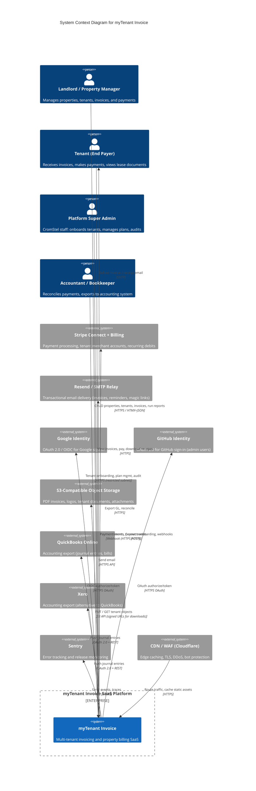
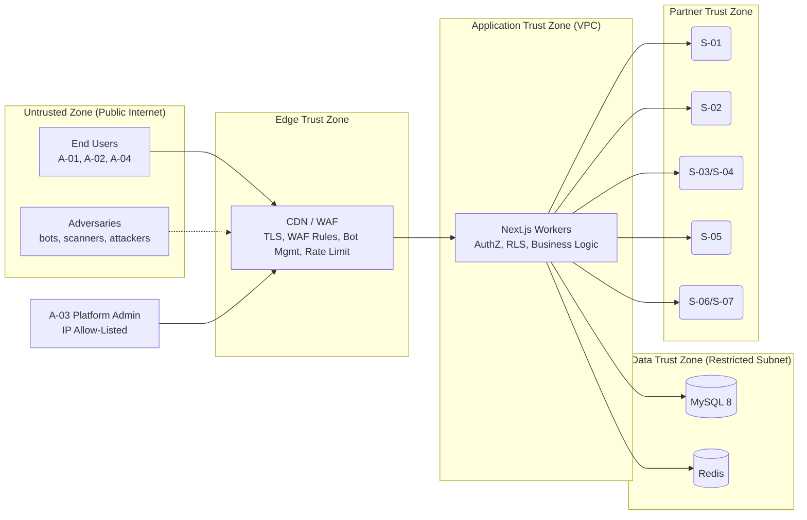
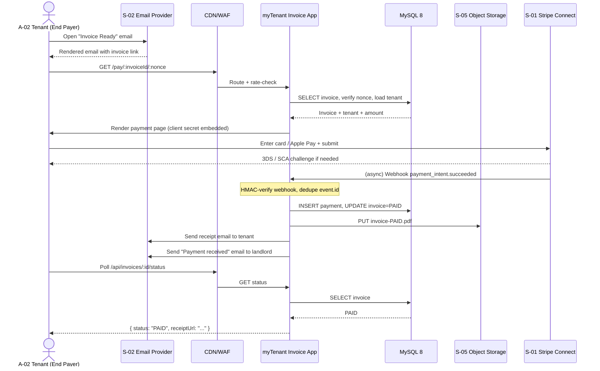
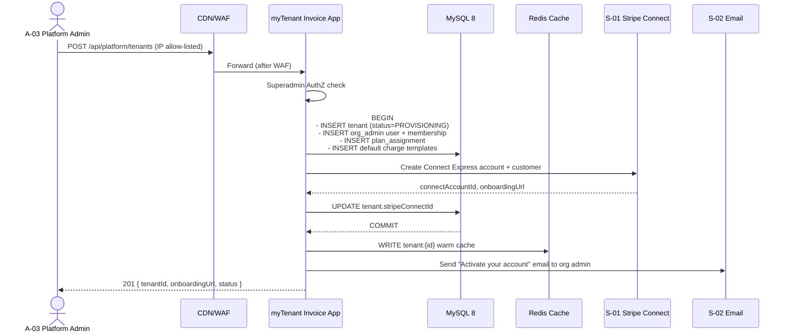

# System Context — C4 Level 1

**Document ID:** ARCH-002
**Status:** Approved
**Version:** 1.0.0
**Last Updated:** 2026-09-20
**Author:** CromStel IT Group — Platform Architecture Team

---

## 1. Purpose

This document defines the **C4 System Context** (Level 1) for myTenant Invoice. It identifies the actors (human and system) that interact with the platform, the external systems the platform depends on, and the high-level data contracts that cross the system boundary.

Use this document to:
- Align stakeholders on scope and system boundary
- Design integration tests at the seam
- Plan threat models (trust boundaries)
- Review upstream/downstream SLAs

---

## 2. System Context Diagram (C4 Level 1)

---

## 3. Actor Catalog

### 3.1 Human Actors

| Actor ID | Name | Description | Primary Channels | Trust Level |
|---|---|---|---|---|
| A-01 | Landlord / Property Manager | Pays for the platform. Creates properties, tenants, charge templates, approves invoices, sends reminders, reconciles payments, runs reports. | Web browser (desktop), PWA tablet | High — authenticated, tenant-scoped session, MFA optional |
| A-02 | Tenant (End Payer) | End-customer of the landlord. Receives invoice email, pays via payment link, downloads receipts, views lease. | Email links, web browser (mobile-first) | Medium — anonymous invoice view + authenticated portal; payments require SCA |
| A-03 | Platform Super Admin | CromStel IT Group operations staff. Onboards new paying tenants, applies plan changes, runs platform-wide reports, investigates support cases, accesses audit log. | Restricted web console (IP allow-listed), CLI tooling | Highest — SSO + mandatory 2FA + break-glass account |
| A-04 | Accountant / Bookkeeper | Staff accountants or external CPAs hired by the landlord. Read-only or limited-write access to financial data. Exports GL, reconciles bank deposits. | Web browser, CSV/XLSX export | High — tenant-scoped, role-limited |

### 3.2 System Actors

| Actor ID | Name | Direction | Description | Authentication |
|---|---|---|---|---|
| S-01 | Stripe Connect | Bi-directional | Processes customer payments, holds tenant merchant accounts, schedules recurring debits, handles disputes. Inbound: Stripe webhooks on `/api/webhooks/stripe`. | HMAC SHA-256 signature (`Stripe-Signature` header) + replay window 5 min |
| S-02 | Resend / SMTP Relay | Outbound primary | Sends all transactional email. Fallback: self-hosted SMTP via Nodemailer. | Bearer token (Resend) / SMTP AUTH (fallback) |
| S-03 | Google Identity | Bi-directional | OAuth provider for tenant admins and tenant users via "Continue with Google". | OIDC `id_token` (RS256) + nonce |
| S-04 | GitHub Identity | Bi-directional | OAuth provider for platform staff and engineering tenants. | OAuth 2.0 access token + email claim |
| S-05 | S3-Compatible Storage | Bi-directional | Stores PDF invoices, tenant logos, lease documents, signature images, receipts. | HMAC-SHA256 signed requests + presigned URLs (expiry ≤ 15 min for writes, ≤ 24 h for reads) |
| S-06 | QuickBooks Online | Outbound | Push journal entries and bills on demand or nightly sync. | OAuth 2.0 per tenant (stored encrypted) |
| S-07 | Xero | Outbound | Alternative accounting export. | OAuth 2.0 per tenant (stored encrypted) |
| S-08 | Sentry | Outbound | Error, performance, and replay telemetry. | DSN + public key (client) + auth token (release tracking) |
| S-09 | CDN / WAF | Edge termination | Cloudflare (or equivalent) terminates TLS, applies WAF rules, caches static assets, bot mitigation. | mTLS origin pull (production) |

---

## 4. External System Interface Contracts

### 4.1 Stripe Connect (S-01)

| Aspect | Specification |
|---|---|
| **Inbound endpoints** | `POST /api/webhooks/stripe` |
| **Outbound endpoints** | Stripe API v1 (`api.stripe.com`) |
| **Key events consumed** | `payment_intent.succeeded`, `payment_intent.payment_failed`, `charge.refunded`, `invoice.payment_succeeded`, `customer.updated`, `account.updated`, `payout.paid` |
| **Key actions produced** | Create `PaymentIntent`, create `SetupIntent`, create Connect Express account, create billing `Subscription`, list `BalanceTransactions` for reconciliation |
| **Idempotency** | All write requests include `Idempotency-Key` (UUID scoped by request) |
| **Webhook verification** | `stripe.webhooks.constructEvent()` — HMAC SHA-256 + 300s tolerance; events are also checked for duplicate `event.id` in `stripe_event` log table |
| **SLA dependency** | Payments page degrades gracefully with "payment provider temporarily unavailable" banner when Stripe is in degraded state |

### 4.2 Email Delivery (S-02)

| Aspect | Specification |
|---|---|
| **Primary provider** | Resend (`api.resend.com`) |
| **Fallback provider** | SMTP via Nodemailer (on Resend 5xx or 429 response) |
| **Inbound (bounce/complaint)** | Resend webhook → `POST /api/webhooks/email` → updates `communication.status` |
| **Template model** | React Email templates rendered server-side, then passed to provider as HTML + plaintext |
| **Rate limits** | Per-tenant throttle: max 500 emails/hour for trial tenants; configurable per plan |
| **DKIM/SPF/DMARC** | Required for production sending domain; monitored weekly |

### 4.3 OAuth Providers (S-03, S-04)

| Aspect | Specification |
|---|---|
| **Authorization flow** | Authorization Code + PKCE (via Auth.js) |
| **Callback URLs** | `/api/auth/callback/google`, `/api/auth/callback/github` |
| **Linking policy** | Existing account matched by verified email; no silent merging; user must confirm on first link |
| **Revocation** | Revocation endpoint in Auth.js; user-initiated disconnect on settings page |

### 4.4 S3 Object Storage (S-05)

| Aspect | Specification |
|---|---|
| **Put path** | Application server → uploads via S3 API (streaming, ≤ 5 GB multipart) |
| **Get path (public)** | No public buckets. All downloads use pre-signed GET URLs, or proxied through `/api/files/[tenantId]/[key]` with RLS check |
| **Key layout** | See [file-storage-architecture.md](./file-storage-architecture.md) §3 |
| **Encryption** | SSE-S3 or SSE-KMS at rest; TLS 1.3 in transit |
| **Retention** | Default 7 years for invoices/receipts (per plan + legal requirement); 30 days for scratch/temp |

### 4.5 Accounting Integrations (S-06, S-07)

| Aspect | Specification |
|---|---|
| **Sync cadence** | Nightly at 02:00 tenant-local time + on-demand button |
| **Sync direction** | myTenant → QBO/Xero only (v1); no read-back to avoid conflicting source of truth |
| **Error handling** | Per-journal retry queue; failures logged to `integration_sync_log` and surfaced to tenant admin dashboard |

---

## 5. System Boundary & Trust Zones

### 5.1 Trust Boundary Rules

1. **Edge → App:** Authenticated TLS; requests without valid session are rejected by middleware for all authenticated routes.
2. **App → Data Zone:** DB authentication via short-lived IAM tokens (prod) or strong passwords (staging). Redis requires AUTH + TLS. No direct DB access from outside VPC.
3. **App → Partners:** All outbound calls use explicit client factories with circuit breakers, timeout budgets, and redacted logging.
4. **Partners → App (webhooks):** All inbound webhooks are verified by HMAC signature before processing; replay attacks are blocked by event ID dedup.
5. **Platform Admin Access:** Restricted to allow-listed CIDRs; all actions written to immutable `platform_audit_log`.

---

## 6. Data Flow — Exemplar End-to-End Scenarios

### 6.1 Scenario: Tenant Pays Invoice via Email Link

### 6.2 Scenario: Platform Admin Onboards a New Tenant Org

---

## 7. Upstream / Downstream SLA Matrix

| External System | Outbound SLA Expected | Our Dependency Grade | Mitigation on Failure |
|---|---|---|---|
| Stripe API | 99.95% | **Critical** | Circuit open → hold payments; show "try again later" UI; webhooks buffer and replay on recovery |
| Stripe Webhook Delivery | Our endpoint must return 2xx within 5s | **Critical** | Fast-path ack (write-only to outbox) + async process; retry with exponential backoff per Stripe spec |
| Resend API | 99.9% | **High** | Fallback to SMTP after 1 failed attempt; non-critical emails re-queued on BullMQ |
| OAuth Providers (Google, GitHub) | 99.9% | **Medium** | Credential login always available as fallback |
| S3-Compatible Storage | 99.95% / 99.99% (R2) | **High** | Uploads buffered locally and retried; critical PDF invoices re-rendered on demand from DB source of truth |
| QuickBooks / Xero | 99.9% | **Low** | Sync queue; manual export CSV always available |
| Sentry | 99.5% | **Low** | Fire-and-forget client with local ring buffer; failure never blocks user flows |

---

## 8. Architectural Significance — Sign-Off Checklist

Before any release changes this boundary, confirm:

- [ ] New external dependency documented here with auth mechanism and SLA
- [ ] New actor added with trust level and threat model note
- [ ] New inbound webhook endpoint signed, deduplicated, replay-protected
- [ ] New outbound integration carries timeout + circuit breaker
- [ ] Platform-admin-only endpoints are behind IP-allow-list + 2FA policy
