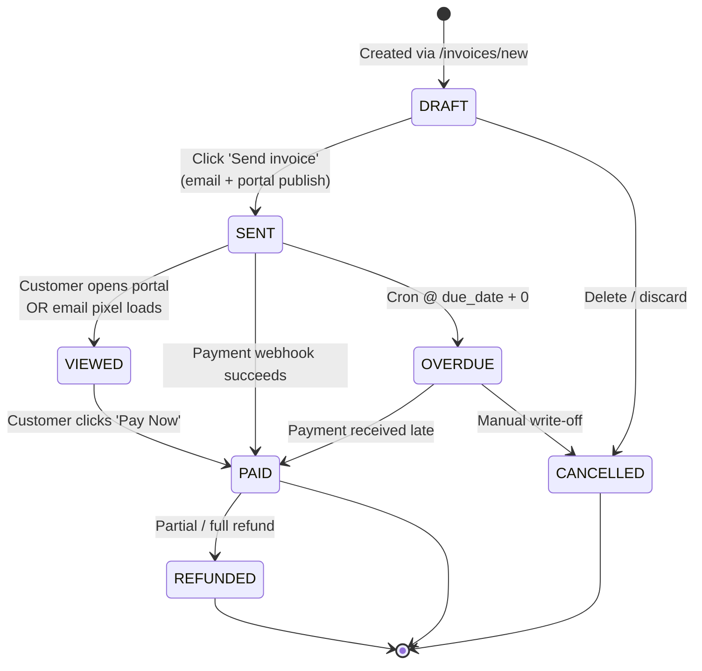

# User Flows

> Mermaid flowcharts + step-by-step UI checklists for the three critical product flows.

---

## 1. Register Organization Flow

Visitor → creates org → becomes OWNER → lands in dashboard.

```mermaid
flowchart TD
    A[Visitor clicks<br/>'Start free trial'] --> B[/register page/]
    B --> C[Fill Step 1:<br/>Full name · Email · Password<br/>Company name · Country · Currency]
    C --> D{Form valid?}
    D -- No --> E[Inline zod errors<br/>focus first invalid]
    E --> C
    D -- Yes --> F[POST /api/auth/register]
    F --> G{Email already<br/>registered?}
    G -- Yes --> H[Toast: 'Email exists'<br/>→ login link]
    G -- No --> I[Create organization<br/>+ OWNER role<br/>+ send verification email]
    I --> J[/verify/ page with OTP]
    J --> K{OTP valid?}
    K -- No --> L[6-digit field shake + error]
    L --> J
    K -- Yes --> M[Mark email_verified = true<br/>Create session cookie]
    M --> N{Onboarding wizard:<br/>Connect Stripe?}
    N -- Skip --> O[/dashboard page/]
    N -- Connect --> P[/settings/billing Stripe OAuth]
    P --> Q[Webhook confirms account_linked]
    Q --> O
    O --> R[In-product tooltip: 'Create your first invoice']
```

### UI Checklist

- **Step-1 form** labels use `htmlFor`, inputs have `aria-invalid` on error, `aria-describedby` points to message id.
- Password field has a show/hide toggle and live strength meter (`zxcvbn` score 0-4).
- After submit, disable the button, show spinner, preserve form values on failure.
- Verify page pre-fills email from token (read-only). OTP input is 6 single-digit fields with `inputmode="numeric"` and auto-advance.
- Onboarding wizard can be dismissed, state persisted in `localStorage` key `onboarding:{orgId}`.

```ts
// Verification token decoding (route handler edge)
// app/api/auth/verify/route.ts
import { NextResponse } from "next/server";
import { jwtVerify } from "jose";

export async function POST(req: Request) {
  const { token, otp } = await req.json();
  const { payload } = await jwtVerify(
    token,
    new TextEncoder().encode(process.env.AUTH_SECRET!)
  );
  const stored = await redis.get(`otp:${payload.sub}`);
  if (stored !== otp) {
    return NextResponse.json({ error: "Invalid code" }, { status: 400 });
  }
  await redis.del(`otp:${payload.sub}`);
  return NextResponse.json({ ok: true });
}
```

---

## 2. Invoice Lifecycle Flow

From draft → sent → viewed → paid (or overdue / cancelled).



### Transition Table & Required UI Confirmations

| From → To      | Trigger                          | Confirmation Required? | Side Effects                                                    |
|----------------|----------------------------------|------------------------|-----------------------------------------------------------------|
| DRAFT → SENT   | Send button click                | Yes, modal w/ recipient preview | queue email, publish portal copy, log `invoice.sent`         |
| SENT → PAID    | Stripe/PayGate webhook           | No (automated)         | create payment record, log `invoice.paid`, fire receipt email  |
| SENT → OVERDUE | Cron job `overdue-marker`        | No (automated)         | mark status, send first reminder email, log `invoice.overdue`  |
| PAID → REFUNDED| Manual refund in Payments page   | Yes, reason + amount   | partial payment refund, log `invoice.refunded`, notify finance |
| ANY → CANCELLED| Void button                      | Yes, confirm email sent | notify customer by email only if previously SENT               |

### Invoice Detail Timeline (UI Component)

```tsx
// app/(platform)/invoices/[id]/_components/invoice-timeline.tsx
import { Badge } from "@/components/ui/badge";
import {
  CheckCircle2, Clock, Eye, Mail, XCircle, RefreshCw,
} from "lucide-react";
import { cn, formatDateTime } from "@/lib/utils";

type Event = {
  kind: "created" | "sent" | "viewed" | "paid" | "overdue" | "refunded" | "cancelled";
  at: Date;
  note?: string;
  actor?: string;
};

const iconMap: Record<Event["kind"], React.ComponentType<{ className?: string }>> = {
  created: Badge, sent: Mail, viewed: Eye,
  paid: CheckCircle2, overdue: Clock, refunded: RefreshCw, cancelled: XCircle,
};

const accentMap: Record<Event["kind"], string> = {
  created: "bg-muted text-muted-foreground",
  sent: "bg-info/10 text-info",
  viewed: "bg-primary/10 text-primary",
  paid: "bg-success/10 text-success",
  overdue: "bg-destructive/10 text-destructive",
  refunded: "bg-warning/10 text-warning",
  cancelled: "bg-muted text-muted-foreground",
};

export function InvoiceTimeline({ events }: { events: Event[] }) {
  return (
    <ol className="relative border-l border-border pl-6">
      {events.map((e, i) => {
        const Icon = iconMap[e.kind];
        return (
          <li key={i} className="mb-6 last:mb-0">
            <span
              className={cn(
                "absolute -left-[11px] flex h-5 w-5 items-center justify-center rounded-full ring-4 ring-background",
                accentMap[e.kind]
              )}
            >
              <Icon className="h-3 w-3" />
            </span>
            <p className="text-sm font-medium capitalize">{e.kind}</p>
            <p className="mt-0.5 text-xs text-muted-foreground">
              {formatDateTime(e.at)} {e.actor && `· by ${e.actor}`}
            </p>
            {e.note && <p className="mt-1 text-sm">{e.note}</p>}
          </li>
        );
      })}
    </ol>
  );
}
```

---

## 3. Payment Flow

Customer pays invoice via Stripe (default) or PayGate (ZA/MU) checkout — redirect + webhook confirmation.

```mermaid
flowchart TD
    Start[Customer opens<br/>portal invoice page] --> A{Status == PAID?}
    A -- Yes --> PaidLanding[Show green banner<br/>+ receipt download]
    A -- No --> B[Click 'Pay Now']
    B --> C[POST /api/payments/checkout]
    C --> D[Server validates:<br/>invoice belongs to org<br/>not paid + not cancelled]
    D --> E[Create Stripe PaymentIntent<br/>metadata={orgId, invoiceId, customerId}]
    E --> F[Stripe Checkout Session w/ mode: payment]
    F --> G[Redirect to checkout.stripe.com]
    G --> H{Customer outcome}
    H -- Cancelled --> I[Return to portal invoice<br/>show: 'Payment cancelled' toast]
    H -- 3DS / Auth --> J[Stripe handles SCA]
    J --> K{Success?}
    K -- No --> I
    K -- Yes --> L[Stripe redirects → /p/{slug}/invoices/{id}?paid=1]
    E --> M[Stripe webhook<br/>payment_intent.succeeded]
    M --> N[Verify signature<br/>+ idempotency-key]
    N --> O[Open transaction<br/>UPDATE invoices SET status=PAID<br/>INSERT payments + ledger_entry]
    O --> P[Queue receipt email + in-app notification]
    L --> Q[UI poll /api/invoices/{id}/status<br/>→ show paid state]
    Q --> PaidLanding
```

### Key Server-Side Guards

```ts
// app/api/payments/checkout/route.ts
import { requirePortalSession } from "@/lib/auth/portal-session";
import { db } from "@/lib/db";
import { stripe } from "@/lib/payments/stripe";
import { z } from "zod";

const schema = z.object({ invoiceId: z.string().cuid() });

export async function POST(req: Request) {
  const session = await requirePortalSession();
  const body = schema.parse(await req.json());

  const invoice = await db.invoice.findByIdForPortal(body.invoiceId, session.customerId);
  if (!invoice) return new Response(null, { status: 404 });
  if (invoice.status === "PAID") return Response.json({ error: "Already paid" }, { status: 409 });
  if (invoice.status === "CANCELLED") return Response.json({ error: "Cancelled" }, { status: 409 });

  const existingIntent = await db.payments.findPendingIntentFor(invoice.id);
  if (existingIntent) {
    return Response.json({ clientSecret: existingIntent.clientSecret });
  }

  const paymentIntent = await stripe.paymentIntents.create({
    amount: Math.round(invoice.totalAmountCents),
    currency: invoice.currency.toLowerCase(),
    metadata: {
      organizationId: invoice.organizationId,
      invoiceId: invoice.id,
      customerId: invoice.customerId,
    },
    automatic_payment_methods: { enabled: true },
    receipt_email: invoice.customerEmail,
  });

  await db.payments.create({
    id: paymentIntent.id,
    invoiceId: invoice.id,
    status: "PENDING",
    amountCents: invoice.totalAmountCents,
    currency: invoice.currency,
    provider: "STRIPE",
  });

  return Response.json({ clientSecret: paymentIntent.client_secret });
}
```

### Portal Pay Button

```tsx
// app/(portal)/[slug]/invoices/[id]/_components/pay-button.tsx
"use client";

import { loadStripe } from "@stripe/stripe-js";
import { Button } from "@/components/ui/button";
import { CreditCard, Loader2 } from "lucide-react";
import { useState } from "react";
import { toast } from "sonner";

const stripePromise = loadStripe(process.env.NEXT_PUBLIC_STRIPE_PK!);

export function PayButton({ invoiceId, totalCents }: { invoiceId: string; totalCents: number }) {
  const [busy, setBusy] = useState(false);

  async function onPay() {
    setBusy(true);
    try {
      const res = await fetch("/api/payments/checkout", {
        method: "POST",
        headers: { "Content-Type": "application/json" },
        body: JSON.stringify({ invoiceId }),
      });
      if (!res.ok) throw new Error(await res.text());
      const { clientSecret } = await res.json();
      const stripe = await stripePromise;
      const { error } = await stripe!.confirmPayment({
        clientSecret,
        confirmParams: { return_url: window.location.href + "?paid=1" },
      });
      if (error) toast.error(error.message ?? "Payment failed");
    } finally {
      setBusy(false);
    }
  }

  return (
    <Button onClick={onPay} disabled={busy}>
      {busy ? <Loader2 className="mr-2 h-4 w-4 animate-spin" /> : <CreditCard className="mr-2 h-4 w-4" />}
      Pay {new Intl.NumberFormat("en-US", { style: "currency", currency: "USD" }).format(totalCents / 100)}
    </Button>
  );
}
```
